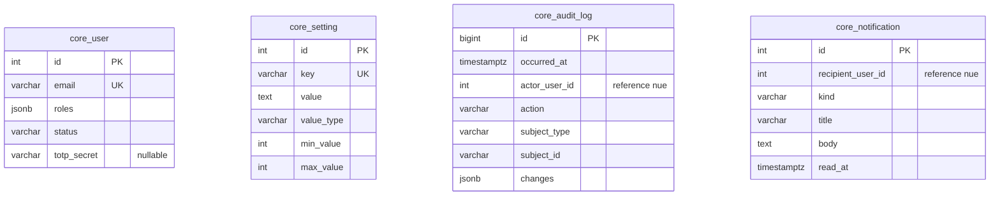
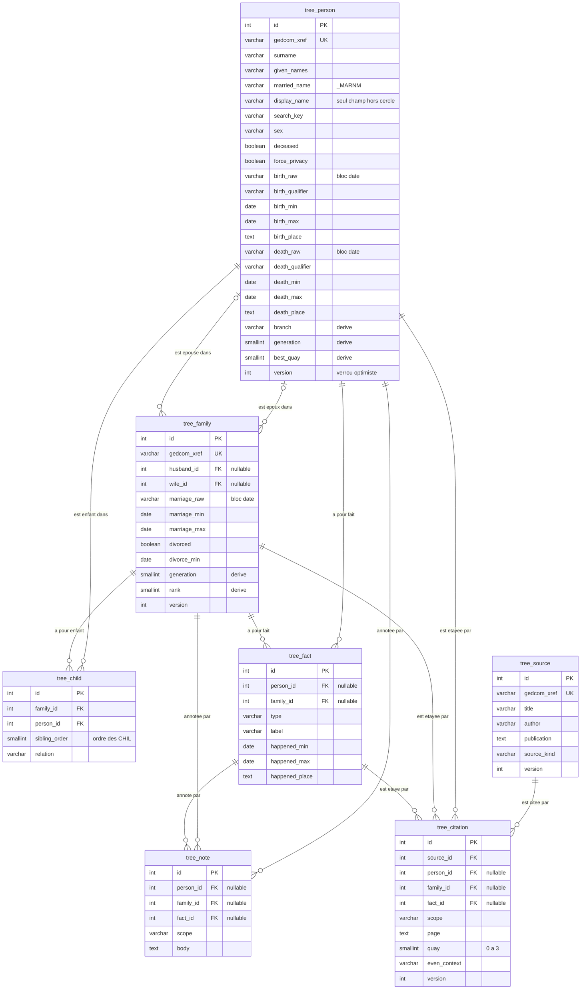
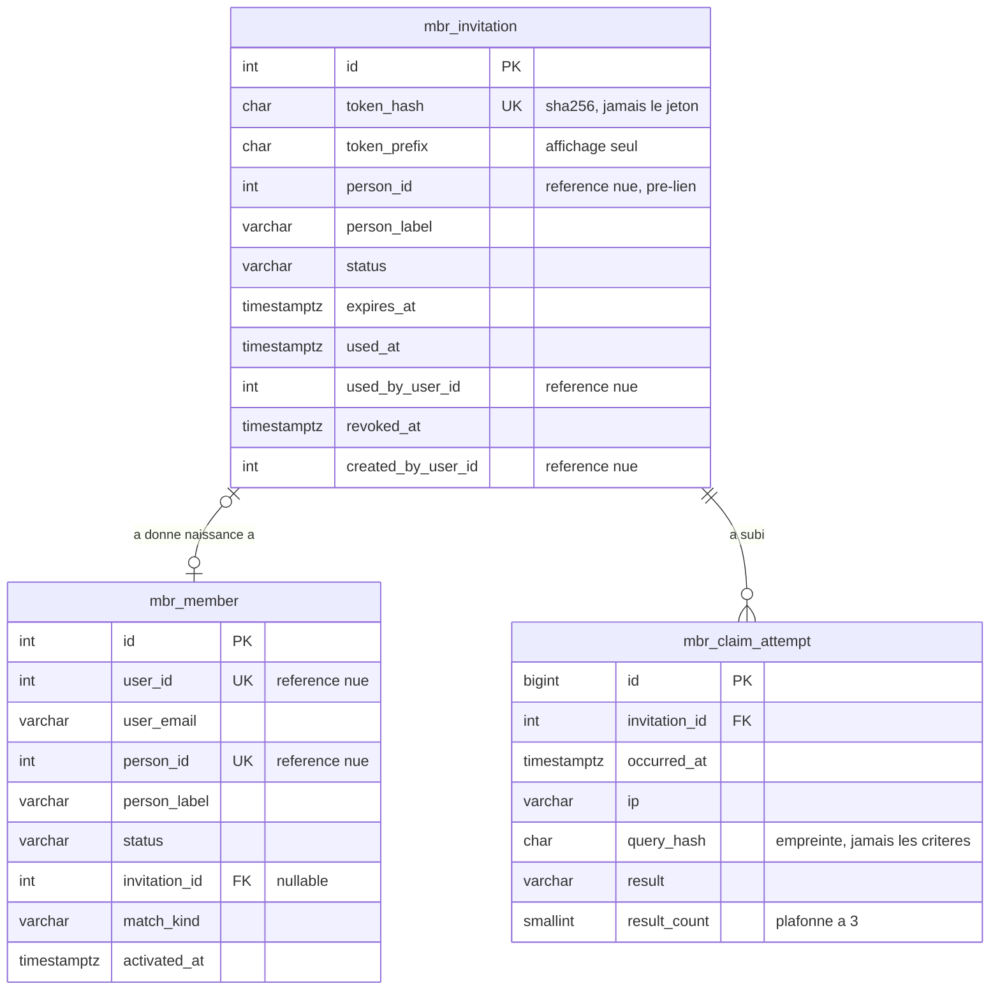
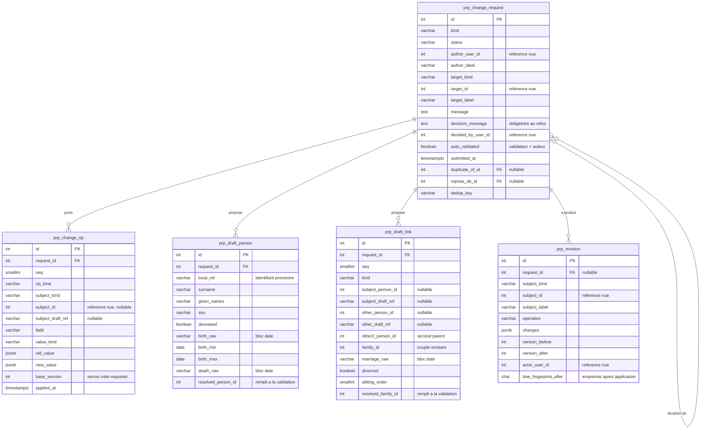
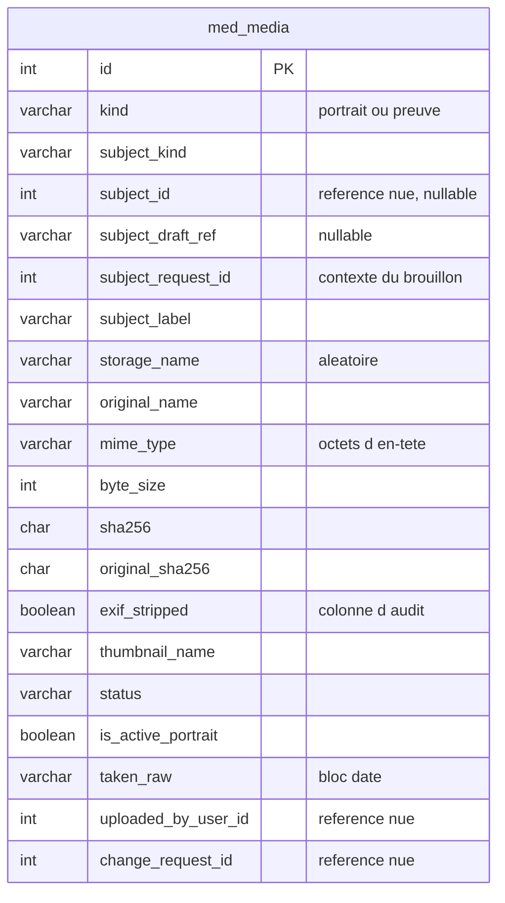
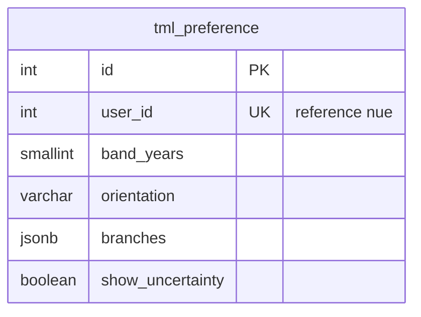
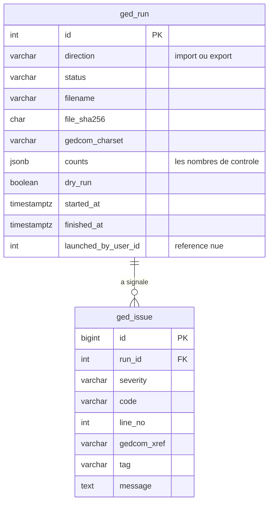
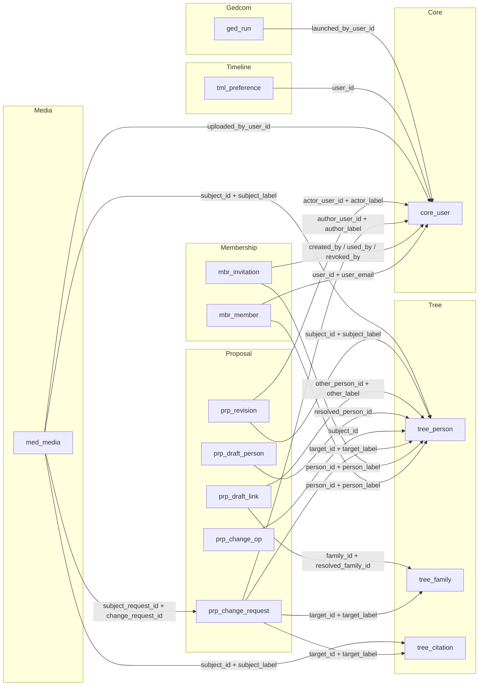

# Modèle de données — Heritage

> Document de référence. Les entités Doctrine s'écrivent à partir de ce seul fichier.
> Toute divergence entre ce document et le code est un bogue **du code**, jusqu'à ce que
> ce document soit corrigé explicitement.
>
> Cible : PostgreSQL 17, Doctrine ORM ^3.6, Symfony 8.1, PHP >= 8.4.
>
> **Convention de renvoi.** « § 9.3 » renvoie à une section **de ce document**.
> « § 6.2 du dossier » renvoie au **dossier de mission** (`brief-mission.md`). Les deux
> numérotations se ressemblent ; la mention « du dossier » est ce qui les sépare, et elle
> n'est jamais omise.

---

## 0. Conventions

### 0.1 Nommage

- **Tables** : `snake_case`, préfixées par module — `core_`, `tree_`, `mbr_`, `prp_`,
  `med_`, `tml_`, `ged_`. Le préfixe n'est pas décoratif : il permet de lire un plan
  d'exécution ou un `pg_dump` et de savoir immédiatement quel module est en cause.
- **Colonnes** : `snake_case`. Les propriétés Doctrine sont en `camelCase` ; la
  conversion est automatique (`underscore` naming strategy), on ne déclare pas `name:`
  sur chaque colonne.
- **Entités** : nom anglais au singulier (`Person`, `ChangeRequest`, `Invitation`),
  comme dans le dépôt de référence. La documentation, les commentaires, les libellés
  d'énumération et l'interface sont en français.

### 0.2 Clés primaires

Toutes les tables ont une clé primaire technique `id`, type `INT` (Doctrine
`#[ORM\Id] #[ORM\GeneratedValue]`, qui émet `SERIAL` sur PostgreSQL). 274 personnes et
103 familles ne justifient pas un `BIGINT`, encore moins un UUID : l'identifiant apparaît
dans les URL et dans les libellés de conflit, il a intérêt à être court et lisible.

Les identifiants GEDCOM (`@I500001@`) **ne sont pas** des clés primaires — voir § 9.8.

### 0.3 Horodatage

`created_at` / `updated_at` en `TIMESTAMPTZ NOT NULL`. `TIMESTAMPTZ`, pas `TIMESTAMP` :
le GEDCOM d'origine porte des horodatages `GMT -0500` (export MyHeritage), et une
sauvegarde restaurée sur un VPS dans un autre fuseau ne doit pas décaler l'historique.

Les **dates généalogiques**, elles, sont en `DATE` sans fuseau : une naissance en 1898
n'a pas d'heure, et lui en donner une inventerait de la précision.

### 0.4 La règle de frontière inter-modules

Reprise sans discussion du dépôt de référence (`docs/adr/0002-monolithe-modulaire.md`) :

> **Aucune relation Doctrine entre modules.** Les références inter-modules passent par
> identifiant + libellé dénormalisé, jamais par jointure objet.

Conséquences concrètes, à appliquer à la lettre :

- Une référence inter-module est **une colonne `INT` nue** (pas de `#[ORM\ManyToOne]`,
  pas de `REFERENCES` en SQL, pas de `ON DELETE`), **plus** une colonne texte portant le
  libellé au moment de l'écriture (`person_id` + `person_label`).
- Le libellé dénormalisé n'est **pas** une source de vérité : c'est un cache d'affichage.
  Il permet d'afficher une file d'attente d'administration sans charger le module `Tree`,
  et il garde une trace lisible si la ligne référencée disparaît. Il est rafraîchi par le
  service qui possède la donnée, jamais par une jointure.
- **`Core` ne fait pas exception.** Aucun module ne pose de clé étrangère vers
  `core_user` : on stocke `xxx_user_id` + `xxx_user_email`. C'est ce que fait déjà
  `core_audit_log` du dépôt de référence, qui range l'acteur sous forme de chaîne.
- À l'intérieur d'un module, les clés étrangères sont normales et attendues, avec
  `ON DELETE CASCADE` quand la ligne fille n'a pas de sens seule.

Dans les tableaux qui suivent, toute référence inter-module est signalée par
**« ⇢ inter-module »** dans la colonne « rôle ». Ce marqueur veut dire : *pas de FK, pas
de relation Doctrine, la cohérence est la responsabilité du service applicatif*.

> **Un libellé dénormalisé est une sortie de données personnelles, et il est la
> contrepartie structurelle de cette règle.** On a supprimé les jointures inter-modules,
> donc on a copié les libellés — et **neuf colonnes réparties sur six tables de trois
> modules stockent désormais le nom d'une personne potentiellement vivante** :
> `mbr_invitation.person_label`, `mbr_member.person_label`,
> `prp_change_request.target_label`, `prp_draft_link.subject_label` / `other_label` /
> `other2_label` / `family_label`, `prp_revision.subject_label`,
> `med_media.subject_label`. Aucune de ces tables ne traverse le normaliseur de
> `Tree\Person`, c'est-à-dire l'endroit unique où le cercle de visibilité est écrit.
> Règle, donc, et elle vaut pour tout `*_label` ajouté plus tard :
> **toute colonne `*_label` désignant une personne est filtrée comme la personne
> elle-même**, et les tests de liste blanche de l'ADR 0003 couvrent les réponses de
> `Proposal`, `Membership` et `Media`, pas seulement celles de `Tree`. En pratique ces
> files sont réservées à l'auteur et aux administrateurs, donc le risque est contenu — mais
> « en pratique » n'est pas une garantie, et c'est la porte de sortie qu'aucun des deux
> corpus n'avait comptée.

Ce que la base ne garantit plus, quatre mesures le compensent, **toutes obligatoires**
(ADR 0002) : résolution de toute référence par le service du module propriétaire *avant*
écriture ; suppression et fusion **par événement, jamais par cascade** — une demande en
cours devient alors `caduque` (§ 5.7) ; rafraîchissement des libellés par le même canal ;
et la commande **`heritage:verifier-integrite`**, exécutée en CI sur les fixtures, qui
parcourt toutes les références inter-modules et signale les pendantes. C'est le filet que
la base ne tend plus ; sans elle, la règle est un pari.

### 0.5 Les cinq colonnes d'une date incertaine

Le motif revient sur sept événements différents (naissance, décès, mariage, divorce,
fait, brouillon de naissance, brouillon de décès). Il est décrit **une fois ici** et
référencé partout ailleurs par la mention « **bloc date `<préfixe>`** ».

Un bloc date `x` est composé de :

| Colonne | Type | Null | Défaut | Rôle |
|---|---|:-:|---|---|
| `x_raw` | `VARCHAR(80)` | oui | `NULL` | La chaîne GEDCOM **verbatim** : `BET 1901 AND 1909`, `ABT 1934`, `11 MAR 1930`, `BEF 12 DEC 1920`. Jamais reconstruite, jamais réécrite par l'application. C'est la provenance. |
| `x_qualifier` | `VARCHAR(12)` | non | `'inconnue'` | Énumération `DateQualifier` (§ 2.8). Porte l'incertitude *qualitative* : `environ`, `avant`, `entre`… |
| `x_min` | `DATE` | oui | `NULL` | Borne basse **inclusive** de l'intervalle calendaire nommé par la chaîne. `NULL` = non bornée à gauche (cas `BEF`). |
| `x_max` | `DATE` | oui | `NULL` | Borne haute **inclusive**. `NULL` = non bornée à droite (cas `AFT`, `FROM`). |
| `x_place` | `TEXT` | oui | `NULL` | Le lieu de l'événement, tel qu'écrit (`PLAC`). Présent seulement sur les blocs qui portent un lieu (naissance, décès, mariage, divorce, fait). |

**Il n'existe nulle part une colonne `x_date` seule.** C'est le cœur de la garantie
demandée au § 4 du dossier de mission (« ne jamais aplatir une fourchette en date
ferme ») : on ne peut pas écrire une date ferme là où il n'y a pas de colonne pour
l'accueillir. Voir § 9.1 pour le raisonnement complet et pour l'objet valeur Doctrine.

Conversion GEDCOM → bloc date, exhaustive sur les 620 valeurs `DATE` du fichier :

| Forme GEDCOM | Occurrences | `qualifier` | `min` | `max` |
|---|---:|---|---|---|
| `11 MAR 1930` | 454 | `exacte` | `1930-03-11` | `1930-03-11` |
| `1930` | 119 | `annee` | `1930-01-01` | `1930-12-31` |
| `ABT 1934` | 23 | `environ` | `1934-01-01` | `1934-12-31` |
| `BET 1901 AND 1909` | 12 | `entre` | `1901-01-01` | `1909-12-31` |
| `JAN 1920` | 5 | `mois` | `1920-01-01` | `1920-01-31` |
| `BEF 1920` / `BEF 12 DEC 1920` | 6 | `avant` | `NULL` | `1919-12-31` / `1920-12-11` |
| `FROM 15 JUN 1900` | 1 | `depuis` | `1900-06-15` | `NULL` |
| *(absente)* | — | `inconnue` | `NULL` | `NULL` |

Contraintes portées par **chaque** bloc date (à répéter table par table) :

```sql
CONSTRAINT ck_<table>_<x>_ordre
  CHECK (x_min IS NULL OR x_max IS NULL OR x_min <= x_max),
CONSTRAINT ck_<table>_<x>_intervalle
  CHECK (x_qualifier <> 'entre' OR (x_min IS NOT NULL AND x_max IS NOT NULL AND x_min < x_max)),
CONSTRAINT ck_<table>_<x>_inconnue
  CHECK (x_qualifier <> 'inconnue' OR (x_min IS NULL AND x_max IS NULL))
```

La deuxième contrainte est celle qui compte : elle rend **impossible** en base une
fourchette dégénérée en point. Si un jour quelqu'un écrit `qualifier = 'entre'` avec
`min = max`, PostgreSQL refuse la ligne.

### 0.6 Ce que le modèle ne contient délibérément pas

Décisions d'exclusion, pour que personne ne les reprenne à zéro dans six mois.

- ~~**Pas de table `tree_place`.**~~ **Reprise effectuée — la table existe.** Le
  raisonnement d'origine est conservé ci-dessous, parce que c'est l'objet de ce
  paragraphe : dire ce qui a été pesé, pour que personne ne le repèse à zéro.

  > *Décision initiale.* 104 lieux distincts pour 315 occurrences, et aucune
  > exigence du dossier de mission ne demande de parcourir l'arbre par lieu. Le
  > lieu est stocké en `TEXT` brut, tel que le GEDCOM l'écrit
  > (`Saint-Ronce-de-Verçay, Fougerie, Florie`). Normaliser coûterait une table,
  > deux clés étrangères par événement, un écran d'administration et une campagne
  > de dédoublonnage — pour rien à ce stade. *Chemin de reprise* : si la recherche
  > par commune devient une exigence, on ajoute `tree_place` et une colonne
  > `place_id` à côté des colonnes `*_place` existantes, qu'on garde comme texte
  > d'origine. Le texte brut n'est jamais un cul-de-sac ; une normalisation
  > prématurée, si.

  L'exigence est venue : une **carte des lieux** (§ 19 du contrat d'API). Le
  chemin de reprise a été pris, **avec un écart qu'il faut connaître** :

  **aucune colonne `place_id` n'a été ajoutée.** `tree_place` est une table de
  **résolution indexée par la chaîne brute** (`raw_key`, la clé repliée par
  `CleDeRecherche`), jointe en PHP sur une centaine d'entrées. Trois raisons
  indépendantes, dont la troisième est la plus coûteuse à découvrir après coup :

  1. Doctrine ne supporte **aucune association dans un `#[ORM\Embeddable]`**, et
     `place_id` aurait dû vivre dans `UncertainDate`. Le mapping n'aurait pas
     validé.
  2. `targetEntity: Place::class` y aurait imposé un `use App\Module\Tree\…` dans
     `App\Module\Core` — ce que `FrontieresInterModulesTest::testLeNoyauNeReferenceAucunModule()`
     interdit, et l'ADR 0002 avec lui.
  3. **`Person` porte un `#[ORM\Version]`.** Réécrire une ligne de personne
     incrémente sa version, **donc périme les demandes en attente qui la
     visaient** (§ 9.6). Une table de résolution ne réécrit aucune personne :
     aucune demande ne meurt pour que la carte existe.

  Rayon d'explosion évité au passage : `UncertainDate` est embarqué à **dix
  endroits, sur cinq entités, dans trois modules** (`Tree`, `Media`, `Proposal`)
  — `med_media` et `prp_draft_*` auraient reçu une colonne dont ils n'ont que
  faire.

  Les cinq colonnes `*_place` sont **intactes**, et le texte brut reste la
  provenance. La table est remplie par `heritage:resoudre-les-lieux`, jamais par
  une migration : une migration ne peut pas lire un référentiel, et les 104
  chaînes n'existent que sur le serveur.
- **Pas de table pour le résultat du moteur de placement.** Voir § 9.9.
- **Pas de table pour le cercle de visibilité.** Voir § 9.3.
- **Pas de table, ni de colonne, ni de compteur d'invalidation de cache.** Les clés de
  cache portent une **empreinte recalculée depuis la base** (§ 2.3, ADR 0005). Une
  empreinte ne peut pas se désynchroniser ; un compteur qu'on oublie d'incrémenter dans un
  chemin d'écriture donne un graphe faux qu'on met des semaines à comprendre.
- **Pas d'extension PostgreSQL** (`pg_trgm`, `unaccent`, `fuzzystrmatch`). La recherche
  floue de rattachement porte sur 274 lignes, limitée à 5 appels par heure et par jeton
  (§ 6.1 du dossier de mission) : elle se fait en PHP sur un jeu de candidats ramené par
  un index `btree` de préfixe. Une extension ajoute une contrainte d'image Docker et un
  point de rupture en migration, pour un gain nul à cette échelle.
- **Pas de table `med_variant`.** Une seule vignette par média, dans une colonne.
- **Pas de table de session.** Sessions Symfony sur système de fichiers, conformément au
  § 3 du dossier de mission (« pas de Redis »).
- **Pas de table de limitation de débit.** Le composant `RateLimiter` de Symfony stocke
  ses compteurs dans le cache. Seule exception, argumentée : `mbr_claim_attempt` (§ 4.3),
  qui existe pour la **traçabilité** de l'oracle d'énumération, pas pour le comptage.

---

## 1. Vue d'ensemble

| Module | Préfixe | Tables |
|---|---|---|
| `Core` | `core_` | `core_user`, `core_setting`, `core_audit_log`, `core_notification` |
| `Tree` | `tree_` | `tree_person`, `tree_family`, `tree_child`, `tree_fact`, `tree_note`, `tree_source`, `tree_citation` |
| `Membership` | `mbr_` | `mbr_invitation`, `mbr_member`, `mbr_claim_attempt` |
| `Proposal` | `prp_` | `prp_change_request`, `prp_change_op`, `prp_draft_person`, `prp_draft_link`, `prp_revision` |
| `Media` | `med_` | `med_media` |
| `Timeline` | `tml_` | `tml_preference` |
| `Gedcom` | `ged_` | `ged_run`, `ged_issue` |

**23 tables.** Les dénombrements de référence après import (§ 4 du dossier de mission)
se lisent ainsi :

| Attendu | Requête de contrôle |
|---|---|
| 274 personnes | `SELECT count(*) FROM tree_person` |
| 103 familles | `SELECT count(*) FROM tree_family` |
| 12 générations | `SELECT count(DISTINCT generation) FROM tree_person` (valeurs 0 à −11) |
| 18 personnes vivantes | calcul applicatif, § 9.2 — **aucune colonne ne le stocke** |
| 224 années de naissance connues | `SELECT count(*) FROM tree_person WHERE birth_max IS NOT NULL` |
| 84 fiches appuyées sur un acte | `SELECT count(*) FROM tree_person WHERE best_quay >= 2` |
| 2 divorces | `SELECT count(*) FROM tree_family WHERE divorced` |
| 4 remariages | personnes conjointes dans ≥ 2 familles (`tree_family`) |
| répartition `pm` 134 / `mm` 64 / `mp` 51 / `pp` 20 / `tr` 5 | `GROUP BY branch` |
| racine `@I500001@` | `core_setting['tree.personne_racine_id']` |

---

## 2. Module `Core` — préfixe `core_`

Noyau partagé **minimal** : l'identité d'authentification, les réglages, le journal
d'audit et les notifications. Rien de métier. Le § 2.3 y ajoute une section sans table :
l'empreinte qui sert de clé à tous les caches, rangée ici parce que tous les modules s'y
réfèrent.

Point d'arbitrage, parce qu'il n'est pas évident : le § 5 du dossier de mission place
« comptes » dans `Core`, et son § 2 illustre la référence inter-module par un
`Membership\Account.personId`. **L'entité s'appelle `Member`** — décision du commanditaire
(`docs/arbitrages.md` § 3) : `Account` entrait en collision conceptuelle avec `Core\User`,
qui *est* le compte. **Il n'existe nulle part de classe `Account` ni de table
`mbr_account`** ; toute occurrence rencontrée ailleurs est un résidu à corriger. Les deux
exigences du dossier sont respectées en **séparant l'identité et le rattachement** :

- `core_user` = l'identité d'authentification (courriel, mot de passe, rôles). C'est
  l'implémentation de `UserInterface`. Elle ne sait rien de l'arbre.
- `mbr_member` = le rattachement compte ↔ personne (§ 4). Il porte `user_id` et
  `person_id`, tous deux en références nues.

Un module qui a besoin de « qui a fait ça » lit `core_user`. Un module qui a besoin de
« quelle personne de l'arbre est-ce » lit `mbr_member`. Aucun des deux ne dépend de
l'autre par une relation.

### 2.1 `core_user`

Comptes d'authentification. Créés **exclusivement** par le parcours d'invitation (§ 4) ou
par la commande console d'amorçage ; aucune route publique d'inscription (§ 6.1 du
dossier de mission).

| Colonne | Type | Null | Défaut | Rôle |
|---|---|:-:|---|---|
| `id` | `INT` | non | identité | PK |
| `email` | `VARCHAR(180)` | non | — | Identifiant de connexion. |
| `password` | `VARCHAR(255)` | non | — | Empreinte du mot de passe, jamais le mot de passe. 255 caractères : les algorithmes que `PasswordHasher` choisira demain sont plus longs qu'aujourd'hui. |
| `roles` | `JSONB` | non | `'[]'` | Liste de rôles. `ROLE_USER` est ajouté à la lecture, jamais stocké (convention du dépôt de référence). |
| `display_name` | `VARCHAR(120)` | non | `''` | Nom affiché dans les files d'administration et les notifications, sans aller chercher la personne rattachée. |
| `status` | `VARCHAR(16)` | non | `'en_attente'` | Énum `UserStatus`. Un compte `en_attente` s'authentifie mais **n'a pas de cercle de visibilité** (§ 6.1 du dossier, étape 3) : il ne voit que les personnes décédées, aucune vivante — pas même celle à laquelle il prétend se rattacher. Régime distinct, pas un cercle vide : voir § 4.5. |
| `totp_secret` | `VARCHAR(160)` | oui | `NULL` | Secret TOTP chiffré, pour la MFA administrateur. Colonne prévue dès maintenant : ajouter une colonne plus tard est trivial, migrer des comptes existants vers un second facteur ne l'est pas. `NULL` = MFA non activée. |
| `totp_enabled_at` | `TIMESTAMPTZ` | oui | `NULL` | Date d'activation du second facteur ; sert au journal d'audit. |
| `last_login_at` | `TIMESTAMPTZ` | oui | `NULL` | Dernière connexion réussie. |
| `created_at` | `TIMESTAMPTZ` | non | `now()` | — |
| `updated_at` | `TIMESTAMPTZ` | non | `now()` | — |

**Clés et index**

| Objet | Définition | Requête servie |
|---|---|---|
| PK | `(id)` | — |
| `uniq_core_user_email` | `UNIQUE (email)` | Le fournisseur d'utilisateurs de Symfony charge par courriel à chaque requête authentifiée. Unicité fonctionnelle *et* index de chargement. |
| `idx_core_user_status` | `(status)` partiel `WHERE status = 'en_attente'` | « Combien de comptes attendent mon activation ? » — pastille du tableau de bord d'administration, exécutée à chaque chargement. Partiel : la table est presque intégralement `actif`, indexer les deux ou trois lignes utiles suffit. |

**Contraintes**

```sql
CONSTRAINT ck_core_user_totp CHECK (totp_secret IS NULL OR totp_enabled_at IS NOT NULL)
```

### 2.2 `core_setting`

Réglages d'administration modifiables **sans redéploiement**. Le § 6.2 du dossier de
mission l'impose explicitement pour `N` (« le commanditaire a formulé ce chiffre avec
hésitation ») ; la même logique vaut pour les autres seuils.

| Colonne | Type | Null | Défaut | Rôle |
|---|---|:-:|---|---|
| `id` | `INT` | non | identité | PK |
| `key` | `VARCHAR(80)` | non | — | Clé pointée, par domaine : `cercle.*`, `tree.*`, `invitation.*`, `media.*`, `timeline.*`. `key` est un mot réservé SQL : à échapper en `"key"`, et à nommer `settingKey` côté Doctrine. |
| `value` | `TEXT` | non | — | Valeur sérialisée en texte. Le type est porté par `value_type`, pas par la colonne : une seule table, pas cinq. |
| `value_type` | `VARCHAR(10)` | non | `'texte'` | Énum `SettingType` : `entier`, `texte`, `booleen`, `json`. Le service de réglages caste à la lecture et **refuse** à l'écriture une valeur qui ne caste pas. |
| `label` | `VARCHAR(160)` | non | — | Libellé français affiché dans l'écran d'administration. |
| `description` | `TEXT` | oui | `NULL` | Ce que le réglage change, en une phrase, pour l'administrateur. |
| `min_value` | `INT` | oui | `NULL` | Borne basse pour les réglages entiers, validée côté serveur. Empêche `cercle.generations = 0` par inadvertance. |
| `max_value` | `INT` | oui | `NULL` | Borne haute. Voir § 9.3 : au-delà de 6, le cercle couvre l'arbre entier et la règle de confidentialité ne protège plus personne. |
| `updated_by_user_id` | `INT` | oui | `NULL` | **⇢ inter-module** (`core_user`) — référence nue même à l'intérieur de `Core`, par cohérence avec la règle du § 0.4. |
| `updated_by_email` | `VARCHAR(180)` | oui | `NULL` | Libellé dénormalisé de l'auteur du dernier changement. |
| `updated_at` | `TIMESTAMPTZ` | non | `now()` | — |

**Clés et index**

| Objet | Définition | Requête servie |
|---|---|---|
| PK | `(id)` | — |
| `uniq_core_setting_key` | `UNIQUE ("key")` | Le service de réglages charge par clé. Il charge en réalité **toute la table d'un coup** (une vingtaine de lignes) et la garde en mémoire pour la durée de la requête ; l'unicité est donc surtout une garantie d'intégrité. |

**Jeu de réglages initial** — posé en migration, pas en fixture : l'application ne démarre
pas sans eux.

| Clé | Type | Défaut | Bornes | Ce que ça change |
|---|---|---:|---|---|
| `cercle.generations` | entier | `3` | 1–6 | Le `N` du § 6.2 du dossier : combien de générations on remonte avant de redescendre. |
| `tree.seuil_vivant_annees` | entier | `110` | 80–130 | Âge au-delà duquel une personne sans décès connu est réputée décédée (§ 9.2). |
| `tree.personne_racine_id` | entier | *(posé à l'import)* | — | La personne « ego » qui définit `generation` et `branch`. `@I500001@` — Natron Romarin. |
| `invitation.ttl_jours` | entier | `7` | 1–30 | Durée de validité d'un lien d'invitation. |
| `invitation.tentatives_par_heure` | entier | `5` | 1–20 | Le garde-fou anti-oracle du § 6.1 du dossier. |
| `invitation.candidats_max` | entier | `3` | 1–5 | Nombre maximal de candidats renvoyés par la recherche de rattachement. |
| `media.taille_max_octets` | entier | `20971520` | — | 20 Mio. Les actes numérisés de `recherche/` montent à plusieurs Mio. |
| `media.mimes_autorises` | json | `["image/jpeg","image/png","image/webp","application/pdf"]` | — | Liste blanche appliquée **après** reniflage des octets d'en-tête. |
| `timeline.bande_annees_defaut` | entier | `10` | 1–200 | Largeur de bande par défaut de la vue chronologique. |

### 2.3 L'empreinte de l'arbre — aucune table

**Il n'existe ni table, ni colonne, ni compteur d'invalidation de cache.** Les clés de
cache du cercle de visibilité (§ 9.3) et du moteur de placement (§ 9.9) portent une
**empreinte recalculée depuis la base**. C'est la décision de l'ADR 0005, et son motif
tient en une phrase : *une empreinte ne peut pas se désynchroniser ; un compteur qu'on
oublie d'incrémenter dans un chemin d'écriture donne un graphe faux qu'on met des semaines
à comprendre.*

Cette section est rangée dans `Core` parce que tous les modules s'y réfèrent. Le service,
lui, appartient à `Tree` — `Tree\Service\TreeFingerprint`, déclaré dans la surface publique
du module — parce que les tables `tree_*` ne se lisent que par leur propriétaire (§ 0.4).
`Membership` l'appelle pour composer sa clé de cercle ; il ne lit pas `tree_person`
lui-même.

**Le calcul.** Une lecture des trois tables **structurantes** de l'arbre, puis un
`sha256` **en PHP** — `Tree\Service\TreeFingerprint`.

```
pour chacune de tree_person, tree_family, tree_child, ORDER BY id :
    colonnes  = découvertes dans les métadonnées Doctrine, triées par nom
                (les clés étrangères comprises : ce sont elles qui portent la parenté)
    valeur    = canonicalisée par type — booléen en 0/1, horodatage en UTC ISO,
                date nue reformatée sans conversion, NULL distinct de la chaîne vide
empreinte = sha256(concaténation canonique)
```

**Les colonnes sont découvertes, jamais énumérées à la main.** Une colonne ajoutée demain
entre dans l'empreinte sans que personne y pense, et **aucune écriture ne peut lui
échapper** — pas même un correctif SQL à chaud qui oublierait de toucher `updated_at`.
C'est exactement ce qu'un compteur ne sait pas garantir, et ce qu'une liste de colonnes
tenue à la main aurait perdu à la première migration. Seule la **liste des trois tables**
reste écrite à la main : c'est la décision de périmètre, elle doit rester un acte
délibéré.

> **Pourquoi pas en SQL.** La première rédaction portait la requête PostgreSQL
> `encode(sha256(convert_to(string_agg(p::text, E'\n' ORDER BY p.id), 'UTF8')), 'hex')`.
> Élégante, et **inutilisable hors de PostgreSQL** : `sha256()`, `convert_to()`,
> `string_agg()` et `p::text` n'existent pas sur SQLite, où tourne la suite de tests — la
> route `GET /api/arbre/graphe` levait une `DBALException` avant même d'atteindre le
> placement, et c'était la seule route du module non couverte de bout en bout.
>
> Brancher sur le dialecte aurait donné **deux implémentations devant produire le même
> haché** : elles finissent toujours par diverger, et la divergence ne se verrait qu'en
> service — un cache qui ne s'invalide jamais, ou qui s'invalide toujours. C'est le
> raisonnement qui a déjà fait écarter le compteur. Une seule implémentation ne peut pas
> se désynchroniser d'elle-même.
>
> L'indifférence au moteur est **prouvée, pas supposée** : `EmpreinteEntreMoteursTest`
> recopie les 274 + 103 + 174 lignes réellement importées de PostgreSQL vers SQLite **en
> les réécrivant à la façon de SQLite** — booléens en `0`/`1`, horodatages sans décalage —
> et exige la même empreinte. Écrire les valeurs verbatim n'aurait rien prouvé : on aurait
> comparé PostgreSQL à lui-même.
>
> Une condition à connaître : SQLite ne stocke pas le décalage horaire
> (`getDateTimeTzFormatString()` y vaut `Y-m-d H:i:s`, contre `Y-m-d H:i:sO`). Les
> horodatages sans décalage sont donc lus **comme de l'UTC**, ce qui est exact tant que
> l'application écrit en UTC — c'est le cas. Si un jour elle écrivait en heure locale, ce
> serait à corriger à l'écriture, pas dans l'empreinte.

Le coût est celui d'une lecture de 274 + 103 + 174 = 551 lignes courtes, négligeable devant
la requête qui sert une fiche. L'empreinte est calculée **une fois par requête HTTP** et
gardée en mémoire pour la durée de celle-ci.

**Conséquence assumée de « la ligne entière »** : `updated_at` en fait partie, donc un
ré-import idempotent — qui réécrit les mêmes données avec de nouveaux horodatages — change
l'empreinte et fait recalculer le placement, pour un graphe identique. C'est le sens
prudent de l'erreur, et c'est le prix de la garantie « aucune écriture ne lui échappe ».

L'empreinte fait 64 caractères hexadécimaux. Elle sert telle quelle de segment de clé de
cache et d'`ETag` HTTP (§ 9.9).

**Ce qu'elle couvre, et ce qu'elle ne couvre pas.** Les trois tables retenues sont celles
dont dépendent le placement et le cercle : personnes, familles, filiations. **Ni médias, ni
citations, ni sources** — ils ne déplacent aucun nœud et n'entrent dans aucun cercle, et
les inclure ferait recalculer tout le graphe à chaque photo téléversée (ADR 0005).

**Il n'y a donc aucune liste de déclencheurs à tenir à jour**, et c'est tout l'intérêt de
la décision : la liste exhaustive qu'un compteur exigeait était une dette permanente, où
chaque nouveau chemin d'écriture était une occasion d'oubli, et un oubli produisait un
cache périmé silencieux — c'est-à-dire une fuite vers un compte qui n'aurait plus dû voir
la fiche. Pour mémoire seulement, les chemins d'écriture qui changent l'empreinte sont : la
validation d'une `prp_change_request`, l'édition directe d'un administrateur (qui est
elle-même une demande auto-validée, § 9.4), l'import GEDCOM, le changement de
`tree.personne_racine_id` — qui recalcule `branch` et `generation` — et toute correction
faite directement en base. Aucun d'eux n'a besoin de « penser à » quoi que ce soit.

Trois changements **n'altèrent pas** l'empreinte, et c'est correct :

| Changement | Pourquoi le cache reste juste |
|---|---|
| `cercle.generations` (`N`) | `{N}` figure dans la clé du cercle (§ 9.3) : les anciennes entrées deviennent inatteignables d'elles-mêmes. |
| `tree.seuil_vivant_annees` | Il ne change ni la topologie ni la composition d'un cercle. Il change ce que la **sérialisation** masque — et la sérialisation n'est pas mise en cache (§ 9.2, § 9.9). |
| Un nouveau `mbr_member`, un portrait, une citation | Le nouveau membre a une clé qui lui est propre ; le reste ne déplace aucun nœud et ne modifie aucune parenté. |

**L'atomicité, qui était l'argument du compteur, est acquise autrement.** Un compteur
devait être incrémenté *dans* la transaction de validation pour qu'aucune fenêtre n'existe
entre l'écriture et l'invalidation. L'empreinte n'a pas ce problème : elle est **dérivée de
la donnée elle-même**. Tant que la transaction n'est pas validée, les autres connexions
lisent l'ancien état, donc l'ancienne empreinte, donc l'ancien cache — qui est juste. Au
`commit`, elles lisent le nouvel état, donc une nouvelle empreinte, donc une nouvelle clé.
Il n'y a pas de fenêtre intermédiaire parce qu'il n'y a rien à synchroniser. Si la
transaction est annulée, il n'y a rien à annuler côté cache.

Les entrées devenues inatteignables sont ramassées par l'expiration du pool (TTL 24 h). **On
ne supprime jamais une clé de cache à la main** : un balayage de clés n'est pas atomique sur
un adaptateur système de fichiers, et c'est précisément ce qu'on évite.

### 2.4 `core_audit_log`

Journal inaltérable **côté applicatif** : alimenté par un `EventSubscriber` Doctrine, en
insertion seule. Aucun service n'écrit ici à la main (convention du dépôt de référence),
aucun code n'émet d'`UPDATE` ni de `DELETE` sur cette table.

| Colonne | Type | Null | Défaut | Rôle |
|---|---|:-:|---|---|
| `id` | `BIGINT` | non | identité | PK. `BIGINT` ici et nulle part ailleurs : c'est la seule table qui croît sans borne. |
| `occurred_at` | `TIMESTAMPTZ` | non | `now()` | — |
| `actor_user_id` | `INT` | oui | `NULL` | **⇢ inter-module** (`core_user`). `NULL` pour les actions système (import CLI). |
| `actor_email` | `VARCHAR(180)` | oui | `NULL` | Libellé dénormalisé. Survit à la suppression du compte : c'est tout l'intérêt d'un journal. |
| `action` | `VARCHAR(40)` | non | — | Énum `AuditAction` (§ 2.7). |
| `subject_type` | `VARCHAR(120)` | non | — | Nom court de l'entité visée (`Tree\Person`, `Proposal\ChangeRequest`). |
| `subject_id` | `VARCHAR(64)` | oui | `NULL` | Identifiant de la ligne visée, **en texte** : le journal traverse les modules et ne présume pas du type de clé. |
| `subject_label` | `VARCHAR(255)` | oui | `NULL` | Libellé lisible au moment des faits (« Marne Dolomite Sureau »). |
| `changes` | `JSONB` | oui | `NULL` | Diff champ par champ : `{"surname": {"avant": "Bourrache", "apres": "BOURRACHE"}}`. **Champs sensibles masqués** : `password`, `totp_secret`, `token_hash` sont remplacés par `"***"` par le souscripteur, jamais écrits. |
| `ip` | `VARCHAR(45)` | oui | `NULL` | 45 caractères : une IPv6 mappée IPv4 (`::ffff:192.168.0.1`) fait 45 signes. L'IP vient du proxy de confiance, pas de `REMOTE_ADDR`. |
| `user_agent` | `VARCHAR(255)` | oui | `NULL` | Tronqué à 255. Utile pour distinguer deux sessions du même compte. |

**Clés et index**

| Objet | Définition | Requête servie |
|---|---|---|
| PK | `(id)` | — |
| `idx_core_audit_occurred_at` | `(occurred_at DESC)` | Écran « journal d'audit », du plus récent au plus ancien, paginé. C'est **la** requête de la table. |
| `idx_core_audit_subject` | `(subject_type, subject_id, occurred_at DESC)` | « Tout ce qui est arrivé à cette personne » — encart d'historique d'une fiche. |
| `idx_core_audit_actor` | `(actor_user_id, occurred_at DESC)` | « Tout ce qu'a fait ce compte » — instruction d'un incident. |
| `idx_core_audit_echecs` | `(action, occurred_at DESC)` partiel `WHERE action = 'connexion_echouee'` | Détection de force brute. Partiel : c'est la seule action qu'on interroge isolément, et elle est minoritaire. |

### 2.5 `core_notification`

Notifications en base, lues par une cloche dans l'interface. Pas de file d'attente, pas de
Redis (§ 3 du dossier de mission) : l'envoi de courriel est synchrone, la notification en
base est la source de vérité.

| Colonne | Type | Null | Défaut | Rôle |
|---|---|:-:|---|---|
| `id` | `INT` | non | identité | PK |
| `recipient_user_id` | `INT` | non | — | **⇢ inter-module** (`core_user`). Destinataire. |
| `kind` | `VARCHAR(32)` | non | — | Énum `NotificationKind` (§ 2.7). |
| `title` | `VARCHAR(160)` | non | — | Titre en français, **déjà rendu** : la notification ne se recompose pas à la lecture, sinon un changement de libellé réécrit l'histoire. |
| `body` | `TEXT` | oui | `NULL` | Corps. **C'est ici qu'atterrit le message obligatoire de refus** du § 6.3 du dossier — l'auteur d'une demande refusée le lit dans sa notification. |
| `link_route` | `VARCHAR(120)` | oui | `NULL` | Nom de route front visée (`demande.detail`). |
| `link_params` | `JSONB` | oui | `NULL` | Paramètres de cette route (`{"id": 42}`). Route + paramètres plutôt qu'une URL construite : une refonte du routage front ne casse pas les notifications d'hier. |
| `read_at` | `TIMESTAMPTZ` | oui | `NULL` | `NULL` = non lue. |
| `created_at` | `TIMESTAMPTZ` | non | `now()` | — |

**Clés et index**

| Objet | Définition | Requête servie |
|---|---|---|
| PK | `(id)` | — |
| `idx_core_notif_destinataire` | `(recipient_user_id, created_at DESC)` | Liste des notifications d'un compte, paginée. |
| `idx_core_notif_non_lues` | `(recipient_user_id)` partiel `WHERE read_at IS NULL` | Le compteur de la cloche, appelé à **chaque** chargement de page. Partiel : seules les non-lues comptent, et elles sont une poignée. |

### 2.6 Références inter-modules sortant de `Core`

Aucune. `Core` est le noyau : il est référencé, il ne référence pas. `core_audit_log`,
`core_notification` et `core_setting` portent des `*_user_id` qui, par la règle du § 0.4,
restent des entiers nus même à l'intérieur du module.

### 2.7 Énumérations de `Core`

Toutes les énumérations du projet sont des `enum` PHP adossés à `string`, stockés en
`VARCHAR`. **Jamais de type `ENUM` PostgreSQL** : ajouter une valeur à un type énuméré
PostgreSQL est une migration à part entière, longtemps impossible à jouer dans une
transaction et toujours irréversible ; une colonne `VARCHAR` contrainte côté PHP coûte
moins cher et se corrige.

**`UserStatus`**

| Valeur | Libellé | Sens |
|---|---|---|
| `actif` | Actif | Se connecte et lit selon son cercle. |
| `en_attente` | En attente de validation | Compte né d'une invitation mais correspondance incertaine (§ 6.1 du dossier, étape 3). Se connecte ; **pas de cercle** — ne voit que les personnes décédées, aucune vivante (§ 4.5). |
| `suspendu` | Suspendu | Désactivé par un administrateur. Conservé pour l'audit. |

**`SettingType`** — `entier`, `texte`, `booleen`, `json`.

**`AuditAction`** — liste exhaustive. Toute décision d'administration y figure (§ 8 du
dossier de mission).

| Valeur | Sens |
|---|---|
| `creation` | Création d'une ligne, tous modules confondus. |
| `modification` | Modification, avec diff dans `changes`. |
| `suppression` | Suppression. |
| `connexion` | Connexion réussie. |
| `connexion_echouee` | Tentative échouée. |
| `deconnexion` | Déconnexion explicite. |
| `invitation_creee` | — |
| `invitation_revoquee` | — |
| `invitation_utilisee` | Un compte est né de ce jeton. |
| `rattachement_tente` | Recherche de rattachement (§ 6.1 du dossier) — tracée même en échec. |
| `demande_soumise` | Une `ChangeRequest` passe en `en_attente`. |
| `demande_validee` | Porte `changes.auto_validation = true` quand le validateur est aussi l'auteur — cas autorisé mais rendu visible (§ 9.4, ADR 0004). Une édition directe d'administrateur est un cas particulier de celui-là. |
| `demande_refusee` | Le motif obligatoire est dans `changes.motif`. |
| `demande_rejouee` | Le verrou optimiste s'était déclenché, toutes les anciennes valeurs concordaient encore : la demande a été rejouée automatiquement sur la version courante (§ 9.6). Tracé parce qu'une écriture qu'aucun humain n'a réexaminée doit se voir. |
| `demande_caduque` | Caducité constatée à la validation (§ 9.6) : une ancienne valeur avait changé, ou la cible avait disparu. Rien n'a été écrit. |
| `role_modifie` | Changement de rôles d'un compte. |
| `compte_suspendu` | — |
| `reglage_modifie` | Changement dans `core_setting`, avec ancienne et nouvelle valeur. |
| `televersement` | Dépôt d'un média. |
| `media_supprime` | — |
| `import_gedcom` | — |
| `export_gedcom` | — |
| `vue_comme_membre` | Un administrateur a activé la bascule du § 6.2 du dossier. Tracé, parce que c'est une lecture de données masquées. |

**`NotificationKind`** — `demande_soumise`, `demande_validee`, `demande_refusee`,
`demande_caduque`, `doublon_probable`, `invitation_utilisee`, `compte_en_attente`,
`media_valide`, `media_refuse`. La notification `demande_caduque` porte le diff de ce qui a
changé et le lien « refaire cette demande » (§ 9.6) : sans eux, c'est une contribution
perdue.

### 2.8 Les quatre types partagés — `UncertainDate`, `DateQualifier`, `Sex`, `Branch`

Ils décrivent des données de `Tree`, et pourtant ils vivent dans `Core`. Ce n'est pas une
incohérence de rangement, c'est la **règle 3 de l'ADR 0002** : « `Core` est le noyau
partagé, et il est le seul. Aucun autre module n'a le droit d'être *un peu* noyau. Si deux
modules ont besoin de la même chose, elle monte dans `Core` ou elle est dupliquée — elle ne
s'installe pas dans le plus gros des deux. »

Or ces quatre-là sont utilisés par trois modules en plus de `Tree` :

| Type | Emplacement | Qui s'en sert hors de `Tree` |
|---|---|---|
| `UncertainDate` (objet valeur `#[ORM\Embeddable]`) | `Core\ValueObject` | `Proposal` (blocs date de `prp_draft_person` et `prp_draft_link`, `value_kind = date_incertaine`), `Media` (bloc date `taken`) |
| `DateQualifier` | `Core\Enum` | les mêmes, plus `Gedcom` à l'analyse des `DATE` |
| `Sex` | `Core\Enum` | `Proposal` (`prp_draft_person.sex`) |
| `Branch` | `Core\Enum` | `Timeline` (`tml_preference.branches`) |

Laisser ces classes dans `Tree` en ferait un second noyau **sans que personne ne l'ait
décidé** — et c'est la frontière la plus facile à franchir sans s'en apercevoir, parce
qu'elle se franchit par un `use` et non par une relation Doctrine. Le contrôle en CI prévu
par l'ADR 0002 ne regarde que les **annotations de relation** : un
`use App\Module\Tree\Enum\Sex;` dans `Proposal` passerait au vert. **Le contrôle doit donc
être élargi aux `use` inter-modules**, avec `Core` en liste blanche — sans quoi la règle 3
n'est vérifiée par rien, alors que c'est précisément celle qu'on vient de sauver.

Les énumérations qui restent dans `Tree` (§ 3.9) sont celles qu'aucun autre module
n'instancie : `FactType`, `ChildRelation`, `NoteScope`, `SourceKind`, `CitationQuality`,
`CitationContext`.

**`DateQualifier`** — `exacte`, `annee`, `mois`, `environ`, `avant`, `apres`, `entre`,
`depuis`, `jusqu_a`, `inconnue`. Correspondances GEDCOM au § 0.5. `apres` (`AFT`) et
`jusqu_a` (`TO`) n'apparaissent pas dans le fichier actuel mais sont dans la norme et
peuvent arriver par une saisie ou un ré-import.

**`Sex`** — valeurs `masculin` (`M` en GEDCOM, 135), `feminin` (`F`, 139),
`inconnu` (`U` ou absent, 0 aujourd'hui). `inconnu` existe pour les créations : on peut
proposer l'ajout d'un enfant dont on ignore le sexe.

**`Branch`** — les quarts d'ascendance, relatifs à la personne racine.

| Valeur | Libellé | Effectif |
|---|---|---:|
| `pp` | Branche paternelle du père | 20 |
| `pm` | Branche maternelle du père | 134 |
| `mp` | Branche paternelle de la mère | 51 |
| `mm` | Branche maternelle de la mère | 64 |
| `tr` | Tronc — la lignée directe et la fratrie de la racine | 5 |

`UncertainDate` est décrit au § 9.1 : son intérêt est **l'absence** de `getDate()`, et c'est
le verrou principal contre l'aplatissement des fourchettes.

---

## 3. Module `Tree` — préfixe `tree_`

Le cœur généalogique : personnes, familles, filiation, faits, notes, sources, citations.
C'est le seul module où les clés étrangères sont denses — parce qu'elles sont toutes
intra-module.

**Principe de découpage**, à retenir avant de lire les tables : la **naissance** et le
**décès** sont des colonnes de `tree_person`, tous les **autres** événements sont des
lignes de `tree_fact`. Ce n'est pas une incohérence, c'est un choix (§ 3.1, encadré).

### 3.1 `tree_person` — 274 lignes après import

| Colonne | Type | Null | Défaut | Rôle |
|---|---|:-:|---|---|
| `id` | `INT` | non | identité | PK |
| `gedcom_xref` | `VARCHAR(20)` | oui | `NULL` | L'identifiant GEDCOM avec ses arobases : `@I500001@`. Voir § 9.8. `NULL` seulement entre la création applicative et le premier `flush` — le service le remplit immédiatement. |
| `gedcom_uid` | `CHAR(32)` | oui | `NULL` | Le `_UID` MyHeritage — **165 individus en portent un**, pas 229 : les 229 `_UID` du fichier se répartissent en 165 sur des `INDI` et 64 sur des `FAM` (§ 9.8). Sans usage applicatif, mais c'est la seule clé qui survit à un aller-retour par un autre logiciel : on la garde. |
| `gedcom_rin` | `VARCHAR(32)` | oui | `NULL` | Le `RIN` (`MH:I500017`). Même raison. |
| `given_names` | `VARCHAR(160)` | non | `''` | Prénoms, dans l'ordre d'état civil (`GIVN`) : « Jade Pyrite Granite Mica ». Vide pour les 7 personnes dont le prénom est inconnu. |
| `surname` | `VARCHAR(120)` | non | `''` | Nom de famille (`SURN`). Vide pour les 4 individus sans `NAME` — les ancêtres réellement inconnus décrits dans le `README.md`. Ce ne sont pas des lignes corrompues : elles ouvrent chacune une branche de recherche. |
| `married_name` | `VARCHAR(120)` | oui | `NULL` | Nom d'épouse (`_MARNM`), 97 occurrences dans le GEDCOM. **`graphe.json` l'a perdu** : c'est l'un des champs que l'aplatissement a mangés. C'est de la vraie donnée, pas du bruit MyHeritage (cf. `README.md`, tableau de contrôle qualité). |
| `nickname` | `VARCHAR(80)` | oui | `NULL` | Nom d'usage courant (`NICK`), 11 occurrences — « Granite » pour Jade Pyrite Granite Mica Chardon. C'est ce que `graphe.json` appelle `usage`. |
| `display_name` | `VARCHAR(255)` | non | — | Nom d'affichage composé, dénormalisé. **La seule colonne nominative que reçoit un compte hors cercle** ; la liste blanche complète pour une personne vivante hors cercle est `id`, `display_name`, `sex`, `generation`, `branch` et la position du nœud avec ses arêtes (§ 9.2, ADR 0003). Composée à l'écriture : `nickname ?? given_names`, puis `surname`, puis `?` si les deux sont vides. |
| `search_key` | `VARCHAR(200)` | non | `''` | `surname \|\| ' ' \|\| given_names \|\| ' ' \|\| nickname`, sans accents, en majuscules, ponctuation retirée, **sans mot répété**. Sert la recherche de l'arbre (§ 5.5 du contrat), sans extension PostgreSQL. Recalculée par `Core\Service\CleDeRecherche` à chaque écriture des noms, aux **trois** sites d'écriture — import GEDCOM, création et modification par demande validée. **`married_name` n'y entre pas** : 97 fiches en portent un, 96 l'ont hors de leur clé, et l'y ajouter est un arbitrage ouvert (97 lignes de reprise, donc 97 `version` incrémentées). |
| `sex` | `VARCHAR(10)` | non | `'inconnu'` | Énum `Sex` (§ 2.8). |
| `deceased` | `BOOLEAN` | non | `false` | Le `DEAT` du GEDCOM. **Attention** : 196 personnes portent `DEAT`, mais seulement 171 ont une date de décès — `DEAT Y` sans `DATE` est un décès certain sans date. D'où une colonne booléenne distincte du bloc date : le décès est un fait, sa date est une information. |
| `force_privacy` | `BOOLEAN` | non | `false` | Verrou manuel de confidentialité. `true` = traiter la personne comme vivante quoi qu'en dise la règle calculée. **Il n'existe pas de valeur inverse** : on ne force jamais dans le sens du démasquage. Voir § 9.2. |
| `privacy_note` | `TEXT` | oui | `NULL` | Pourquoi `force_privacy` a été posé. Obligatoire quand il l'est (contrainte ci-dessous) : le GEDCOM porte déjà des décisions de caviardage « CONSIGNÉE POUR NE PAS ÊTRE REDÉFAITE », on ne perd pas ce raisonnement. |
| **bloc date `birth`** | — | — | — | `birth_raw`, `birth_qualifier`, `birth_min`, `birth_max`, `birth_place` (§ 0.5). |
| **bloc date `death`** | — | — | — | `death_raw`, `death_qualifier`, `death_min`, `death_max`, `death_place` (§ 0.5). |
| `branch` | `VARCHAR(2)` | oui | `NULL` | Énum `Branch` (§ 2.8) — `pp`, `pm`, `mp`, `mm`, `tr`. **Colonne dérivée**, relative à `tree.personne_racine_id`, recalculée et persistée par un **service de `Tree`** après toute écriture structurante. **Ce n'est pas le moteur de placement qui l'écrit** : l'ADR 0005 lui interdit tout accès à la base, et c'est cette contrainte qui le rend testable contre `graphe.json`. Le moteur la **consomme** en entrée. Aucune `ChangeRequest` ne la modifie. |
| `generation` | `SMALLINT` | oui | `NULL` | Rang générationnel, 0 pour la racine, négatif en remontant (jusqu'à −11). **Dérivée**, même régime que `branch` : écrite par `Tree`, lue par le moteur. |
| `best_quay` | `SMALLINT` | oui | `NULL` | Meilleur `QUAY` parmi les citations de la personne — 0 à 3, `NULL` si aucune citation. **Dérivée**, recalculée par le service de citations. Sert le filtre « non vérifié » du visualiseur sans agrégat à la volée. |
| `citation_count` | `SMALLINT` | non | `0` | Nombre de citations. Dérivée. `0` = le « sans source » de `graphe.json` (9 personnes). |
| `version` | `INT` | non | `1` | Verrou optimiste Doctrine (`#[ORM\Version]`). Voir § 9.6. |
| `created_at` | `TIMESTAMPTZ` | non | `now()` | — |
| `updated_at` | `TIMESTAMPTZ` | non | `now()` | — |

> **Pourquoi naissance et décès sont des colonnes et pas des `tree_fact`**
>
> Parce qu'ils sont lus **à chaque** sérialisation d'une personne, **à chaque** passage
> du moteur de placement (tri des fratries par année de naissance) et **à chaque** barre
> de la vue chronologique. Les faire passer par une jointure sur une table
> polymorphe coûterait deux `LEFT JOIN` et un `DISTINCT ON` sur les 274 lignes, à chaque
> rendu, pour respecter une pureté GEDCOM dont personne ne tire rien. Les autres
> événements — baptême, inhumation, recensement, profession, résidence — sont lus à
> l'ouverture d'une fiche, une par une : `tree_fact` leur convient parfaitement.
>
> Corollaire à respecter : l'import GEDCOM range `BIRT` et `DEAT` dans les colonnes et
> **n'en fait pas aussi** des `tree_fact`. Un fait dupliqué est une divergence qui
> attend son heure.

**Clés et index**

| Objet | Définition | Requête servie |
|---|---|---|
| PK | `(id)` | — |
| `uniq_tree_person_xref` | `UNIQUE (gedcom_xref)` | Le ré-import retrouve la ligne existante depuis `@I500017@` sans créer un doublon. C'est ce qui rend l'import **idempotent**. |
| `idx_tree_person_search` | `(search_key varchar_pattern_ops)` | Le **tri** de la recherche de l'arbre (`ORDER BY search_key`), et les `LIKE 'X%'` préfixés. `varchar_pattern_ops` : sans cet opérateur, un index `btree` sur une base non-`C` — la nôtre est en ICU `fr-FR` — ne sert pas les `LIKE` préfixés. **Il ne sert pas le filtre de la recherche** : celui-ci porte une branche infixe `'% X%'`, qu'aucun index btree ne peut satisfaire — `EXPLAIN` rend un `Seq Scan` même avec `enable_seqscan = off`. Ce n'est pas une régression du correctif multi-mots : la branche infixe préexistait. Corrigé ici parce que trois endroits du dépôt affirmaient le contraire. **Ce n'est pas non plus la recherche de rattachement** (§ 4.3), qui compare `surname` et `given_names` en PHP et ne lit jamais cette colonne. |
| `idx_tree_person_surname` | `(surname, given_names)` | Liste alphabétique de l'index des noms. |
| `idx_tree_person_birth` | `(birth_min)` | Vue chronologique (bornes de bande), tri des fratries, et le calcul du § 9.2. |
| `idx_tree_person_placement` | `(branch, generation)` | Filtrage par quart d'ascendance — la vue chronologique n'affiche parfois qu'une branche (§ 7.1), et les 134 personnes de `pm` justifient l'index. **Ce n'est pas l'ordre dans lequel le moteur de placement pose les nœuds** : il part de l'ego et récurse sur l'ascendance, sans jamais lire `branch` (ADR 0005). Une première rédaction l'affirmait, en déduisant l'algorithme de sa sortie. |
| `idx_tree_person_vivants` | `(id)` partiel `WHERE deceased = false` | Le candidat-set du calcul « qui est vivant » (§ 9.2) : 78 lignes sur 274. Sert aussi l'audit de la règle de confidentialité, qui doit pouvoir énumérer les personnes à risque sans scanner la table. |
| `idx_tree_person_quay` | `(best_quay)` partiel `WHERE best_quay = 0 OR best_quay IS NULL` | Filtres « Non vérifiés » et « Sans source » du visualiseur : 175 lignes, la moitié de la table — l'index partiel gagne peu ici, mais il documente l'intention et devient rentable dès que l'arbre grossit. |

**Contraintes**

```sql
-- Les trois contraintes du bloc date, pour birth puis pour death (§ 0.5).
CONSTRAINT ck_tree_person_birth_ordre       CHECK (birth_min IS NULL OR birth_max IS NULL OR birth_min <= birth_max),
CONSTRAINT ck_tree_person_birth_intervalle  CHECK (birth_qualifier <> 'entre' OR (birth_min IS NOT NULL AND birth_max IS NOT NULL AND birth_min < birth_max)),
CONSTRAINT ck_tree_person_birth_inconnue    CHECK (birth_qualifier <> 'inconnue' OR (birth_min IS NULL AND birth_max IS NULL)),
CONSTRAINT ck_tree_person_death_ordre       CHECK (death_min IS NULL OR death_max IS NULL OR death_min <= death_max),
CONSTRAINT ck_tree_person_death_intervalle  CHECK (death_qualifier <> 'entre' OR (death_min IS NOT NULL AND death_max IS NOT NULL AND death_min < death_max)),
CONSTRAINT ck_tree_person_death_inconnue    CHECK (death_qualifier <> 'inconnue' OR (death_min IS NULL AND death_max IS NULL)),

-- Une date de décès implique le décès. L'inverse n'est pas vrai (DEAT Y sans DATE).
CONSTRAINT ck_tree_person_deces_coherent
  CHECK (deceased = true OR (death_min IS NULL AND death_max IS NULL AND death_raw IS NULL)),

-- On ne caviarde pas sans écrire pourquoi.
CONSTRAINT ck_tree_person_privacy_motivee
  CHECK (force_privacy = false OR privacy_note IS NOT NULL),

CONSTRAINT ck_tree_person_quay CHECK (best_quay IS NULL OR best_quay BETWEEN 0 AND 3)
```

**Ce que `tree_person` ne porte pas, volontairement**

- **`parente`** (« cousine germaine, éloignée de 1 génération »). `graphe.json` et
  `const D` la stockent parce qu'ils étaient un rendu figé pour un unique lecteur. Ici,
  le lien de parenté est **relatif au lecteur**, et il y aura autant de lecteurs que de
  comptes. Le stocker serait stocker la réponse d'une seule personne. Calculé à la volée
  par le service de parenté, à partir de la même structure d'adjacence que le cercle de
  visibilité (§ 9.3) — donc pour le même prix, c'est-à-dire presque rien.
- **`prive`** — voir § 9.2. C'est une propriété calculée, pas une colonne.
- **`fiable`, `sans_source`, `quay`** — remplacés par `best_quay` et `citation_count`,
  qui sont les deux seuls agrégats dont dérivent les trois.
- **`unions`, `parents`, `enfants`, `conjoints`, `fratrie`** — ce sont des projections du
  graphe, reconstruites depuis `tree_family` et `tree_child`. Les dupliquer en colonnes
  garantirait la désynchronisation à la première validation.
- **`ligne_dates`** (« 11.3.1930 – 24.6.2009 ») — c'est du formatage. Il se fabrique à la
  sérialisation, à partir des deux blocs date, et il doit **rester** capable d'afficher
  une fourchette (§ 9.1).

### 3.2 `tree_family` — 103 lignes après import

Le nœud de jonction du § 7.1 du dossier de mission : le **losange de 22 × 14** posé entre un
couple et ses enfants, 26 px sous leur rangée (`graphe.py`, repris en ADR 0005 — ce n'est
pas un « petit cercle », comme le disaient une première rédaction de cet ADR et du dossier). Une famille peut n'avoir qu'un seul époux (3 cas dans les données : `WIFE`
sans `HUSB`) et n'avoir aucun enfant (7 cas).

| Colonne | Type | Null | Défaut | Rôle |
|---|---|:-:|---|---|
| `id` | `INT` | non | identité | PK |
| `gedcom_xref` | `VARCHAR(20)` | oui | `NULL` | `@F500028@`. Voir § 9.8. |
| `gedcom_uid` | `CHAR(32)` | oui | `NULL` | `_UID` de la famille. |
| `gedcom_rin` | `VARCHAR(32)` | oui | `NULL` | `RIN` (`MH:F500028`). |
| `husband_id` | `INT` | oui | `NULL` | **FK intra-module** → `tree_person(id)`, `ON DELETE SET NULL`. 100 valeurs sur 103. |
| `wife_id` | `INT` | oui | `NULL` | **FK intra-module** → `tree_person(id)`, `ON DELETE SET NULL`. 103 valeurs sur 103. |
| **bloc date `marriage`** | — | — | — | `marriage_raw`, `marriage_qualifier`, `marriage_min`, `marriage_max`, `marriage_place` (§ 0.5). 39 familles sur 103 n'ont pas de date de mariage : **une union sans date reste une union** (§ 6.4 du dossier de mission). |
| `divorced` | `BOOLEAN` | non | `false` | Le `DIV` du GEDCOM. 2 cas. Même raisonnement que `deceased` : le fait et sa date sont deux choses. |
| **bloc date `divorce`** | — | — | — | `divorce_raw`, `divorce_qualifier`, `divorce_min`, `divorce_max`, `divorce_place` (§ 0.5). Couvre aussi la « date de rupture » du § 6.4 du dossier — séparation comme divorce. |
| `generation` | `SMALLINT` | oui | `NULL` | Rang générationnel de la famille, dérivé. |
| `rank` | `SMALLINT` | oui | `NULL` | Rang vertical du nœud de jonction dans le rendu. Dérivé, et dans les données existantes `rank = 2 × generation + 1` — la famille se pose sur une demi-ligne entre les deux générations. Recalculé et persisté par un **service de `Tree`**, comme `branch` et `generation` (§ 3.1) et pour la même raison : le moteur de placement n'écrit rien en base. La colonne existe pour que le test de non-régression contre `graphe.json` puisse comparer. |
| `version` | `INT` | non | `1` | Verrou optimiste. |
| `created_at` | `TIMESTAMPTZ` | non | `now()` | — |
| `updated_at` | `TIMESTAMPTZ` | non | `now()` | — |

**Clés et index**

| Objet | Définition | Requête servie |
|---|---|---|
| PK | `(id)` | — |
| `uniq_tree_family_xref` | `UNIQUE (gedcom_xref)` | Idempotence du ré-import. |
| `uniq_tree_family_couple` | `UNIQUE NULLS NOT DISTINCT (husband_id, wife_id)` | **La contrainte qui rend déterministe la « création de famille implicite » du § 6.4 du dossier.** Quand une demande dit « conjoint de X », le service cherche la famille du couple ; s'il peut y en avoir deux, il ne sait pas laquelle. `NULLS NOT DISTINCT` est du PostgreSQL 15+ (on est en 17) et traite deux `NULL` comme égaux, ce qui interdit aussi deux familles « mère seule » pour la même mère. Vérifié sur les données réelles : aucun couple n'apparaît deux fois, la contrainte passe à l'import. |
| `idx_tree_family_husband` | `(husband_id)` | « Les familles où cette personne est époux » — le `FAMS` du GEDCOM, lu à chaque ouverture de fiche et par le moteur de placement. |
| `idx_tree_family_wife` | `(wife_id)` | Idem côté épouse. |
| `idx_tree_family_marriage` | `(marriage_min)` | Vue chronologique et tri des unions d'une même personne (4 remariages à ordonner). |

**Contraintes**

```sql
CONSTRAINT ck_tree_family_marriage_ordre      CHECK (marriage_min IS NULL OR marriage_max IS NULL OR marriage_min <= marriage_max),
CONSTRAINT ck_tree_family_marriage_intervalle CHECK (marriage_qualifier <> 'entre' OR (marriage_min IS NOT NULL AND marriage_max IS NOT NULL AND marriage_min < marriage_max)),
CONSTRAINT ck_tree_family_divorce_ordre       CHECK (divorce_min IS NULL OR divorce_max IS NULL OR divorce_min <= divorce_max),
CONSTRAINT ck_tree_family_divorce_intervalle  CHECK (divorce_qualifier <> 'entre' OR (divorce_min IS NOT NULL AND divorce_max IS NOT NULL AND divorce_min < divorce_max)),

-- Une famille sans aucun époux n'est pas une famille, c'est une ligne perdue.
CONSTRAINT ck_tree_family_au_moins_un_epoux
  CHECK (husband_id IS NOT NULL OR wife_id IS NOT NULL),

-- Pas de date de divorce sans divorce.
CONSTRAINT ck_tree_family_divorce_coherent
  CHECK (divorced = true OR (divorce_min IS NULL AND divorce_max IS NULL AND divorce_raw IS NULL)),

-- On ne divorce pas avant de se marier.
CONSTRAINT ck_tree_family_divorce_apres_mariage
  CHECK (divorce_min IS NULL OR marriage_max IS NULL OR divorce_min >= marriage_min)
```

### 3.3 `tree_child` — 174 lignes après import

La filiation, c'est-à-dire le `CHIL` du GEDCOM. Table d'association **avec attributs** :
l'ordre de fratrie et la nature du lien ne rentrent pas dans un `ManyToMany` nu.

| Colonne | Type | Null | Défaut | Rôle |
|---|---|:-:|---|---|
| `id` | `INT` | non | identité | PK |
| `family_id` | `INT` | non | — | **FK intra-module** → `tree_family(id)`, `ON DELETE CASCADE`. |
| `person_id` | `INT` | non | — | **FK intra-module** → `tree_person(id)`, `ON DELETE CASCADE`. |
| `sibling_order` | `SMALLINT` | non | `0` | Rang dans la fratrie, **dans l'ordre des lignes `CHIL` du GEDCOM**. Le § 7.1 du dossier de mission impose que l'ordre des fratries soit préservé par le moteur de placement : c'est cette colonne qui le porte. Ce n'est pas l'ordre des naissances — 50 personnes n'ont pas de date. |
| `relation` | `VARCHAR(16)` | non | `'naissance'` | Énum `ChildRelation` (§ 3.9). Le GEDCOM d'origine ne porte aucun `PEDI` : tout arrive en `naissance`. La colonne existe pour les ajouts futurs (adoption, reconnaissance), qui sont des cas réels en généalogie. |
| `created_at` | `TIMESTAMPTZ` | non | `now()` | — |

**Clés et index**

| Objet | Définition | Requête servie |
|---|---|---|
| PK | `(id)` | — |
| `uniq_tree_child` | `UNIQUE (family_id, person_id)` | Interdit d'inscrire deux fois le même enfant dans la même famille — ce qu'un rejeu de validation pourrait faire. |
| `idx_tree_child_fratrie` | `(family_id, sibling_order)` | « Les enfants de cette famille, dans l'ordre » — appelée une fois par famille à chaque calcul de placement, soit 103 fois. C'est l'index le plus chaud du module. |
| `idx_tree_child_person` | `(person_id)` | « De quelle famille cette personne est-elle issue » — le `FAMC`, lu à l'ouverture de chaque fiche et par le parcours ascendant du cercle de visibilité (§ 9.3). |

**Contrainte** — pas d'unicité sur `person_id` seul. Dans les données actuelles, chaque
personne n'est enfant que d'une famille (174 pour 174), mais une adoption crée
légitimement un second rattachement. En revanche l'import **signale** (dans `ged_issue`,
sévérité `avertissement`) toute personne qui recevrait deux liens de relation
`naissance` : c'est un défaut de données, pas une adoption.

### 3.4 `tree_fact` — 87 lignes après import

Tous les événements datés **autres que** naissance, décès, mariage et divorce : 43
professions, 21 résidences, 12 inhumations, 5 recensements, 2 baptêmes religieux, 1
baptême, 3 événements libres.

| Colonne | Type | Null | Défaut | Rôle |
|---|---|:-:|---|---|
| `id` | `INT` | non | identité | PK |
| `person_id` | `INT` | oui | `NULL` | **FK intra-module** → `tree_person(id)`, `ON DELETE CASCADE`. |
| `family_id` | `INT` | oui | `NULL` | **FK intra-module** → `tree_family(id)`, `ON DELETE CASCADE`. Exactement un des deux est renseigné. |
| `type` | `VARCHAR(24)` | non | — | Énum `FactType` (§ 3.9). |
| `label` | `VARCHAR(255)` | oui | `NULL` | La valeur textuelle du fait, quand il en a une : « Tisserand », « Chainetier (Forgeron?) », « Journalier, briquetier à sa mort ». C'est la ligne `1 OCCU <valeur>`. |
| **bloc date `happened`** | — | — | — | `happened_raw`, `happened_qualifier`, `happened_min`, `happened_max`, `happened_place` (§ 0.5). |
| `address` | `TEXT` | oui | `NULL` | L'`ADDR`/`ADR1` détaillé, quand il existe (12 occurrences), distinct du `PLAC`. |
| `age` | `VARCHAR(20)` | oui | `NULL` | L'`AGE` du GEDCOM (39 occurrences), conservé **en texte** : il vaut parfois « 0y 3m », parfois « INFANT ». En faire un entier inventerait de la précision. |
| `cause` | `VARCHAR(255)` | oui | `NULL` | Le `CAUS` (1 occurrence). |
| `sort_order` | `SMALLINT` | non | `0` | Ordre d'affichage dans la fiche quand deux faits partagent la même date, ou n'en ont pas. |
| `created_at` | `TIMESTAMPTZ` | non | `now()` | — |
| `updated_at` | `TIMESTAMPTZ` | non | `now()` | — |

**Clés et index**

| Objet | Définition | Requête servie |
|---|---|---|
| PK | `(id)` | — |
| `idx_tree_fact_person` | `(person_id, happened_min NULLS LAST, sort_order)` | « Les faits de cette personne, en ordre chronologique » — la frise d'une fiche. L'index rend le tri gratuit ; `NULLS LAST` place les faits non datés en fin, ce qui est l'ordre attendu à l'écran. |
| `idx_tree_fact_family` | `(family_id)` | Faits rattachés à une famille. |
| `idx_tree_fact_date` | `(happened_min)` | Vue chronologique : les recensements et résidences y apparaissent comme jalons. |

**Contraintes**

```sql
CONSTRAINT ck_tree_fact_sujet_unique CHECK (num_nonnulls(person_id, family_id) = 1),
CONSTRAINT ck_tree_fact_happened_ordre      CHECK (happened_min IS NULL OR happened_max IS NULL OR happened_min <= happened_max),
CONSTRAINT ck_tree_fact_happened_intervalle CHECK (happened_qualifier <> 'entre' OR (happened_min IS NOT NULL AND happened_max IS NOT NULL AND happened_min < happened_max))
```

`num_nonnulls()` est une fonction PostgreSQL native : elle dit ce qu'on veut dire
(« exactement un sujet ») en une expression, là où une conjonction de `IS NULL` devient
illisible à trois colonnes.

### 3.5 `tree_note` — 175 lignes après import

Les notes de recherche. **Ce sont les lignes les plus précieuses du fichier** et les plus
faciles à perdre : elles contiennent le raisonnement derrière les corrections (« MyHeritage
avait recopié l'année de décès dans le champ naissance »), les décisions de caviardage
(« CONSIGNÉE POUR NE PAS ÊTRE REDÉFAITE »), et les faisceaux d'indices non conclus. Le
`README.md` du projet rappelle que 116 d'entre elles avaient déjà été perdues une fois par
un exporteur négligent.

Décompte exact, pour que l'import puisse se contrôler : 105 `NOTE` de niveau 1 sur des
`INDI`, 31 sur des `FAM`, plus 32 et 7 `NOTE` de niveau 2 imbriquées dans un événement —
soit **175**. Les 14 `NOTE` portées par des enregistrements `SOUR` ne viennent **pas**
ici : elles vont dans `tree_source.note` (§ 3.6).

| Colonne | Type | Null | Défaut | Rôle |
|---|---|:-:|---|---|
| `id` | `INT` | non | identité | PK |
| `person_id` | `INT` | oui | `NULL` | **FK intra-module** → `tree_person(id)`, `ON DELETE CASCADE`. |
| `family_id` | `INT` | oui | `NULL` | **FK intra-module** → `tree_family(id)`, `ON DELETE CASCADE`. |
| `fact_id` | `INT` | oui | `NULL` | **FK intra-module** → `tree_fact(id)`, `ON DELETE CASCADE`. Exactement un des trois est renseigné. |
| `scope` | `VARCHAR(16)` | non | `'generale'` | Énum `NoteScope` (§ 3.9). Résout le problème posé par le découpage du § 3.1 : `1 BIRT / 2 NOTE` devient une note de `scope = 'naissance'` rattachée à la personne, puisque la naissance n'a pas de ligne à elle. |
| `body` | `TEXT` | non | — | Le corps, sauts de ligne compris. Les `CONT` du GEDCOM deviennent des `\n`, les `CONC` sont recollés sans séparateur. Inverser les deux est l'erreur classique : `CONC` = suite du mot, `CONT` = ligne suivante. |
| `author_user_id` | `INT` | oui | `NULL` | **⇢ inter-module** (`core_user`). `NULL` pour les notes importées du GEDCOM. |
| `author_label` | `VARCHAR(120)` | oui | `NULL` | Libellé dénormalisé de l'auteur. |
| `created_at` | `TIMESTAMPTZ` | non | `now()` | — |
| `updated_at` | `TIMESTAMPTZ` | non | `now()` | — |

**Clés et index**

| Objet | Définition | Requête servie |
|---|---|---|
| PK | `(id)` | — |
| `idx_tree_note_person` | `(person_id, scope)` | « Les notes de cette personne », et le sous-ensemble à afficher sous la naissance ou sous le décès. |
| `idx_tree_note_family` | `(family_id)` | — |
| `idx_tree_note_fact` | `(fact_id)` | — |

**Contrainte**

```sql
CONSTRAINT ck_tree_note_sujet_unique CHECK (num_nonnulls(person_id, family_id, fact_id) = 1)
```

### 3.6 `tree_source` — 28 lignes après import

**La source**, au sens GEDCOM `SOUR` de niveau 0 : un corpus, un fonds, un site,
un fichier. Pas son usage. Voir § 9.7 pour le raisonnement complet sur la séparation.

| Colonne | Type | Null | Défaut | Rôle |
|---|---|:-:|---|---|
| `id` | `INT` | non | identité | PK |
| `gedcom_xref` | `VARCHAR(20)` | oui | `NULL` | `@S500001@`. |
| `title` | `VARCHAR(255)` | non | — | `TITL` : « Fichier des personnes décédées », « Bourrache Web Site », « Dénombrements de population de la Fougerie ». |
| `author` | `VARCHAR(255)` | oui | `NULL` | `AUTH` : « Institut national de la statistique et des études économiques (INSEE) », « Ambre Bourrache ». |
| `publication` | `TEXT` | oui | `NULL` | `PUBL` : l'éditeur, la cote, les conditions d'accès. C'est souvent le champ le plus informatif — « archives.ombrage.fr — recensements nominatifs, cotes 4 E (1802-1892) et 88 W (1958) ». |
| `text` | `TEXT` | oui | `NULL` | `TEXT` : le descriptif du corpus fourni par l'éditeur. |
| `note` | `TEXT` | oui | `NULL` | `NOTE` de la source. |
| `media_type` | `VARCHAR(60)` | oui | `NULL` | `_MEDI`. Reliquat MyHeritage, souvent un identifiant numérique de collection ; conservé tel quel pour l'export. |
| `source_kind` | `VARCHAR(24)` | non | `'autre'` | Énum `SourceKind` (§ 3.9). **Ajout par rapport au GEDCOM**, et c'est délibéré : c'est la qualification qui permet de dire « ces 40 fiches reposent sur un arbre d'un autre utilisateur ». Posée à l'import à partir du `TITL`/`PUBL`, révisable à la main. |
| `version` | `INT` | non | `1` | Verrou optimiste : une source est éditable par `ChangeRequest`. |
| `created_at` | `TIMESTAMPTZ` | non | `now()` | — |
| `updated_at` | `TIMESTAMPTZ` | non | `now()` | — |

**Clés et index**

| Objet | Définition | Requête servie |
|---|---|---|
| PK | `(id)` | — |
| `uniq_tree_source_xref` | `UNIQUE (gedcom_xref)` | Idempotence du ré-import. |
| `idx_tree_source_title` | `(title)` | Liste des sources, triée — l'écran « d'où vient ce que je sais ». |
| `idx_tree_source_kind` | `(source_kind)` | « Toutes les sources qui sont des arbres d'autres utilisateurs » : le point d'entrée du tri de fiabilité. |

### 3.7 `tree_citation` — 483 lignes après import

**L'usage d'une source sur un fait précis**, avec sa page et son `QUAY`. C'est la table
qui porte la fiabilité, et c'est elle qui répondra un jour à « ces 40 fiches reposent sur
la même recopie non vérifiée » (§ 9.7).

Décompte exact : le fichier porte 484 lignes `1 SOUR`, dont **une dans l'enregistrement
`HEAD`** — celle-là décrit la provenance du fichier, pas un fait, et n'est pas une
citation. Restent **483**, ventilées en 414 sur des `INDI` et 69 sur des `FAM`. Le nombre
de `2 QUAY` du fichier, 483, le confirme.

| Colonne | Type | Null | Défaut | Rôle |
|---|---|:-:|---|---|
| `id` | `INT` | non | identité | PK |
| `source_id` | `INT` | non | — | **FK intra-module** → `tree_source(id)`, `ON DELETE RESTRICT`. `RESTRICT` et pas `CASCADE` : supprimer une source qui étaye 161 citations doit être refusé, pas exécuté. |
| `person_id` | `INT` | oui | `NULL` | **FK intra-module** → `tree_person(id)`, `ON DELETE CASCADE`. |
| `family_id` | `INT` | oui | `NULL` | **FK intra-module** → `tree_family(id)`, `ON DELETE CASCADE`. |
| `fact_id` | `INT` | oui | `NULL` | **FK intra-module** → `tree_fact(id)`, `ON DELETE CASCADE`. Exactement un des trois est renseigné. |
| `scope` | `VARCHAR(16)` | non | `'generale'` | Énum `NoteScope`, réutilisé. Permet de dire « cette citation étaye la *naissance* », alors que la naissance n'a pas de ligne propre (§ 3.1). |
| `page` | `TEXT` | oui | `NULL` | Le `PAGE` : « Saint-Ronce-de-Verçay, recensement de 1958, cote 88 W 14, vue 4, hameau du Houx, maison 12, ménage 31, individu n° 45 ». C'est la référence qui permet de **retrouver** la pièce. `TEXT` et pas `VARCHAR` : certains `PAGE` sont des URL de plusieurs centaines de caractères. |
| `quay` | `SMALLINT` | oui | `NULL` | Le niveau de confiance, 0 à 3. Voir l'énum `CitationQuality` (§ 3.9) et § 9.7. `NULL` = non renseigné, ce qui n'est **pas** la même chose que 0. |
| `even_context` | `VARCHAR(20)` | oui | `NULL` | Énum `CitationContext` : `discovery`, `record`, `smart_matching`, `autre`. C'est le `2 EVEN` de MyHeritage (127 `Discovery`, 27 `Record`, 18 `Smart Matching`). **C'est le champ qui a servi à la requalification des `QUAY`** décrite dans le `README.md` : une citation issue d'une Person Discovery est une recopie, pas une preuve. On le garde pour pouvoir refaire le tri. |
| `role` | `VARCHAR(120)` | oui | `NULL` | Le `ROLE` (52 occurrences, mal formaté chez MyHeritage : `10823:18741399-:`). Conservé brut pour l'export ; sans usage applicatif. |
| `data_date_raw` | `VARCHAR(60)` | oui | `NULL` | Le `DATA/DATE` : la date **de consultation ou de saisie** de la citation, pas celle du fait. Gardée en texte : elle ne sert qu'à l'export et à l'archéologie. |
| `data_text` | `TEXT` | oui | `NULL` | Le `DATA/TEXT` : la transcription de ce que dit la pièce. Parfois très long (tableaux de ménage recopiés), avec des `CONT`. |
| `url` | `TEXT` | oui | `NULL` | Lien direct vers la pièce en ligne quand il existe. |
| `version` | `INT` | non | `1` | Verrou optimiste : une citation est éditable par `ChangeRequest` (§ 6.3 du dossier, « Portées possibles : personne, famille, citation, média »). |
| `created_at` | `TIMESTAMPTZ` | non | `now()` | — |
| `updated_at` | `TIMESTAMPTZ` | non | `now()` | — |

**Clés et index**

| Objet | Définition | Requête servie |
|---|---|---|
| PK | `(id)` | — |
| `idx_tree_citation_person` | `(person_id, scope)` | « Les sources de cette fiche » — encart de chaque fiche, et recalcul de `best_quay`. |
| `idx_tree_citation_source` | `(source_id, quay)` | **La requête du § 9.7** : « quelles fiches reposent sur cette source, et avec quelle confiance ». Composite (`source_id`, `quay`) parce que la question se pose toujours dans cet ordre : d'abord la source, puis le tri par fiabilité. |
| `idx_tree_citation_family` | `(family_id)` | — |
| `idx_tree_citation_fact` | `(fact_id)` | — |
| `idx_tree_citation_douteuses` | `(quay)` partiel `WHERE quay = 0` | Écran « ce qui repose sur du vent » : 220 citations sur 414 côté personnes. Sert le filtre du visualiseur. |

**Contraintes**

```sql
CONSTRAINT ck_tree_citation_sujet_unique CHECK (num_nonnulls(person_id, family_id, fact_id) = 1),

-- MyHeritage émettait 27 QUAY 4, valeur qui n'existe pas dans la norme GEDCOM.
-- La contrainte est ce qui garantit qu'aucun import ne la fera revenir.
CONSTRAINT ck_tree_citation_quay CHECK (quay IS NULL OR quay BETWEEN 0 AND 3)
```

### 3.8 Références inter-modules sortant de `Tree`

| Table | Colonnes | Cible | Libellé dénormalisé |
|---|---|---|---|
| `tree_note` | `author_user_id` | `Core\User` | `author_label` |

C'est tout. `Tree` est volontairement presque étanche : il ne sait rien des comptes, rien
des demandes, rien des médias. Ce sont `Media` et `Proposal` qui pointent vers lui.

### 3.9 Énumérations de `Tree`

> **`Sex`, `Branch` et `DateQualifier` ne sont pas ici.** Elles décrivent des colonnes de
> `Tree`, mais trois autres modules les instancient : elles vivent donc dans `Core\Enum`,
> avec l'objet valeur `UncertainDate`. Le raisonnement et la liste des usages sont au
> **§ 2.8** ; les valeurs y sont écrites en toutes lettres. Ne pas les redéclarer ici :
> deux énumérations du même nom dans deux modules, c'est la panne qu'on met une journée à
> voir.

**`FactType`**

| Valeur | GEDCOM | Libellé | Effectif |
|---|---|---|---:|
| `profession` | `OCCU` | Profession | 43 |
| `residence` | `RESI` | Résidence | 21 |
| `inhumation` | `BURI` | Inhumation | 12 |
| `recensement` | `CENS` | Recensement | 5 |
| `bapteme_religieux` | `CHR` | Baptême | 2 |
| `bapteme` | `BAPM` | Baptême | 1 |
| `autre` | `EVEN` | Événement | 3 |

**`ChildRelation`** — `naissance` (défaut), `adoption`, `reconnaissance`, `presume`.
`presume` est utile : le `README.md` décrit plusieurs rattachements « qui reposent sur un
faisceau et non sur un acte ». Marquer le lien plutôt que d'écrire une note qu'on ne
relira pas.

**`NoteScope`** — `generale`, `naissance`, `deces`, `mariage`, `divorce`, `source`.

**`SourceKind`**

| Valeur | Libellé | Ce que c'est |
|---|---|---|
| `acte_etat_civil` | Acte d'état civil | Registre, table décennale, acte paroissial. |
| `recensement` | Recensement | Dénombrements nominatifs. |
| `registre_officiel` | Registre officiel | Fichier INSEE des décès, registres matricules. |
| `arbre_tiers` | Arbre d'un autre utilisateur | Le cas des 161 citations requalifiées en `QUAY 0`. |
| `publication` | Publication | Ouvrage, article, site documentaire. |
| `temoignage` | Témoignage familial | Livret de famille, papiers, souvenirs — la seule source disponible pour les actes de moins de 75 ans. |
| `autre` | Autre | — |

**`CitationQuality`** — les valeurs de `QUAY`, avec les libellés déjà retenus dans
`graphe.json` pour que l'interface ne change pas de vocabulaire.

| Valeur | Libellé affiché | Sens | Effectif |
|---:|---|---|---:|
| `0` | recopie non vérifiée | Aucune fiabilité. Person Discovery, Smart Match, arbre d'un tiers. | 242 |
| `1` | index ou déduction | Index nominatif, table décennale, déduction argumentée. | 64 |
| `2` | acte ou registre | Preuve secondaire : recensement, fichier des décès, avis de décès. | 177 |
| `3` | preuve directe | Acte original, preuve primaire. **Aucune occurrence aujourd'hui**, et c'est un fait significatif : après la requalification décrite dans le `README.md`, plus rien dans l'arbre n'est appuyé sur une preuve directe. |

**`CitationContext`** — `discovery`, `record`, `smart_matching`, `autre`.

---

## 4. Module `Membership` — préfixe `mbr_`

Invitations, inscription, rattachement compte ↔ personne, cercle de visibilité. C'est le
module le plus exposé du produit : le § 6.1 du dossier de mission désigne le lien
d'invitation comme « le principal risque », parce qu'un lien mal gardé devient un oracle
permettant d'énumérer les personnes vivantes de l'arbre.

**Le cercle de visibilité n'a pas de table.** Voir § 9.3 pour la décision et les chiffres.

### 4.1 `mbr_invitation`

| Colonne | Type | Null | Défaut | Rôle |
|---|---|:-:|---|---|
| `id` | `INT` | non | identité | PK |
| `token_hash` | `CHAR(64)` | non | — | `hash('sha256', $jeton)` en hexadécimal. **Le jeton en clair n'est jamais stocké** (§ 6.1 du dossier). Il n'existe qu'en mémoire à la création, le temps d'être affiché à l'administrateur et envoyé par courriel. Un administrateur qui perd le lien révoque et recrée ; il ne peut pas le relire, et c'est voulu. |
| `token_prefix` | `CHAR(8)` | non | — | Les 8 premiers caractères du jeton en clair. Sert **uniquement** à l'affichage dans la liste d'administration (« invitation `a3f91c2d…` »), pour distinguer deux invitations sans révéler quoi que ce soit d'exploitable : 8 caractères sur 64, c'est trop peu pour reconstruire le jeton. |
| `person_id` | `INT` | oui | `NULL` | **⇢ inter-module** (`Tree\Person`). Le **pré-lien** du § 6.1 du dossier : l'administrateur désigne à l'avance la personne de l'arbre. C'est le cas nominal, et c'est ce qui permet au candidat de simplement confirmer sa date de naissance au lieu de déclencher une recherche floue. |
| `person_label` | `VARCHAR(255)` | oui | `NULL` | Libellé dénormalisé de cette personne. |
| `email` | `VARCHAR(180)` | oui | `NULL` | Destinataire, quand le lien est envoyé par courriel. `NULL` quand l'administrateur copie le lien à la main — les **deux chemins doivent exister** (§ 6.1 du dossier). |
| `status` | `VARCHAR(12)` | non | `'active'` | Énum `InvitationStatus` (§ 4.5). Colonne dénormalisée par rapport à `used_at`/`revoked_at`/`expires_at` : elle rend la liste d'administration lisible d'un coup d'œil et s'indexe. Le service la maintient ; `expiree` est posée paresseusement à la première lecture après échéance. |
| `expires_at` | `TIMESTAMPTZ` | non | — | Échéance. Calculée à la création depuis `invitation.ttl_jours` (7 par défaut). |
| `used_at` | `TIMESTAMPTZ` | oui | `NULL` | Usage **unique** : dès qu'un compte naît du jeton, la colonne est posée et le jeton ne vaut plus rien. |
| `used_by_user_id` | `INT` | oui | `NULL` | **⇢ inter-module** (`Core\User`). Qui s'en est servi. |
| `used_by_email` | `VARCHAR(180)` | oui | `NULL` | Libellé dénormalisé. |
| `revoked_at` | `TIMESTAMPTZ` | oui | `NULL` | Révocation manuelle. |
| `revoked_by_user_id` | `INT` | oui | `NULL` | **⇢ inter-module** (`Core\User`). |
| `revoked_by_email` | `VARCHAR(180)` | oui | `NULL` | Libellé dénormalisé. |
| `created_by_user_id` | `INT` | non | — | **⇢ inter-module** (`Core\User`). Qui a créé l'invitation — traçabilité exigée au § 6.1 du dossier. |
| `created_by_email` | `VARCHAR(180)` | non | — | Libellé dénormalisé. |
| `note` | `VARCHAR(255)` | oui | `NULL` | Aide-mémoire de l'administrateur (« pour la cousine de Saule »). |
| `created_at` | `TIMESTAMPTZ` | non | `now()` | — |

**Clés et index**

| Objet | Définition | Requête servie |
|---|---|---|
| PK | `(id)` | — |
| `uniq_mbr_invitation_token` | `UNIQUE (token_hash)` | **L'index critique.** Chaque arrivée sur le lien d'invitation fait exactement une requête : `WHERE token_hash = ?`. Un défaut d'index se paierait en temps de réponse mesurable, donc en canal auxiliaire : un jeton valide répondrait plus lentement qu'un invalide. L'unicité protège en outre d'une collision de génération. |
| `idx_mbr_invitation_status` | `(status, created_at DESC)` | Liste d'administration, filtrée sur `active` par défaut. |
| `idx_mbr_invitation_person` | `(person_id)` partiel `WHERE person_id IS NOT NULL` | « Une invitation est-elle déjà en cours pour cette personne ? » — posée avant d'en créer une, pour éviter deux liens concurrents vers la même fiche. |

**Contraintes**

```sql
CONSTRAINT ck_mbr_invitation_usage
  CHECK ((used_at IS NULL) = (used_by_user_id IS NULL)),
CONSTRAINT ck_mbr_invitation_revocation
  CHECK ((revoked_at IS NULL) = (revoked_by_user_id IS NULL)),
-- Une invitation ne peut pas être à la fois consommée et révoquée.
CONSTRAINT ck_mbr_invitation_exclusif
  CHECK (used_at IS NULL OR revoked_at IS NULL)
```

> **Le 404 plutôt que le 403.** Le § 6.1 du dossier de mission impose de répondre **404**
> sur un jeton invalide, expiré ou révoqué, et non 403 : un 403 confirmerait que la route
> existe. Ce n'est pas une contrainte de schéma, mais c'est la raison d'être de
> `token_hash` et il faut la lire ici pour ne pas la perdre en route.

### 4.2 `mbr_member`

Le rattachement compte ↔ personne. Une ligne par membre. **Entité `Member`, table
`mbr_member`** — décision du commanditaire, tranchée contre le `Membership\Account` que cite
le § 2 du dossier de mission : `Core\User` est déjà le compte, deux « comptes » dans deux
modules garantissent qu'on ira chercher le mot de passe au mauvais endroit, et la valeur
ajoutée de cette table est le **rattachement**.

| Colonne | Type | Null | Défaut | Rôle |
|---|---|:-:|---|---|
| `id` | `INT` | non | identité | PK |
| `user_id` | `INT` | non | — | **⇢ inter-module** (`Core\User`). |
| `user_email` | `VARCHAR(180)` | non | — | Libellé dénormalisé : permet d'afficher la liste des membres sans charger `Core`. |
| `person_id` | `INT` | non | — | **⇢ inter-module** (`Tree\Person`). La personne de l'arbre que ce compte **est**. C'est le point d'ancrage du cercle de visibilité (§ 9.3). |
| `person_label` | `VARCHAR(255)` | non | — | Libellé dénormalisé. Rafraîchi par le service `Tree` quand le nom d'affichage change. |
| `status` | `VARCHAR(12)` | non | `'en_attente'` | Énum `MemberStatus` (§ 4.5). |
| `invitation_id` | `INT` | oui | `NULL` | **FK intra-module** → `mbr_invitation(id)`, `ON DELETE SET NULL`. D'où vient ce membre. `NULL` pour le compte d'amorçage créé en console. |
| `match_kind` | `VARCHAR(24)` | non | — | Énum `MatchKind` : comment le rattachement a été établi (`pre_lie`, `recherche_confirmee`, `manuel_admin`). Déterminé l'activation automatique : seul `pre_lie` avec date de naissance confirmée donne un compte `actif` sans intervention (§ 6.1 du dossier, étape 3). **24 et non 16** : `recherche_confirmee` fait 19 signes. |
| `linked_at` | `TIMESTAMPTZ` | non | `now()` | Date du rattachement. |
| `activated_at` | `TIMESTAMPTZ` | oui | `NULL` | Date de passage en `actif`. |
| `activated_by_user_id` | `INT` | oui | `NULL` | **⇢ inter-module** (`Core\User`). `NULL` si l'activation était automatique. |
| `created_at` | `TIMESTAMPTZ` | non | `now()` | — |
| `updated_at` | `TIMESTAMPTZ` | non | `now()` | — |

**Clés et index**

| Objet | Définition | Requête servie |
|---|---|---|
| PK | `(id)` | — |
| `uniq_mbr_member_user` | `UNIQUE (user_id)` | « Un compte est rattaché à **une** personne » (§ 6.1 du dossier). La base le garantit, pas le code. |
| `uniq_mbr_member_person` | `UNIQUE (person_id)` | « Une personne ne peut être réclamée que par **un** compte » (§ 6.1 du dossier). Même raison : c'est une règle métier dure, elle se met dans le schéma. Sans cette contrainte, deux invitations envoyées par erreur à la même personne créent deux comptes qui se voient l'un l'autre comme soi-même. |
| `idx_mbr_member_status` | `(status)` partiel `WHERE status = 'en_attente'` | File d'activation de l'administrateur. |

### 4.3 `mbr_claim_attempt`

Traçabilité des tentatives de rattachement. **C'est la seule table de limitation de débit
du projet**, et son existence se justifie : le § 6.1 du dossier de mission décrit
l'énumération des personnes vivantes comme le principal risque du produit. Le compteur du
`RateLimiter` de Symfony, stocké dans le cache système de fichiers, sait dire « non » mais
ne sait rien raconter après coup. Ici on veut pouvoir répondre, trois semaines plus tard,
à « qu'est-ce que ce jeton a essayé de chercher ».

Le comptage lui-même reste au `RateLimiter` (il est atomique et cadencé) ; cette table est
le journal, écrit en insertion seule.

| Colonne | Type | Null | Défaut | Rôle |
|---|---|:-:|---|---|
| `id` | `BIGINT` | non | identité | PK |
| `invitation_id` | `INT` | non | — | **FK intra-module** → `mbr_invitation(id)`, `ON DELETE CASCADE`. |
| `occurred_at` | `TIMESTAMPTZ` | non | `now()` | — |
| `ip` | `VARCHAR(45)` | oui | `NULL` | IP cliente restaurée par le proxy de confiance. |
| `query_hash` | `CHAR(64)` | non | — | `sha256` des critères soumis (nom, prénom, date de naissance), normalisés. **On ne stocke pas les critères en clair** : ils désignent une personne vivante, souvent réelle, et ce journal serait sinon exactement la fuite qu'il est censé documenter. L'empreinte suffit à détecter un balayage — mille tentatives avec mille empreintes différentes. |
| `result` | `VARCHAR(24)` | non | — | Énum `ClaimResult` (§ 4.5). |
| `result_count` | `SMALLINT` | non | `0` | Nombre de candidats renvoyés — **plafonné à 3** par `invitation.candidats_max`. |

**Clés et index**

| Objet | Définition | Requête servie |
|---|---|---|
| PK | `(id)` | — |
| `idx_mbr_claim_invitation` | `(invitation_id, occurred_at DESC)` | « Les 5 dernières tentatives de ce jeton » — vérification du garde-fou, et écran d'instruction. |
| `idx_mbr_claim_ip` | `(ip, occurred_at DESC)` | Détection d'un balayage distribué sur plusieurs jetons depuis une même adresse. |

### 4.4 Références inter-modules sortant de `Membership`

| Table | Colonnes | Cible | Libellé dénormalisé |
|---|---|---|---|
| `mbr_invitation` | `person_id` | `Tree\Person` | `person_label` |
| `mbr_invitation` | `created_by_user_id`, `used_by_user_id`, `revoked_by_user_id` | `Core\User` | `created_by_email`, `used_by_email`, `revoked_by_email` |
| `mbr_member` | `user_id` | `Core\User` | `user_email` |
| `mbr_member` | `person_id` | `Tree\Person` | `person_label` |
| `mbr_member` | `activated_by_user_id` | `Core\User` | — |

### 4.5 Énumérations de `Membership`

**`InvitationStatus`** — `active`, `utilisee`, `expiree`, `revoquee`.

**`MemberStatus`** — `actif`, `en_attente`, `suspendu`.

**Un membre `en_attente` n'a pas de cercle de visibilité. Il en obtient un à la validation.**
C'est une **décision du commanditaire** (`docs/arbitrages.md` § 3), et la formulation compte
autant que la règle :

> **Ce n'est pas un cercle réduit, c'est un régime distinct.** Le service de cercle ne rend
> pas une liste vide pour un compte en attente : il rend « **pas de cercle** » — un état à
> part, que le code doit pouvoir distinguer de « cercle calculé, résultat vide ». Il ne faut
> **pas** l'implémenter comme « un cercle avec `N = 0` » : la nuance disparaîtrait au premier
> remaniement, et un `N = 0` reste un cercle — il contient encore `u` et ses conjoints, donc
> il laisserait sortir la fiche d'une personne vivante.

Ce que ce régime laisse voir, précisément : les personnes **décédées**, et elles seules —
soit 256 fiches sur 274. C'est la conséquence mécanique de « une personne décédée est un
fait historique, visible de tout membre connecté » (ADR 0003) : n'ayant pas de cercle, ce
compte ne franchit jamais la porte qui mène à une fiche vivante.

**Aucune personne vivante, dans aucune des sept portes de sortie — y compris celle à
laquelle le compte prétend se rattacher.** C'est le point à ne pas manquer : le candidat a
pu confirmer une date de naissance à l'inscription (§ 6.1 du dossier), et
`mbr_invitation.person_id` désigne peut-être déjà cette personne. **Confirmer une date n'est
pas la lire**, et le pré-lien n'ouvre aucun accès. Tant que l'administrateur n'a pas
activé le compte, cette fiche lui est aussi fermée qu'aux autres.

Motif du commanditaire : l'attente peut durer des jours, un écran vide pousse à l'abandon,
et l'arbre ancien n'expose rien de sensible.

**`MatchKind`**

| Valeur | Sens | Active le compte ? |
|---|---|---|
| `pre_lie` | L'administrateur avait désigné la personne sur l'invitation, le candidat a confirmé la date de naissance. | Oui, automatiquement. |
| `recherche_confirmee` | Pas de pré-lien ; la recherche floue a renvoyé un candidat, le candidat l'a retenu. | Non — `en_attente` + notification à l'administrateur. |
| `manuel_admin` | Rattachement posé ou corrigé à la main par un administrateur. | Oui. |

**`ClaimResult`**

| Valeur | Sens |
|---|---|
| `confirme` | Le candidat a confirmé la date de naissance de la personne pré-liée. |
| `echec_date` | Date de naissance non confirmée. Le compte n'est pas créé. |
| `candidats_proposes` | La recherche floue a renvoyé 1 à 3 candidats, en affichage minimal (`P. Romarin, 1980`). |
| `aucun_candidat` | Recherche infructueuse. Réponse indistinguable, côté client, d'un plafond atteint. |
| `limite_atteinte` | Plafond horaire dépassé. |

---

## 5. Module `Proposal` — préfixe `prp_`

Un seul mécanisme de validation pour tout (§ 6.4 du dossier de mission) : modifier un
champ, ajouter une personne, ajouter un lien, joindre un média passent par la **même**
`ChangeRequest`, la même file d'attente, le même message obligatoire au refus.

**Le découpage en cinq tables, et pourquoi.** C'est la décision structurante du module ;
elle est argumentée en détail au § 9.4 et § 9.5, mais le principe tient en deux lignes :

- Une **modification** porte sur une ligne qui existe déjà → `prp_change_op`, un op par
  champ, avec l'ancienne et la nouvelle valeur.
- Une **création** n'a pas de ligne sur laquelle porter → `prp_draft_person` et
  `prp_draft_link`, qui décrivent la fiche et ses liens sous un identifiant **provisoire**.

Tenter d'exprimer une création comme une liste d'ops sur un sujet inexistant est le piège
classique de ce genre de modèle : on se retrouve à reconstituer une fiche à partir d'un
sac de paires clé-valeur à chaque rendu du graphe, et la première valeur manquante devient
un `null` silencieux dans l'arbre.

### 5.1 `prp_change_request`

L'en-tête de la demande. Une ligne = une décision de l'administrateur.

| Colonne | Type | Null | Défaut | Rôle |
|---|---|:-:|---|---|
| `id` | `INT` | non | identité | PK |
| `kind` | `VARCHAR(24)` | non | — | Énum `RequestKind` (§ 5.7). Dit quelles tables filles sont peuplées. |
| `status` | `VARCHAR(12)` | non | `'brouillon'` | Énum `RequestStatus` (§ 5.7). |
| `author_user_id` | `INT` | non | — | **⇢ inter-module** (`Core\User`). L'auteur. C'est lui, et lui seul avec les administrateurs, qui voit le calque « en attente » (§ 6.3 du dossier). |
| `author_label` | `VARCHAR(120)` | non | — | Libellé dénormalisé. |
| `target_kind` | `VARCHAR(12)` | oui | `NULL` | Énum `SubjectKind` : `personne`, `famille`, `citation`, `media`. `NULL` pour une création pure, qui ne vise rien d'existant. |
| `target_id` | `INT` | oui | `NULL` | **⇢ inter-module** (`Tree\Person`, `Tree\Family`, `Tree\Citation`, ou `Media\Media`). La ligne visée. Dénormalisé depuis les ops : sert à afficher et à filtrer la file d'attente sans jointure, et à détecter les demandes concurrentes sur la même fiche. |
| `target_label` | `VARCHAR(255)` | oui | `NULL` | Libellé dénormalisé de la cible. |
| `message` | `TEXT` | oui | `NULL` | Le mot du demandeur (« c'est ma grand-tante, j'ai l'acte »). Facultatif. |
| `decision_message` | `TEXT` | oui | `NULL` | Le mot de l'administrateur. **Obligatoire au refus** — contrainte ci-dessous, pas seulement validation de formulaire. Il parvient à l'auteur dans sa notification (§ 2.5). |
| `decided_by_user_id` | `INT` | oui | `NULL` | **⇢ inter-module** (`Core\User`). |
| `decided_by_label` | `VARCHAR(120)` | oui | `NULL` | Libellé dénormalisé. |
| `decided_at` | `TIMESTAMPTZ` | oui | `NULL` | — |
| `auto_validated` | `BOOLEAN` | non | `false` | `true` quand le validateur est aussi l'auteur — l'administrateur qui valide une demande qu'il avait déposée, et le cas particulier de l'édition directe (§ 9.4). Autorisé : il n'y a qu'un administrateur, l'interdire bloquerait le produit. Mais **rendu visible**, et en **colonne** plutôt qu'enfoui dans le `JSONB` d'audit, pour que « montre-moi toutes les auto-validations » soit une requête et non une fouille. Une décision d'administration indistinguable d'une contribution ordinaire est exactement ce qu'un journal d'audit doit éviter (ADR 0004). |
| `submitted_at` | `TIMESTAMPTZ` | oui | `NULL` | Passage de `brouillon` à `en_attente`. C'est l'horodatage qui ordonne la file d'attente, pas `created_at`. |
| `duplicate_of_id` | `INT` | oui | `NULL` | **FK intra-module** → `prp_change_request(id)`, `ON DELETE SET NULL`. Auto-référence. Renseignée quand l'administrateur refuse une demande **en renvoyant à une autre** (§ 6.4 du dossier : « deux cousins peuvent proposer le même arrière-grand-oncle »). L'auteur voit alors « votre proposition rejoint la demande n° 12 », pas un refus sec. **Ne pas confondre avec `reprise_de_id`** — voir l'encadré ci-dessous. |
| `reprise_de_id` | `INT` | oui | `NULL` | **FK intra-module** → `prp_change_request(id)`, `ON DELETE SET NULL`. Seconde auto-référence. La demande dont celle-ci est la **reprise**, après un refus ou une caducité — le bouton « refaire cette demande » du § 9.6. Sans elle, la demande d'origine affiche un dossier **amputé de ses pièces sans explication** (voir l'encadré). |
| `dedup_key` | `VARCHAR(160)` | oui | `NULL` | Clé de rapprochement des doublons probables : `search_key` de la personne proposée + année de naissance (ou fourchette). Calculée à la soumission pour les demandes de création. Voir l'index ci-dessous. |
| `created_at` | `TIMESTAMPTZ` | non | `now()` | — |
| `updated_at` | `TIMESTAMPTZ` | non | `now()` | — |

**Clés et index**

| Objet | Définition | Requête servie |
|---|---|---|
| PK | `(id)` | — |
| `idx_prp_request_file` | `(status, submitted_at)` partiel `WHERE status = 'en_attente'` | **La file d'attente de l'administrateur**, dans l'ordre de soumission. C'est l'écran d'accueil de l'administration ; l'index partiel le sert en balayage d'index seul. |
| `idx_prp_request_auteur` | `(author_user_id, created_at DESC)` | « Mes demandes » — y compris les refusées, qui **restent consultables par leur auteur avec le motif** (§ 6.3 du dossier). |
| `idx_prp_request_cible` | `(target_kind, target_id, status)` | Deux usages, tous deux chauds : le **calque « en attente »** d'une fiche (l'API cherche, à chaque affichage de personne, s'il existe des demandes en cours sur elle), et la détection de demandes concurrentes avant validation. |
| `idx_prp_request_dedup` | `(dedup_key)` partiel `WHERE dedup_key IS NOT NULL AND status = 'en_attente'` | Rapprochement des doublons du § 6.4 du dossier : à l'ouverture d'une demande de création, l'administrateur voit les autres demandes en attente portant la même clé. |

> **Deux auto-références, deux sens : `duplicate_of_id` et `reprise_de_id`**
>
> Elles se ressemblent — même table, même type, même `ON DELETE` — et c'est précisément
> pourquoi la distinction est écrite ici plutôt que laissée à deviner.
>
> | | `duplicate_of_id` | `reprise_de_id` |
> |---|---|---|
> | Qui | **Deux auteurs différents** | **Le même auteur** |
> | Quoi | Deux cousins proposent le même arrière-grand-oncle | Sa propre demande, refaite après refus ou caducité |
> | Posée par | L'administrateur, au refus, en renvoyant à l'autre demande | Le service, à la création de la reprise |
> | Ce que l'auteur lit | « votre proposition rejoint la demande n° 12 » | « votre demande n° 12 a été refaite en n° 21 » |
>
> **Ne pas fusionner les deux sur une seule colonne.** Elles décrivent des situations qui
> n'ont en commun que leur forme : une colonne à deux sens les rend illisibles toutes les
> deux, et c'est le genre de surcharge qu'on ne défait jamais une fois des lignes écrites.
>
> **Pourquoi `reprise_de_id` existe, alors qu'un service pourrait s'en passer.** Une reprise
> emporte avec elle les **médias déjà téléversés** : le service repointe les pièces de
> l'origine vers la reprise, parce qu'un acte photographié est le travail le plus coûteux
> d'une contribution et que faire retéléverser perdrait entièrement ce qu'une caducité
> n'avait perdu qu'à moitié. Sans cette colonne, la demande d'origine affiche donc un
> dossier **amputé de ses pièces, sans explication** — et qui la rouvre six mois plus tard
> conclut à une perte de données. Un enregistrement faux qui ne dit pas pourquoi coûte plus
> cher que la ligne qui l'explique.

**Contraintes**

```sql
-- Le message est obligatoire au refus. C'est une règle métier du § 6.3 du dossier, pas une
-- préférence d'interface : elle se tient dans le schéma pour qu'aucun chemin de code
-- (console, test, correctif à chaud) ne puisse la contourner.
CONSTRAINT ck_prp_request_motif_refus
  CHECK (status <> 'refusee' OR (decision_message IS NOT NULL AND length(btrim(decision_message)) > 0)),

CONSTRAINT ck_prp_request_decision
  CHECK (status NOT IN ('validee','refusee') OR (decided_at IS NOT NULL AND decided_by_user_id IS NOT NULL)),

CONSTRAINT ck_prp_request_soumission
  CHECK (status = 'brouillon' OR submitted_at IS NOT NULL),

CONSTRAINT ck_prp_request_cible
  CHECK ((target_kind IS NULL) = (target_id IS NULL)),

-- Une auto-validation est une validation : elle a un décideur, et c'est l'auteur.
CONSTRAINT ck_prp_request_auto_validation
  CHECK (auto_validated = false
         OR (status = 'validee' AND decided_by_user_id = author_user_id))
```

### 5.2 `prp_change_op`

Un op par champ, comme l'exige le § 6.3 du dossier de mission. C'est la table qui porte le
diff, et c'est celle dont le typage a demandé le plus de réflexion (§ 9.4).

**Entité `ChangeRequestOp`, table `prp_change_op`** — les deux noms, écrits noir sur blanc,
parce que l'ADR 0004 nomme l'entité et ce document nommait la table, et que personne n'avait
posé la correspondance. C'est la convention du reste du modèle (§ 0.1 : entité anglaise au
singulier, table préfixée et abrégée). Sans cette ligne, Doctrine laissé à lui-même
produirait `prp_change_request_op`.

| Colonne | Type | Null | Défaut | Rôle |
|---|---|:-:|---|---|
| `id` | `INT` | non | identité | PK |
| `request_id` | `INT` | non | — | **FK intra-module** → `prp_change_request(id)`, `ON DELETE CASCADE`. |
| `seq` | `SMALLINT` | non | — | Ordre d'application. Les ops se rejouent dans cet ordre, toujours. Un diff qui s'applique dans un ordre variable n'est pas reproductible, donc pas auditable. |
| `op_kind` | `VARCHAR(20)` | non | — | Énum `OpKind` (§ 5.7). |
| `subject_kind` | `VARCHAR(12)` | non | — | Énum `SubjectKind` : sur quel type de ligne porte l'op. |
| `subject_id` | `INT` | oui | `NULL` | **⇢ inter-module**. La ligne visée, quand elle existe. |
| `subject_draft_ref` | `VARCHAR(8)` | oui | `NULL` | La référence provisoire (`#p1`), quand l'op porte sur une ligne que la demande crée. Exactement un des deux est renseigné. Voir § 9.5. |
| `field` | `VARCHAR(60)` | oui | `NULL` | Nom du champ modifié, **au nom de propriété Doctrine** (`surname`, `birth`, `deceased`), pas au nom de colonne. **Un bloc date se nomme par son bloc — `birth`, `death`, `marriage`, `divorce`, `happened`, `taken` — jamais par une de ses cinq colonnes.** Écrire `birthMin` ici contredirait la règle énoncée plus bas (« une date incertaine est un seul op, pas cinq ») et rouvrirait l'aplatissement que le § 9.1 interdit ; c'est aussi ce que les entités posent, un `UncertainDate $birth` embarqué, et non cinq propriétés scalaires. C'est le nom que le service de rejeu utilise pour appeler le bon `setter`. `NULL` pour les ops qui ne portent pas sur un champ (ajout de lien, ajout de média). |
| `value_kind` | `VARCHAR(16)` | non | — | Énum `ValueKind` (§ 5.7) : le type sémantique de `old_value`/`new_value`. C'est lui qui dit comment interpréter le JSON et quel contrôle appliquer avant de rejouer. |
| `old_value` | `JSONB` | oui | `NULL` | La valeur **au moment de la soumission**. Sert trois choses : afficher le diff (« Bourrache → BOURRACHE ») ; **décider, quand le verrou s'est déclenché, entre rejeu automatique et caducité** (§ 9.6) — c'est elle, et non `base_version`, qui tranche ; et rendre le refus intelligible après coup. |
| `new_value` | `JSONB` | oui | `NULL` | La valeur proposée. `NULL` est une valeur légitime (« effacer le lieu de décès ») — c'est pourquoi la colonne est `JSONB` nullable et pas une chaîne vide. |
| `base_version` | `INT` | oui | `NULL` | La valeur de `version` de la ligne visée au moment de la soumission. **C'est le verrou optimiste inter-requêtes** (§ 9.6). `NULL` quand le sujet est un brouillon. |
| `applied_at` | `TIMESTAMPTZ` | oui | `NULL` | Horodatage du rejeu effectif. `NULL` tant que la demande n'est pas validée. Permet de diagnostiquer une validation partiellement appliquée — qui ne devrait jamais arriver, puisque tout est dans une transaction, mais un diagnostic qu'on n'a pas est un diagnostic qu'on regrette. |

**Clés et index**

| Objet | Définition | Requête servie |
|---|---|---|
| PK | `(id)` | — |
| `uniq_prp_op_seq` | `UNIQUE (request_id, seq)` | Garantit un ordre total et interdit deux ops au même rang. |
| `idx_prp_op_sujet` | `(subject_kind, subject_id)` partiel `WHERE subject_id IS NOT NULL` | **Le calque « en attente »** : « quels champs de la personne 17 sont en cours de modification, et par qui » — appelé à chaque affichage de fiche pour l'auteur et les administrateurs. |

**Contraintes**

```sql
CONSTRAINT ck_prp_op_sujet_unique
  CHECK (num_nonnulls(subject_id, subject_draft_ref) = 1),

-- Un op de champ nomme un champ ; les autres n'en nomment pas.
CONSTRAINT ck_prp_op_champ
  CHECK ((op_kind = 'champ') = (field IS NOT NULL)),

-- Une modification qui ne modifie rien n'a rien à faire dans une demande.
CONSTRAINT ck_prp_op_changement
  CHECK (op_kind <> 'champ' OR old_value IS DISTINCT FROM new_value)
```

**Forme du JSON, par `value_kind`.** À respecter au caractère près : c'est le contrat
entre le formulaire, l'affichage du diff et le service de rejeu.

| `value_kind` | Forme | Exemple |
|---|---|---|
| `texte` | scalaire JSON string ou `null` | `"BOURRACHE"` |
| `entier` | scalaire JSON number ou `null` | `3` |
| `booleen` | scalaire JSON boolean | `true` |
| `enum` | scalaire JSON string, valeur de l'énum | `"feminin"` |
| `date_incertaine` | objet à 5 clés, **toujours les 5** | `{"raw":"BET 1901 AND 1909","qualifier":"entre","min":"1901-01-01","max":"1909-12-31","place":"Saule, Ombrage, Sylvanie"}` |
| `reference` | objet `{kind, id, draftRef, label}` — un des deux parmi `id`/`draftRef` | `{"kind":"personne","id":42,"draftRef":null,"label":"Marne Dolomite Sureau"}` |
| `lien` | objet décrivant un lien familial, même forme que `prp_draft_link` sérialisée | voir § 5.4 |
| `media` | objet `{mediaId, kind, caption, sha256}` | `{"mediaId":88,"kind":"preuve","caption":"Acte n°3, Épinaille 1910","sha256":"…"}` |

Le point qui compte : **une date incertaine est un seul op, pas cinq.** Découper
`birth_raw`, `birth_qualifier`, `birth_min`, `birth_max`, `birth_place` en cinq ops
permettrait à un administrateur d'en valider trois sur cinq et de fabriquer une date
incohérente — exactement l'aplatissement que le § 9.1 interdit. Le bloc date est atomique
dans le modèle, il l'est donc aussi dans le diff, et il s'affiche comme une seule ligne :
« Naissance : 1987 → entre 1901 et 1909 ».

### 5.3 `prp_draft_person`

La fiche proposée, tant qu'elle n'a pas d'identifiant. **Ses colonnes sont exactement le
sous-ensemble éditable de `tree_person`**, avec les mêmes noms et les mêmes types. Ce
n'est pas de la paresse : la validation devient une copie colonne à colonne, sans table de
correspondance. Une table de correspondance entre deux jeux de noms est l'endroit où les
champs se perdent en silence quand on en ajoute un.

| Colonne | Type | Null | Défaut | Rôle |
|---|---|:-:|---|---|
| `id` | `INT` | non | identité | PK |
| `request_id` | `INT` | non | — | **FK intra-module** → `prp_change_request(id)`, `ON DELETE CASCADE`. |
| `local_ref` | `VARCHAR(8)` | non | — | L'identifiant **provisoire** : `#p1`, `#p2`… Unique dans la demande. Voir § 9.5. |
| `given_names` | `VARCHAR(160)` | non | `''` | — |
| `surname` | `VARCHAR(120)` | non | `''` | — |
| `married_name` | `VARCHAR(120)` | oui | `NULL` | — |
| `nickname` | `VARCHAR(80)` | oui | `NULL` | — |
| `sex` | `VARCHAR(10)` | non | `'inconnu'` | Énum `Sex` (§ 2.8). |
| `deceased` | `BOOLEAN` | non | `false` | — |
| **bloc date `birth`** | — | — | — | Les 5 colonnes, mêmes contraintes qu'au § 3.1. |
| **bloc date `death`** | — | — | — | Idem. |
| `note` | `TEXT` | oui | `NULL` | La note de recherche que le demandeur veut joindre — elle deviendra une `tree_note` de scope `generale`. |
| `resolved_person_id` | `INT` | oui | `NULL` | **⇢ inter-module** (`Tree\Person`). Rempli **à la validation**. C'est ce qui permet, six mois plus tard, d'ouvrir la demande n° 12 et d'arriver sur la fiche réellement créée. Sans cette colonne, une demande validée perd le lien vers son résultat. |
| `created_at` | `TIMESTAMPTZ` | non | `now()` | — |

**Clés et index**

| Objet | Définition | Requête servie |
|---|---|---|
| PK | `(id)` | — |
| `uniq_prp_draft_person_ref` | `UNIQUE (request_id, local_ref)` | Garantit qu'une référence provisoire désigne une seule fiche dans la demande. C'est la contrainte sur laquelle repose tout le § 9.5. |
| `idx_prp_draft_person_resolved` | `(resolved_person_id)` partiel `WHERE resolved_person_id IS NOT NULL` | « Cette personne vient-elle d'une demande, et laquelle ? » — encart de provenance sur la fiche. |

**Contraintes** — les six contraintes de bloc date du § 3.1, plus :

```sql
-- Une fiche sans le moindre nom n'est pas proposable. Les 4 individus sans NAME du
-- GEDCOM existent par import ; on n'en crée pas de nouveaux à la main.
CONSTRAINT ck_prp_draft_person_nom
  CHECK (length(btrim(surname)) > 0 OR length(btrim(given_names)) > 0)
```

### 5.4 `prp_draft_link`

Les liens de la personne proposée — ou, pour une demande de nature `ajout_lien`, le lien
entre deux personnes qui existent déjà. Le § 6.4 du dossier de mission exige **au moins
un** lien, « sinon la personne flotterait hors de l'arbre » ; c'est une règle de service,
pas de schéma, parce qu'elle porte sur le nombre de lignes filles.

| Colonne | Type | Null | Défaut | Rôle |
|---|---|:-:|---|---|
| `id` | `INT` | non | identité | PK |
| `request_id` | `INT` | non | — | **FK intra-module** → `prp_change_request(id)`, `ON DELETE CASCADE`. |
| `seq` | `SMALLINT` | non | — | Ordre de traitement, comme pour les ops. |
| `kind` | `VARCHAR(16)` | non | — | Énum `LinkKind` : `enfant_de`, `parent_de`, `conjoint_de`. Les trois natures du § 6.4 du dossier, ni plus ni moins. |
| `subject_person_id` | `INT` | oui | `NULL` | **⇢ inter-module** (`Tree\Person`). Le sujet du lien, quand c'est une personne existante. |
| `subject_draft_ref` | `VARCHAR(8)` | oui | `NULL` | Le sujet, quand c'est un brouillon de cette demande. Exactement un des deux. |
| `subject_label` | `VARCHAR(255)` | non | — | Libellé dénormalisé, pour afficher le lien sans rien charger. |
| `other_person_id` | `INT` | oui | `NULL` | **⇢ inter-module** (`Tree\Person`). L'autre extrémité. |
| `other_draft_ref` | `VARCHAR(8)` | oui | `NULL` | L'autre extrémité, si c'est un brouillon. |
| `other_label` | `VARCHAR(255)` | oui | `NULL` | Libellé dénormalisé. |
| `other2_person_id` | `INT` | oui | `NULL` | **⇢ inter-module**. Le **second parent**, quand `kind = 'enfant_de'` et que le demandeur a désigné deux parents plutôt qu'une famille. |
| `other2_draft_ref` | `VARCHAR(8)` | oui | `NULL` | Idem, en brouillon. |
| `other2_label` | `VARCHAR(255)` | oui | `NULL` | Libellé dénormalisé. |
| `family_id` | `INT` | oui | `NULL` | **⇢ inter-module** (`Tree\Family`). Renseigné quand le demandeur a désigné **un couple existant** au lieu d'un ou deux parents. Exclusif avec `other_*`. |
| `family_label` | `VARCHAR(255)` | oui | `NULL` | Libellé dénormalisé du couple. |
| **bloc date `marriage`** | — | — | — | Les 5 colonnes. Ne concerne que `conjoint_de`. « Toutes facultatives : une union sans date reste une union » (§ 6.4 du dossier). |
| `divorced` | `BOOLEAN` | non | `false` | — |
| **bloc date `divorce`** | — | — | — | Les 5 colonnes. C'est la « date de rupture » du § 6.4 du dossier — divorce ou séparation. |
| `sibling_order` | `SMALLINT` | oui | `NULL` | Rang souhaité dans la fratrie, quand le demandeur le connaît (« c'était l'aîné »). `NULL` = à la fin. |
| `resolved_family_id` | `INT` | oui | `NULL` | **⇢ inter-module** (`Tree\Family`). Rempli à la validation : la famille finalement trouvée ou créée. Voir § 9.5. |
| `note` | `TEXT` | oui | `NULL` | Justification du lien par le demandeur. |
| `created_at` | `TIMESTAMPTZ` | non | `now()` | — |

**Clés et index**

| Objet | Définition | Requête servie |
|---|---|---|
| PK | `(id)` | — |
| `uniq_prp_draft_link_seq` | `UNIQUE (request_id, seq)` | Ordre total. |
| `idx_prp_draft_link_request` | `(request_id, seq)` | Chargement des liens d'une demande, dans l'ordre — à l'affichage et au rejeu. |
| `idx_prp_draft_link_other` | `(other_person_id)` partiel `WHERE other_person_id IS NOT NULL` | « Y a-t-il une demande en attente qui propose de me rattacher quelqu'un ? » — sert le calque « en attente » côté personnes **existantes** : le graphe d'un lecteur doit montrer le nœud proposé relié à sa parenté, donc il faut savoir, pour une personne donnée, quels brouillons la citent. |

**Contraintes**

```sql
CONSTRAINT ck_prp_link_sujet_unique
  CHECK (num_nonnulls(subject_person_id, subject_draft_ref) = 1),

-- Soit on désigne une famille existante, soit on désigne un ou deux parents. Jamais les
-- deux : le service ne saurait pas laquelle des deux intentions respecter.
CONSTRAINT ck_prp_link_cible
  CHECK (
    (family_id IS NOT NULL AND other_person_id IS NULL AND other_draft_ref IS NULL
                           AND other2_person_id IS NULL AND other2_draft_ref IS NULL)
    OR
    (family_id IS NULL AND num_nonnulls(other_person_id, other_draft_ref) = 1)
  ),

-- Un couple existant ne se désigne que pour une filiation.
CONSTRAINT ck_prp_link_famille_filiation
  CHECK (family_id IS NULL OR kind = 'enfant_de'),

-- Un second parent n'a de sens que pour une filiation.
CONSTRAINT ck_prp_link_second_parent
  CHECK (num_nonnulls(other2_person_id, other2_draft_ref) = 0 OR kind = 'enfant_de'),

CONSTRAINT ck_prp_link_second_parent_unique
  CHECK (num_nonnulls(other2_person_id, other2_draft_ref) <= 1),

-- Les dates d'union ne concernent que les unions.
CONSTRAINT ck_prp_link_dates_union
  CHECK (kind = 'conjoint_de' OR (marriage_raw IS NULL AND marriage_min IS NULL
                                  AND divorce_raw IS NULL AND divorce_min IS NULL
                                  AND divorced = false))
```

### 5.5 `prp_revision`

L'historique des changements **effectivement appliqués** à l'arbre. Distincte du journal
d'audit de `Core` : `core_audit_log` enregistre « qui a fait quoi » pour la sécurité,
`prp_revision` enregistre « ce que l'arbre est devenu » pour la généalogie. Un
administrateur qui édite directement produit une `Revision` — l'écriture est
auto-approuvée mais **tracée, pas passée sous silence** (§ 6.3 du dossier).

| Colonne | Type | Null | Défaut | Rôle |
|---|---|:-:|---|---|
| `id` | `INT` | non | identité | PK |
| `request_id` | `INT` | oui | `NULL` | **FK intra-module** → `prp_change_request(id)`, `ON DELETE SET NULL`. `NULL` **pour le seul import GEDCOM**. Une édition directe d'administrateur porte bien un `request_id` : elle crée une `prp_change_request` auto-validée dans la même transaction (§ 9.4, ADR 0004). **Il n'existe aucun chemin d'écriture applicatif qui contourne le mécanisme** ; une `prp_revision` sans demande est donc le signe d'un import, jamais d'un raccourci. |
| `subject_kind` | `VARCHAR(12)` | non | — | Énum `SubjectKind`. |
| `subject_id` | `INT` | non | — | **⇢ inter-module**. La ligne touchée. |
| `subject_label` | `VARCHAR(255)` | non | — | Libellé au moment des faits. |
| `operation` | `VARCHAR(24)` | non | — | Énum `RevisionOperation` : `creation`, `modification`, `suppression`, `lien_ajoute`, `lien_retire`. **24 et non 12** : `modification` fait exactement 12 signes, donc marge nulle sur l'énumération la plus susceptible de grandir du modèle (`fusion`, `lien_modifie`… viendront avec le traitement des doublons et des liens). Une colonne trop courte ne se voit qu'au premier `INSERT`. |
| `changes` | `JSONB` | non | — | Le diff appliqué, même forme que `core_audit_log.changes` : `{"surname": {"avant": …, "apres": …}}`. Pour une création, `avant` vaut `null` partout. |
| `version_before` | `INT` | oui | `NULL` | `version` de la ligne avant application. |
| `version_after` | `INT` | oui | `NULL` | Après. Les deux permettent de rejouer l'historique d'une fiche sans ambiguïté, et de repérer un trou (§ 9.6). |
| `actor_user_id` | `INT` | non | — | **⇢ inter-module** (`Core\User`). Celui qui a **validé**, pas celui qui a proposé — l'auteur de la proposition est dans `prp_change_request.author_user_id`. |
| `actor_label` | `VARCHAR(120)` | non | — | Libellé dénormalisé. |
| `tree_fingerprint_after` | `CHAR(64)` | non | — | L'**empreinte de l'arbre** (§ 2.3) telle que recalculée après application, dans la même transaction. Sert à répondre à « l'entrée de cache que je viens de lire — ou l'`ETag` que ce navigateur me renvoie — correspond à quel état de l'arbre ? », donc à situer un rendu dans l'historique. Une empreinte servie qui ne correspond à aucune révision connue est un diagnostic, pas une panne. |
| `applied_at` | `TIMESTAMPTZ` | non | `now()` | — |

**Clés et index**

| Objet | Définition | Requête servie |
|---|---|---|
| PK | `(id)` | — |
| `idx_prp_revision_sujet` | `(subject_kind, subject_id, applied_at DESC)` | « L'historique de cette fiche » — encart d'une fiche, la requête principale de la table. |
| `idx_prp_revision_request` | `(request_id)` | « Qu'est-ce que cette validation a réellement produit ? » — une demande de création produit plusieurs révisions (la personne, la famille, la filiation). |
| `idx_prp_revision_date` | `(applied_at DESC)` | Fil « activité récente sur l'arbre ». |

### 5.6 Références inter-modules sortant de `Proposal`

| Table | Colonnes | Cible | Libellé dénormalisé |
|---|---|---|---|
| `prp_change_request` | `author_user_id`, `decided_by_user_id` | `Core\User` | `author_label`, `decided_by_label` |
| `prp_change_request` | `target_id` (+ `target_kind`) | `Tree\Person` / `Tree\Family` / `Tree\Citation` / `Media\Media` | `target_label` |
| `prp_change_op` | `subject_id` (+ `subject_kind`) | idem | — (le libellé est sur l'en-tête) |
| `prp_draft_person` | `resolved_person_id` | `Tree\Person` | — |
| `prp_draft_link` | `subject_person_id`, `other_person_id`, `other2_person_id` | `Tree\Person` | `subject_label`, `other_label`, `other2_label` |
| `prp_draft_link` | `family_id`, `resolved_family_id` | `Tree\Family` | `family_label` |
| `prp_revision` | `subject_id` (+ `subject_kind`) | tous modules | `subject_label` |
| `prp_revision` | `actor_user_id` | `Core\User` | `actor_label` |

C'est le module qui pointe le plus vers l'extérieur — c'est normal, son métier est de
décrire des changements sur les autres. Aucune de ces colonnes n'est une clé étrangère.
Conséquence à assumer : **rien n'empêche en base une demande de viser une personne
supprimée**. Le service de validation le vérifie et bascule la demande en `caduque` — c'est
aussi ce que produit l'événement de suppression ou de fusion publié par `Tree` (ADR 0002,
compensation 2). C'est le prix de la frontière, et il est explicitement accepté.

### 5.7 Énumérations de `Proposal`

**`RequestKind`**

| Valeur | Tables filles peuplées | Sens |
|---|---|---|
| `modification_personne` | `prp_change_op` | Un ou plusieurs champs d'une fiche existante. |
| `modification_famille` | `prp_change_op` | Dates ou lieu d'union, divorce. |
| `modification_citation` | `prp_change_op` | Page, `QUAY`, transcription. |
| `creation_personne` | `prp_draft_person` + `prp_draft_link` | Le cas du § 6.4 du dossier et du § 9.5. |
| `ajout_lien` | `prp_draft_link` | « Ils étaient frère et sœur », « elle s'est remariée avec lui » — sans fiche nouvelle. |
| `ajout_media` | `prp_change_op` (`op_kind = 'ajout_media'`) | Portrait ou preuve. |
| `ajout_citation` | `prp_change_op` (`op_kind = 'ajout_citation'`) | « Cette fiche repose sur cet acte ». |
| `ajout_note` | `prp_change_op` (`op_kind = 'ajout_note'`) | Le raisonnement derrière une correction, sur une fiche existante. |
| `suppression_personne` | `prp_change_op` (`op_kind = 'suppression_personne'`) | Effacer une fiche — **la seule nature qui retire**. `message` y est **obligatoire**, et l'op porte dans `old_value` l'inventaire de ce qu'elle emporte (§ 6.4 quater du contrat d'API). |

**`RequestStatus`**

| Valeur | Sens |
|---|---|
| `brouillon` | En cours de saisie. Visible de son seul auteur, pas dans la file d'attente. |
| `en_attente` | Soumise. Dans la file de l'administrateur, et **appliquée au calque du seul auteur** (§ 6.3 du dossier). |
| `validee` | Appliquée. Les ops portent leur `applied_at`, les révisions existent. |
| `refusee` | Refusée, avec motif obligatoire. Reste consultable par son auteur. |
| `annulee` | Retirée par son auteur avant décision. |
| `caduque` | Le monde a bougé sous la demande : à la validation, l'`old_value` d'un de ses ops ne correspondait plus à la base, ou la personne visée a été supprimée ou fusionnée, ou — cas propre à la création — l'identifiant provisoire référençait une personne disparue entre-temps. **Rien n'a été appliqué.** Statut **distinct de `refusee`** : personne ne l'a refusée. L'auteur est notifié avec le diff de ce qui a changé et dispose de « refaire cette demande », pré-remplie sur les valeurs courantes (§ 9.6). La caducité est constatée **à la validation**, jamais par une tâche de fond : à ce volume, un balayage périodique serait de la mécanique pour rien. |

**`OpKind`** — `champ`, `ajout_lien`, `retrait_lien`, `ajout_media`, `retrait_media`,
`ajout_citation`, `retrait_citation`, `ajout_note`, `suppression_personne`. La dernière
tient tout juste dans `prp_change_op.op_kind`, un `VARCHAR(20)` : vingt caractères tout
rond. Une nature plus longue demanderait une migration.

**`SubjectKind`** — `personne`, `famille`, `citation`, `media`, `note`, `fait`. Les six
valeurs sont ouvertes à `prp_change_op.subject_kind` et à `prp_revision.subject_kind` ;
`prp_change_request.target_kind`, lui, n'en accepte que **quatre** — `personne`, `famille`,
`citation`, `media` — parce que ce sont les seules portées qu'une demande peut viser
(§ 6.3 du dossier). Une note ou un fait ne sont jamais la cible d'une demande : ils sont
touchés *par* une demande qui vise la personne ou la famille qui les porte.

**`ValueKind`** — `texte`, `entier`, `booleen`, `enum`, `date_incertaine`, `reference`,
`lien`, `media`, `citation`, `note`, `suppression`. Le dernier est le seul qui vive dans
`old_value` **sans jumeau** dans `new_value` : une suppression n'a pas d'« après », et son
« avant » n'est pas la valeur d'un champ mais le décompte de ce qui disparaîtra.

**`LinkKind`** — `enfant_de`, `parent_de`, `conjoint_de`.

**`RevisionOperation`** — `creation`, `modification`, `suppression`, `lien_ajoute`,
`lien_retire`.

---

## 6. Module `Media` — préfixe `med_`

Portraits et preuves. Une seule table : les contrôles d'entrée du § 6.5 du dossier de
mission (reniflage des octets d'en-tête, ré-encodage pour purger l'EXIF, nom aléatoire,
empreinte, vignette) sont du ressort du service, pas du schéma — mais le schéma doit
porter leurs **résultats**, sinon on ne peut pas prouver qu'ils ont eu lieu.

### 6.1 `med_media`

| Colonne | Type | Null | Défaut | Rôle |
|---|---|:-:|---|---|
| `id` | `INT` | non | identité | PK |
| `kind` | `VARCHAR(12)` | non | — | Énum `MediaKind` : `portrait` ou `preuve`. |
| `subject_kind` | `VARCHAR(12)` | non | — | Énum `MediaSubject` : `personne`, `famille`, `citation`. Les images de `recherche/` et `vignettes/` s'importent en preuves rattachées aux **citations** existantes (§ 6.5 du dossier), d'où la troisième valeur. |
| `subject_id` | `INT` | oui | `NULL` | **⇢ inter-module** (`Tree\Person`, `Tree\Family`, `Tree\Citation`). |
| `subject_draft_ref` | `VARCHAR(8)` | oui | `NULL` | La référence provisoire (`#p1`) quand le média est joint à une personne **pas encore créée**. Exactement un des deux est renseigné. C'est la réponse à « comment référencer la personne proposée depuis ses médias » (§ 9.5). |
| `subject_request_id` | `INT` | oui | `NULL` | **⇢ inter-module** (`Proposal\ChangeRequest`). Obligatoire quand `subject_draft_ref` est posé : une référence provisoire n'a de sens que dans le contexte de **sa** demande. `#p1` de la demande 12 et `#p1` de la demande 13 ne désignent pas la même personne. |
| `subject_label` | `VARCHAR(255)` | non | — | Libellé dénormalisé. |
| `storage_name` | `VARCHAR(80)` | non | — | Nom du fichier sur disque : **aléatoire**, sans rapport avec le nom d'origine ni avec le sujet. Un nom devinable rend le stockage énumérable, même hors racine web. |
| `original_name` | `VARCHAR(255)` | oui | `NULL` | Nom fourni au téléversement. Affiché, jamais utilisé pour lire ou écrire un fichier. |
| `mime_type` | `VARCHAR(60)` | non | — | Type réel, **déterminé par les octets d'en-tête** — jamais l'extension, jamais le `Content-Type` annoncé (§ 6.5 du dossier). C'est le type constaté qui est stocké : si un jour la liste blanche change, on sait ce qu'on a déjà accepté. |
| `byte_size` | `INT` | non | — | Taille du fichier stocké, **après ré-encodage**. |
| `sha256` | `CHAR(64)` | non | — | Empreinte du fichier stocké. Détection de doublon (§ 6.5 du dossier). |
| `original_sha256` | `CHAR(64)` | oui | `NULL` | Empreinte du fichier **tel que reçu**, avant ré-encodage. Permet de reconnaître un second dépôt du même original, que le ré-encodage aurait rendu différent octet pour octet. |
| `exif_stripped` | `BOOLEAN` | non | `false` | Le ré-encodage a bien eu lieu. **Colonne d'audit, pas de configuration** : elle répond à « est-on certain qu'aucune coordonnée GPS n'est partie avec cette photo de famille ». Un `false` sur une image est un incident. |
| `width` | `SMALLINT` | oui | `NULL` | Largeur en pixels, pour les images. |
| `height` | `SMALLINT` | oui | `NULL` | Hauteur. |
| `page_count` | `SMALLINT` | oui | `NULL` | Nombre de pages, pour les PDF. |
| `thumbnail_name` | `VARCHAR(80)` | oui | `NULL` | Nom de la vignette sur disque, générée à l'enregistrement. `NULL` si la génération a échoué — l'interface affiche alors un substitut plutôt que de casser. |
| `status` | `VARCHAR(12)` | non | `'en_attente'` | Énum `MediaStatus` (§ 6.3). Un média déposé par un membre suit le **même circuit de validation** que les autres modifications (§ 6.5 du dossier). |
| `is_active_portrait` | `BOOLEAN` | non | `false` | Le portrait courant. Les précédents sont **conservés** (§ 6.5 du dossier), avec `status = 'remplace'`. |
| `caption` | `VARCHAR(255)` | oui | `NULL` | Légende. « Acte n° 3, Épinaille 1910, nom de la mère ». |
| **bloc date `taken`** | — | — | — | `taken_raw`, `taken_qualifier`, `taken_min`, `taken_max`, `taken_place` (§ 0.5). Une photo d'archive est datée, souvent approximativement — mêmes règles que partout ailleurs, pas d'exception. |
| `uploaded_by_user_id` | `INT` | non | — | **⇢ inter-module** (`Core\User`). |
| `uploaded_by_label` | `VARCHAR(120)` | non | — | Libellé dénormalisé. |
| `change_request_id` | `INT` | oui | `NULL` | **⇢ inter-module** (`Proposal\ChangeRequest`). La demande qui a validé ce média. `NULL` pour un dépôt direct d'administrateur ou pour l'import. |
| `created_at` | `TIMESTAMPTZ` | non | `now()` | — |
| `updated_at` | `TIMESTAMPTZ` | non | `now()` | — |

**Clés et index**

| Objet | Définition | Requête servie |
|---|---|---|
| PK | `(id)` | — |
| `idx_med_media_sujet` | `(subject_kind, subject_id, status)` | « Les médias validés de cette personne » — à chaque ouverture de fiche. `status` dans l'index parce que la requête filtre toujours dessus : on ne montre pas les preuves en attente aux autres membres. |
| `uniq_med_portrait_actif` | `UNIQUE (subject_kind, subject_id)` partiel `WHERE kind = 'portrait' AND is_active_portrait = true` | **« Un seul portrait actif par personne »** (§ 6.5 du dossier). Règle métier dure, donc contrainte, pas discipline de service. Un index partiel unique est exactement l'outil : il n'empêche pas d'empiler dix portraits remplacés. |
| `idx_med_media_sha` | `(sha256)` | Détection de doublon au téléversement. **Non unique** : le même acte de mariage étaye légitimement les fiches des deux époux et de leurs quatre parents. Le doublon est un avertissement à l'utilisateur (« ce fichier est déjà dans l'arbre, sur la fiche X »), pas un refus. |
| `idx_med_media_brouillon` | `(subject_request_id, subject_draft_ref)` partiel `WHERE subject_draft_ref IS NOT NULL` | Résolution des références provisoires à la validation (§ 9.5), et affichage du nœud en attente avec sa preuve. |
| `idx_med_media_attente` | `(status, created_at)` partiel `WHERE status = 'en_attente'` | File de validation des médias. |

**Contraintes**

```sql
CONSTRAINT ck_med_media_sujet_unique
  CHECK (num_nonnulls(subject_id, subject_draft_ref) = 1),

-- Une référence provisoire n'existe que dans le contexte de sa demande.
CONSTRAINT ck_med_media_brouillon_contexte
  CHECK ((subject_draft_ref IS NULL) = (subject_request_id IS NULL)),

-- Seule une personne a un portrait.
CONSTRAINT ck_med_media_portrait
  CHECK (kind <> 'portrait' OR subject_kind = 'personne'),

-- Un portrait actif est un média actif.
CONSTRAINT ck_med_media_portrait_actif
  CHECK (is_active_portrait = false OR (kind = 'portrait' AND status = 'actif')),

CONSTRAINT ck_med_media_taken_ordre      CHECK (taken_min IS NULL OR taken_max IS NULL OR taken_min <= taken_max),
CONSTRAINT ck_med_media_taken_intervalle CHECK (taken_qualifier <> 'entre' OR (taken_min IS NOT NULL AND taken_max IS NOT NULL AND taken_min < taken_max))
```

> **Le fichier n'est pas dans la base.** Aucune colonne `BYTEA`. Les fichiers vivent hors
> racine web, dans un volume monté, et sont servis par une route authentifiée qui applique
> le cercle de visibilité (§ 6.5 du dossier de mission). Conséquence directe sur les
> sauvegardes, à écrire dans le `compose.prod.yaml` : **un `pg_dump` seul ne sauvegarde
> pas les médias.** Il faut sauvegarder la base *et* le volume, et les restaurer ensemble
> — une base restaurée seule référence des fichiers absents.

### 6.2 Références inter-modules sortant de `Media`

| Table | Colonnes | Cible | Libellé dénormalisé |
|---|---|---|---|
| `med_media` | `subject_id` (+ `subject_kind`) | `Tree\Person` / `Tree\Family` / `Tree\Citation` | `subject_label` |
| `med_media` | `subject_request_id`, `change_request_id` | `Proposal\ChangeRequest` | — |
| `med_media` | `uploaded_by_user_id` | `Core\User` | `uploaded_by_label` |

### 6.3 Énumérations de `Media`

**`MediaKind`** — `portrait`, `preuve`.

**`MediaSubject`** — `personne`, `famille`, `citation`.

**`MediaStatus`**

| Valeur | Sens |
|---|---|
| `en_attente` | Déposé par un membre, pas encore validé. Visible de son seul déposant et des administrateurs. |
| `actif` | Validé, visible selon le cercle. |
| `remplace` | Ancien portrait, conservé (§ 6.5 du dossier). Consultable dans l'historique de la fiche. |
| `refuse` | Refusé, avec motif dans la demande associée. Le fichier est **conservé sur disque** jusqu'à purge explicite : un refus n'est pas une destruction. |

---

## 7. Module `Timeline` — préfixe `tml_`

Le § 5 du dossier de mission prévoit que ce module « peut n'avoir aucune table ». Il en a
**une**, et une seule, pour une raison précise.

La vue chronologique ne stocke aucune donnée : elle lit `tree_person` (les deux blocs
date), `tree_family` et `tree_fact`, applique le cercle de visibilité, et dessine. Aucune
table de rendu, aucune table de bandes — les bandes se calculent à partir de `N` et des
bornes de l'arbre, en deux lignes.

En revanche, le réglage de l'utilisateur mérite d'être en base plutôt qu'en
`localStorage` : le § 7.4 du dossier fait de la largeur de bande et de l'orientation des
choix structurants de lecture, et un membre qui ouvre l'application sur son téléphone
après l'avoir réglée sur son ordinateur doit retrouver sa vue. Un `localStorage` ne
traverse pas les appareils.

### 7.1 `tml_preference`

| Colonne | Type | Null | Défaut | Rôle |
|---|---|:-:|---|---|
| `id` | `INT` | non | identité | PK |
| `user_id` | `INT` | non | — | **⇢ inter-module** (`Core\User`). |
| `band_years` | `SMALLINT` | non | `10` | La tranche de `N` années, réglée par l'utilisateur : 1, 5, 10, 25, 50 ou saisie libre (§ 7.4 du dossier). |
| `orientation` | `VARCHAR(10)` | non | `'lignes'` | Énum `TimelineOrientation` : `lignes` ou `colonnes`. La bascule du § 7.4 du dossier. |
| `branches` | `JSONB` | non | `'["pp","pm","mp","mm","tr"]'` | Branches affichées. Tableau de valeurs de l'énum `Branch` (§ 2.8). Permet de n'afficher qu'un quart d'ascendance — utile quand 134 personnes sont sur `pm`. |
| `show_uncertainty` | `BOOLEAN` | non | `true` | Affiche ou non les hachures aux extrémités des barres, sur l'intervalle `birth_min` → `birth_max` (§ 7.4 du dossier). Réglage de confort ; le défaut est `true` parce que **masquer l'incertitude est précisément ce que le § 4 du dossier interdit**. |
| `updated_at` | `TIMESTAMPTZ` | non | `now()` | — |

**Clés et index**

| Objet | Définition | Requête servie |
|---|---|---|
| PK | `(id)` | — |
| `uniq_tml_preference_user` | `UNIQUE (user_id)` | Une préférence par compte. Chargée par `user_id` à l'ouverture de l'onglet. |

**Contrainte**

```sql
CONSTRAINT ck_tml_preference_bande CHECK (band_years BETWEEN 1 AND 500)
```

### 7.2 Références inter-modules sortant de `Timeline`

| Table | Colonnes | Cible |
|---|---|---|
| `tml_preference` | `user_id` | `Core\User` |

### 7.3 Énumération de `Timeline`

**`TimelineOrientation`** — `lignes`, `colonnes`.

---

## 8. Module `Gedcom` — préfixe `ged_`

Import et export. Deux tables, toutes deux **journalières** : le module ne possède aucune
donnée généalogique, il en produit et en consomme.

Rappel du § 9 du dossier de mission : l'import des vraies données est une **commande
locale** (`bin/console heritage:import-gedcom`), pas une fixture. Ces tables sont donc
alimentées depuis la console autant que depuis l'interface.

### 8.1 `ged_run`

Une ligne par exécution, import **ou** export. Une seule table pour les deux directions :
les colonnes utiles sont les mêmes (fichier, empreinte, dénombrements, durée, état), et
deux tables jumelles auraient divergé au premier ajout de colonne.

| Colonne | Type | Null | Défaut | Rôle |
|---|---|:-:|---|---|
| `id` | `INT` | non | identité | PK |
| `direction` | `VARCHAR(8)` | non | — | Énum `RunDirection` : `import`, `export`. |
| `status` | `VARCHAR(12)` | non | `'en_cours'` | Énum `RunStatus` : `en_cours`, `reussi`, `echoue`. |
| `filename` | `VARCHAR(255)` | non | — | Nom du fichier lu ou produit (`arbre-romarin-v5.ged`). |
| `file_sha256` | `CHAR(64)` | oui | `NULL` | Empreinte du fichier. À l'import, c'est ce qui permet de dire « ce fichier a déjà été importé le 14 septembre » avant de tout rejouer. |
| `byte_size` | `INT` | oui | `NULL` | Taille. |
| `gedcom_charset` | `VARCHAR(20)` | oui | `NULL` | Le `CHAR` de l'en-tête GEDCOM. Le `README.md` documente un fichier d'origine invalide en UTF-8 (un caractère accentué coupé en deux par le découpage de lignes) : savoir ce que le fichier **annonçait** aide à comprendre ce qu'on a lu. |
| `counts` | `JSONB` | oui | `NULL` | Les dénombrements : `{"individus":274,"familles":103,"filiations":174,"sources":28,"citations":483,"faits":87,"notes":175,"medias":31}`. C'est la table de contrôle du § 4 du dossier — « un import qui ne retombe pas exactement sur ces nombres est un import raté ». Stocker les nombres permet de comparer deux imports, pas seulement de les lire dans un log perdu. |
| `dry_run` | `BOOLEAN` | non | `false` | Exécution à blanc : on lit, on compte, on signale, on n'écrit rien. C'est le mode dans lequel on découvre qu'un fichier est mauvais **avant** d'avoir touché la base. |
| `started_at` | `TIMESTAMPTZ` | non | `now()` | — |
| `finished_at` | `TIMESTAMPTZ` | oui | `NULL` | `NULL` tant que l'exécution court — ou si elle s'est interrompue brutalement, ce qui est en soi une information. |
| `error` | `TEXT` | oui | `NULL` | Message d'échec. |
| `launched_by_user_id` | `INT` | oui | `NULL` | **⇢ inter-module** (`Core\User`). `NULL` pour un lancement en console. |
| `launched_by_label` | `VARCHAR(120)` | oui | `NULL` | Libellé dénormalisé, ou `'console'`. |

**Clés et index**

| Objet | Définition | Requête servie |
|---|---|---|
| PK | `(id)` | — |
| `idx_ged_run_date` | `(direction, started_at DESC)` | « Le dernier import », « les derniers exports » — écran d'administration. |
| `idx_ged_run_sha` | `(file_sha256)` partiel `WHERE file_sha256 IS NOT NULL` | « Ce fichier a-t-il déjà été importé ? », posée avant de lancer. |

### 8.2 `ged_issue`

Le rapport, ligne par ligne. Sans cette table, un import raté ne laisse qu'un message
générique et il faut relire 9 516 lignes à la main.

| Colonne | Type | Null | Défaut | Rôle |
|---|---|:-:|---|---|
| `id` | `BIGINT` | non | identité | PK |
| `run_id` | `INT` | non | — | **FK intra-module** → `ged_run(id)`, `ON DELETE CASCADE`. |
| `severity` | `VARCHAR(16)` | non | — | Énum `IssueSeverity` : `info`, `avertissement`, `erreur`. **16 et non 12** : `avertissement` fait 13 signes, et c'est la sévérité la plus fréquente d'un import réel. |
| `code` | `VARCHAR(40)` | non | — | Code stable, pour pouvoir filtrer et pour pouvoir **taire une catégorie** entière une fois qu'on a décidé qu'elle était sans effet. Voir la liste ci-dessous. |
| `line_no` | `INT` | oui | `NULL` | Numéro de ligne dans le fichier. |
| `gedcom_xref` | `VARCHAR(20)` | oui | `NULL` | L'enregistrement concerné (`@I500017@`). |
| `tag` | `VARCHAR(20)` | oui | `NULL` | Le tag GEDCOM en cause (`_UID`, `ROLE`, `QUAY`). |
| `message` | `TEXT` | non | — | Le détail, en français. |
| `raw_line` | `TEXT` | oui | `NULL` | La ligne brute, pour ne pas avoir à rouvrir le fichier. |

**Clés et index**

| Objet | Définition | Requête servie |
|---|---|---|
| PK | `(id)` | — |
| `idx_ged_issue_run` | `(run_id, severity, code)` | Le rapport d'un import, groupé par sévérité puis par catégorie — exactement la présentation du tableau de contrôle qualité du `README.md`. |
| `idx_ged_issue_xref` | `(gedcom_xref)` partiel `WHERE gedcom_xref IS NOT NULL` | « Qu'est-ce qui a posé problème sur cette personne ? » |

**Codes attendus**, tirés de ce que le fichier réel contient :

| Code | Sévérité | Ce que c'est |
|---|---|---|
| `tag_proprietaire_ignore` | `info` | `_UPD`, `_UID`, `_PRIM`, `_TYPE`, `_MEDI`, `_ALBUM`, `_FILESIZE`, `_CUTOUT`, `_PHOTO_RIN`… — 473 occurrences, sans effet. Bruit MyHeritage. |
| `role_mal_forme` | `info` | 52 `ROLE` au format `10823:18741399-:`. Conservés bruts. |
| `nom_vide` | `avertissement` | Les 4 individus sans `NAME`. Ce ne sont **pas** des données corrompues : ce sont des ancêtres réellement inconnus, chacun ouvrant une branche de recherche. |
| `quay_hors_norme` | `avertissement` | `QUAY 4`, valeur qui n'existe pas dans la norme. La contrainte `ck_tree_citation_quay` la refuserait ; l'import la ramène à 3 et le signale. |
| `date_non_analysable` | `avertissement` | Chaîne `DATE` qu'aucune forme du § 0.5 ne couvre. Rangée en `raw` avec `qualifier = 'inconnue'` : **on ne jette jamais la chaîne d'origine**. |
| `filiation_multiple` | `avertissement` | Une personne reçoit deux `FAMC` de relation `naissance` (§ 3.3). |
| `media_distant` | `avertissement` | Un `OBJE/FILE` pointe vers une URL MyHeritage (les 31 `FILE` du fichier sont des liens `sites-cf.mhcache.com` signés et **expirants**). L'import enregistre le média en `med_media` avec `status = 'en_attente'` et l'URL en `caption`, mais **ne télécharge rien** : le lien sera mort, et un import qui dépend d'un tiers n'est pas reproductible. |
| `lien_casse` | `erreur` | `FAMC`/`FAMS`/`CHIL`/`HUSB`/`WIFE` pointant vers un `xref` inexistant. |
| `dénombrement_inattendu` | `erreur` | Les nombres finaux ne correspondent pas aux valeurs attendues du § 1. Bloque l'import hors `dry_run`. |
| `encodage_invalide` | `erreur` | Octet non décodable — le défaut historique décrit dans le `README.md`. |

### 8.3 Références inter-modules sortant de `Gedcom`

| Table | Colonnes | Cible | Libellé dénormalisé |
|---|---|---|---|
| `ged_run` | `launched_by_user_id` | `Core\User` | `launched_by_label` |

L'import **écrit** dans `Tree`, `Media` et `Core`, mais il le fait par appel de service,
pas par relation. Il n'y a aucune clé étrangère de `ged_*` vers `tree_*` : le lien entre un
import et ce qu'il a produit passe par `tree_person.gedcom_xref` et par les `prp_revision`
que l'import émet.

### 8.4 Énumérations de `Gedcom`

**`RunDirection`** — `import`, `export`.

**`RunStatus`** — `en_cours`, `reussi`, `echoue`.

**`IssueSeverity`** — `info`, `avertissement`, `erreur`.

---

## 9. Décisions et pièges

Neuf points. Les huit premiers sont ceux que la mission désigne comme faisant la valeur du
document ; le neuvième est une conséquence du troisième qu'il aurait été malhonnête de
laisser implicite.

### 9.1 Les dates incertaines

**Le problème.** La donnée porte `nais`, `an_nais`, `an_nais_max`. Sur 274 personnes, 11
ont une naissance en fourchette (`BET 1901 AND 1909`, `1856-1857`, `1868-1880`) et 23 une
date approximative (`ABT 1934`). Le § 4 du dossier de mission en fait une règle de fond :
*« Ne jamais aplatir une fourchette en date ferme : ni en base, ni à l'écran. »*

Ce n'est pas une préférence esthétique. Le `README.md` raconte ce que coûte
l'aplatissement : MyHeritage avait écrit `1987` en naissance pour Marne Dolomite Sureau
(`@I500017@`) — son année de décès, recopiée dans le mauvais champ — ce qui la faisait
naître après ses propres enfants et **générait six incohérences en cascade**. La valeur
juste est `BET 1901 AND 1909`, déduite de trois bornes (parents nés en 1876, mariage en
1927, premier enfant en février 1928). Une base qui n'aurait qu'une colonne `birth_date`
aurait forcé à choisir un point dans cette fourchette, c'est-à-dire à réinventer le même
bogue sous une autre forme.

**La représentation retenue** — cinq colonnes, décrites au § 0.5 :

| Colonne | Ce qu'elle porte |
|---|---|
| `birth_raw` | `"BET 1901 AND 1909"` — la chaîne GEDCOM verbatim |
| `birth_qualifier` | `entre` — l'incertitude qualitative |
| `birth_min` | `1901-01-01` — borne basse inclusive, nullable |
| `birth_max` | `1909-12-31` — borne haute inclusive, nullable |
| `birth_place` | le lieu |

**Pourquoi cette forme, et pas les trois alternatives évidentes.**

- *Une colonne `DATE` plus une colonne `precision` (`jour`/`mois`/`annee`)* : ne sait pas
  représenter `BET 1901 AND 1909` — 1901 et 1909 ne diffèrent pas par la précision, elles
  encadrent. Ne sait pas non plus représenter `BEF 1920`, qui n'a pas de borne basse.
- *Un `DATERANGE` PostgreSQL* : séduisant, et techniquement correct pour les bornes. Mais
  il perd le qualificatif — `ABT 1934` et `1934` produisent le même intervalle
  `[1934-01-01, 1935-01-01)` alors qu'ils ne disent pas la même chose — et il n'a pas de
  type Doctrine natif, donc il faudrait écrire et maintenir un type DBAL personnalisé pour
  une base de 274 lignes. Deux colonnes `DATE` sont plus bêtes, plus portables et plus
  faciles à indexer séparément.
- *Garder seulement `raw` et analyser à la lecture* : rend tout tri et tout filtre
  impossible en SQL. La vue chronologique doit ordonner 274 barres par année de naissance ;
  elle ne va pas analyser 274 chaînes GEDCOM à chaque rendu.

**Ce qui garantit qu'on n'aplatira pas**, concrètement, en trois verrous superposés :

1. **Il n'existe aucune colonne où écrire une date ferme.** Pas de `birth_date`. Un
   développeur pressé ne peut pas « juste mettre la date » : il n'y a pas de place.
2. **Une contrainte `CHECK` interdit la fourchette dégénérée**
   (`ck_tree_person_birth_intervalle`, § 3.1) : `qualifier = 'entre'` avec `min = max` est
   refusé par PostgreSQL. C'est le filet en dessous du code.
3. **L'objet valeur Doctrine n'expose aucun accesseur qui rende une date unique.**

   `App\Module\Core\ValueObject\UncertainDate` (dans `Core` et non dans `Tree` : trois
   autres modules l'instancient — voir § 2.8), déclaré en `#[ORM\Embeddable]` et utilisé
   en `#[ORM\Embedded]` sur chaque bloc date, expose :
   `getRaw(): ?string`, `getQualifier(): DateQualifier`, `getMin(): ?DateTimeImmutable`,
   `getMax(): ?DateTimeImmutable`, `isRange(): bool`, `isKnown(): bool`,
   `format(): string`, `overlaps(UncertainDate $other): bool`.

   **Il n'y a pas de `getDate()`, pas de `getYear()`, pas de `__toString()` qui rendrait
   une date.** C'est le verrou le plus important des trois, parce que c'est celui que le
   développeur rencontre en premier : l'API de l'objet ne propose tout simplement pas le
   geste interdit. `format()` rend « entre 1901 et 1909 », « vers 1934 », « 11 mars
   1930 », « avant 1920 » — jamais un point quand il y a un intervalle.

   Conséquence à accepter : un appelant qui veut malgré tout un point pour dessiner
   (placer le centre d'une barre) doit l'écrire lui-même, à partir de `getMin()` et
   `getMax()`. C'est délibéré. Le calcul doit être visible à l'endroit où il est fait, pas
   caché dans un accesseur qu'on appellerait sans y penser.

**L'`ABT` n'est jamais élargi.** `ABT 1934` donne `min = 1934-01-01`, `max = 1934-12-31`,
`qualifier = environ`. On pourrait être tenté d'élargir à ±2 ou ±5 ans pour « refléter
l'approximation ». Ce serait inventer de la donnée : la source dit « vers 1934 », elle ne
dit pas « entre 1929 et 1939 ». Les bornes portent **l'intervalle calendaire que la chaîne
nomme** ; le qualificatif porte le doute. Un consommateur qui a besoin d'une tolérance
(un rapprochement de doublons, par exemple) l'applique lui-même et assume son choix.

**À l'écran.** Le § 7.4 du dossier impose que les dates incertaines « se dessinent comme
telles » : hachure ou dégradé aux extrémités, sur l'intervalle `birth_min` → `birth_max`.
Le champ `show_uncertainty` de `tml_preference` (§ 7.1) vaut `true` par défaut pour cette
raison. Et `ligne_dates` — la chaîne « 11.3.1930 – 24.6.2009 » de `graphe.json` — n'est
pas stockée : elle est produite par `format()` à la sérialisation, ce qui garantit qu'elle
ne peut pas afficher un point là où la base a un intervalle.

### 9.2 Une personne vivante contre une personne décédée

**Tranché : `prive` est une propriété calculée, pas une colonne stockée.** Aucune colonne
`is_living` nulle part.

**Pourquoi.** `prive` est aujourd'hui un booléen figé dans le GEDCOM (`1 RESN privacy`, 18
occurrences). Le stocker en base, c'est stocker le résultat d'un calcul dont **toutes les
entrées bougent** : la date du jour avance tous les jours, le seuil est un réglage
d'administration, et un décès enregistré change la réponse. Une colonne booléenne aurait
besoin d'être recalculée par une tâche nocturne. Le jour où cette tâche échoue en silence,
une fiche de personne vivante devient publique. C'est exactement le mode de défaillance
qu'on ne peut pas se permettre ici.

**La règle, formellement.**

```
seuil     = core_setting['tree.seuil_vivant_annees']        (110 par défaut)
borne(p)  = année(p.birth_max)
            sinon, si inconnue : médiane des années de naissance de la génération p.generation

estVivant(p) = p.force_privacy
             OR ( NOT p.deceased
                  AND borne(p) is not null
                  AND (annéeCourante − borne(p)) <= seuil )
```

**Le seuil de 110 ans n'est pas arbitraire, il est vérifié sur les données.** Appliquée
aux 274 personnes réelles, la règle ci-dessus reproduit **exactement** les 18 `RESN
privacy` du GEDCOM : zéro manque, zéro faux positif.

| Seuil | Personnes classées vivantes | Manques | Faux positifs |
|---:|---:|---|---|
| 95 | 14 | 4 | 0 |
| 105 | 15 | 3 | 0 |
| **110** | **18** | **0** | **0** |
| 115 | 18 | 0 | 0 |

C'est aussi le seuil retenu par les services d'archives et par FamilySearch, ce qui est
rassurant mais accessoire : ce qui compte est qu'il retombe sur les 18 décisions qu'un
humain a prises fiche par fiche, dont celle de Pyroxène Tilleul (`@I500202@`, né vers
1934, 92 ans) que la note GEDCOM décrit comme « vivant à quatre-vingt-douze ans, improbable mais
non exclu ».

**Le repli par génération n'est pas un raffinement, c'est ce qui rend la règle
utilisable.** Sans lui, la règle naïve « pas de décès + né il y a moins de N ans » produit
**27 faux positifs** : ce sont les 27 personnes sans aucune date de naissance et sans
`DEAT`, dont Lapis Fluorine Fenouil, Marne Aragonite Mélisse, Pyrite Lapis Bruyère — des
ancêtres du XVIII<sup>e</sup> siècle, que la règle naïve déclarerait vivants parce qu'elle
ne sait rien d'eux. Masquer 27 fiches d'ancêtres n'est pas « prudent », c'est rendre l'arbre
inutilisable et entraîner les utilisateurs à ignorer la signalétique de confidentialité.

**Et l'erreur symétrique est pire — c'est elle qui rend le repli non négociable.** On
pourrait croire qu'il suffit d'inverser le doute : « sans date de naissance, donc décédée ».
Mesuré sur les mêmes 274 personnes, ce choix ne masque plus que **11 fiches** — donc
**7 personnes réellement vivantes sortent en clair**. Les trois variantes, recalculées lors
du portage du moteur (2026-09-15) :

| Variante | Personnes masquées | Verdict |
|---|---:|---|
| **La règle ci-dessus** — seuil 110 + repli par médiane | **18** | exactement les 18 `RESN privacy`, 0 manque, 0 faux positif |
| « sans date, donc vivante » | 45 | **27 faux positifs** — des ancêtres du XVIII<sup>e</sup> siècle |
| « sans date, donc décédée » | 11 | **7 personnes vivantes exposées** |

Les 27 personnes sans aucune date sont le nœud du problème : il faut bien décider quelque
chose pour elles, et **les deux décisions évidentes sont fausses, chacune dans son sens**.
La médiane de génération est ce qui évite d'avoir à choisir entre sur-masquer et fuiter.

C'est un argument de **sécurité**, pas de justesse statistique, et il faut le lire comme
tel : quelqu'un qui trouvera cette règle alambiquée dans deux ans et voudra la simplifier
tombera nécessairement sur l'une des deux lignes du bas.

Le repli utilise la médiane des années de naissance par génération, calculée sur les
données réelles :

| `generation` | 0 | −1 | −2 | −3 | −4 | −5 | −6 | −7 | −8 | −9 | −10 | −11 |
|---|---:|---:|---:|---:|---:|---:|---:|---:|---:|---:|---:|---:|
| médiane | 2012 | 1983 | 1942 | 1928 | 1891 | 1862 | 1825 | 1792 | 1743 | 1725 | 1693 | 1657 |

Ces médianes ne sont pas des constantes en dur : elles se recalculent en une requête
`GROUP BY generation` et se gardent en cache sous la même empreinte que le reste (§ 2.3).

**Médiane au sens strict** — moyenne des deux valeurs centrales quand l'effectif est pair,
tronquée à l'entier. Ce n'est pas un détail de goût : c'est cette définition qui retombe sur
les **12** valeurs ci-dessus, là où la variante « on prend la valeur basse » n'en retrouve
que 10 (générations −1 et −10). Le genre de précision qui se perd et se réimplémente de
travers, d'où sa présence ici plutôt que dans le seul code.

L'année agrégée est celle de `birth_max`, la même que la `borne(p)` de la règle — et non
`birth_min`, sans quoi deux notions d'« année de naissance » coexisteraient dans le même
calcul.

**`force_privacy` : l'échappatoire, dans un seul sens.** La règle est juste sur 274 cas
sur 274 aujourd'hui, mais elle reste une règle. Le GEDCOM porte des décisions humaines
explicitement consignées pour ne pas être redéfaites — « DÉCISION DE CAVIARDAGE, CONSIGNÉE
POUR NE PAS ÊTRE REDÉFAITE », pour une personne dont on n'arrive pas à établir le décès.
La colonne `force_privacy` permet de dire « masque-la de toute façon », et
`privacy_note` oblige à écrire pourquoi (contrainte `ck_tree_person_privacy_motivee`).

**Il n'existe volontairement aucun moyen de forcer dans l'autre sens.** Pas de
`force_public`, pas de `privacy_override = 'decede'`. La seule façon de déclarer quelqu'un
décédé est d'enregistrer son décès — `deceased = true`, avec ou sans date, ce que le
GEDCOM sait déjà exprimer (`DEAT Y` sans `DATE` : 25 cas). Un dérogateur qui démasque est
un dérogateur qui, un jour, démasquera par erreur ; un dérogateur qui masque ne peut se
tromper que dans le sens prudent.

**Ce qui arrive quand quelqu'un meurt.** Une `ChangeRequest` de nature
`modification_personne` porte deux ops : `deceased: false → true` et le bloc date `death`.
À la validation : la personne passe décédée, l'empreinte de l'arbre change d'elle-même
(§ 2.3) — `tree_person` a été écrite —, tous les cercles et le placement mis en cache
deviennent inatteignables, et **à la
requête suivante** la fiche est visible de tous les membres connectés — « une personne
décédée est un fait historique » (§ 6.2 du dossier). Le délai entre la validation et le
changement d'affichage est celui d'un rechargement de page. Aucune tâche de fond, aucun
recalcul à programmer, rien à oublier.

**Ce qui arrive quand la règle change.** Un administrateur passe
`tree.seuil_vivant_annees` de 110 à 100. Il n'y a **rien à invalider** : le seuil ne
change ni la topologie ni la composition d'un cercle (§ 2.3), il change ce que la
sérialisation masque — et la sérialisation n'est jamais mise en cache. Trois personnes
cessent d'être masquées à la requête suivante. **Aucune migration, aucun `UPDATE` de masse,
aucune fenêtre pendant laquelle la
base serait dans un état intermédiaire** — parce qu'il n'y a rien à mettre à jour. C'est
le bénéfice concret de ne pas avoir stocké la propriété : changer la règle coûte une
ligne dans `core_setting`. Si `is_living` était une colonne, ce même changement serait un
`UPDATE` sur 274 lignes, non transactionnel avec les lectures en cours, et réversible
seulement par un autre `UPDATE`.

**Le champ qui sort de l'API s'appelle `vivant`.** Il faut le nommer ici, parce que c'est
le maillon manquant entre ce document et l'ADR 0007 : le rendu conserve la règle
`.fiche.prive` (contour en tirets), donc le canevas attend un booléen, et il n'existe
aucune colonne pour le porter — puisque c'est justement la décision de ce paragraphe. Le
normaliseur le **calcule** à chaque sérialisation, à partir de `deceased`, `birth_max`,
`force_privacy` et `tree.seuil_vivant_annees`, et l'émet sous le nom `vivant`. Sans cette
phrase, un agent qui lit l'ADR 0007 cherchera `prive` dans le modèle, ne le trouvera pas, et
ajoutera une colonne — c'est-à-dire exactement ce qu'on vient d'écarter.

Conséquence à assumer et non à découvrir : **`.fiche.prive` est le « masquage est son propre
indice »** que l'ADR 0003 accepte comme risque résiduel. Un contour en tirets annonce « cette
personne est vivante ». Les deux ADR sont cohérents là-dessus ; ce n'est pas un oubli.

**`vivant` est donc dans la liste blanche, y compris hors cercle**, et son motif n'est **pas**
celui de `branch`. On a écrit plus haut que `branch` ne s'apprend pas parce qu'elle se déduit
des arêtes ; **cet argument ne se transpose pas** — savoir qu'une personne est vivante ne se
déduit d'aucune arête. Ce qui justifie `vivant`, c'est autre chose, et il faut l'écrire pour
que personne ne croie l'argument de `branch` universel :

1. **Le rendu l'affiche déjà en toutes lettres.** La ligne de dates d'un nœud masqué vaut la
   constante « vivant·e » — c'est ce que fait le moteur d'origine (`docs/moteur-retrouve/graphe.py`,
   `ligne_dates()`), c'est ce que le portage reproduit. Le mot est sur le nœud.
2. **Le masquage lui-même le dit**, et l'ADR 0003 accepte explicitement ce risque résiduel :
   une fiche muette est une fiche de personne vivante.
3. **Ne pas l'envoyer serait pire.** Le client devrait alors inférer l'état vivant de
   l'*absence* de champs — exactement l'inférence côté client que le § 6.2 du dossier
   interdit, et une inférence qui casse au premier champ ajouté.

Le gain d'information pour un lecteur hors cercle est donc **nul**, et l'explicite vaut mieux
que l'implicite.

**Où la règle s'applique.** Dans le normaliseur de sérialisation, jamais dans le
contrôleur (§ 8 du dossier de mission). Un champ masqué **n'est pas envoyé puis caché :
il n'est pas envoyé**. Pour une personne vivante hors cercle, la charge utile contient
exactement sept choses — c'est la **liste blanche** de l'ADR 0003, et elle se recopie telle
quelle dans le test fonctionnel de chacune des portes de sortie : `id`,
`display_name`, `sex`, `generation`, `branch`, `vivant`, et la position du nœud avec ses
arêtes. Rien d'autre. Ni date, ni lieu, ni source, ni citation, ni média, ni portrait, ni
note, ni `birth_raw`, ni rattachement à un compte.
`generation` y figure parce qu'elle **est** le rang vertical du nœud (`y = generation × 150`,
ADR 0005) : la masquer reviendrait à ne pas envoyer sa position. `branch` y figure parce que
le canevas colore les nœuds par quart d'ascendance et que la chronologie en fait ses
colonnes — et parce qu'elle **n'apprend rien** : la branche se déduit du chemin qui relie la
personne à la racine, c'est-à-dire des arêtes, que tout lecteur reçoit déjà. C'est un choix
assumé, adossé au risque résiduel de l'ADR 0003 — la topologie reste visible.
Le test compare la réponse à cette liste blanche, **jamais à une liste noire** : une liste
noire oublierait le champ ajouté demain.

> **Et une liste blanche ne suffit pas non plus, parce qu'elle raisonne champ par champ.**
> Règle générale, qui la complète : **tout champ dérivé d'une donnée masquée est lui-même une
> donnée masquée.** Un champ peut fuir sans être le champ qu'on masque — il suffit qu'il soit
> calculé à partir de lui. Le cas concret, trouvé en écrivant le contrat d'API : la
> **largeur** d'un nœud du graphe est calculée sur le texte affiché, donc si elle se calcule
> sur la vraie ligne de dates, **la largeur de la boîte encode la longueur des dates** d'une
> personne masquée — une fuite qu'aucun test de liste blanche ne verra, puisque `w` est un
> nombre légitime et que la date, elle, n'est pas envoyée.
>
> Le moteur d'origine traitait déjà le cas, et c'est ce qui rend la règle gratuite ici : sa
> ligne de dates vaut la **constante** « vivant·e » pour une personne masquée
> (`docs/moteur-retrouve/graphe.py`, `ligne_dates()`), donc la largeur ne dépend que du nom —
> qu'on envoie de toute façon. **Le portage doit conserver cette constante**, et pas
> seulement pour l'esthétique : la reproduire est à la fois ce qui ferme la fuite et ce qui
> satisfait le critère d'égalité exacte de l'ADR 0005. Les deux exigences pointent dans le
> même sens, ce qui est rare et vaut d'être noté.
>
> Point qui sauve l'architecture au passage : l'état vivant est une propriété **de la
> personne, pas du lecteur**. La largeur reste donc identique pour tout le monde, le
> placement de l'étage 1 reste partagé, et le cache à deux étages de l'ADR 0005 n'est pas
> entamé. Si la largeur avait dû dépendre du cercle du lecteur, il aurait fallu un placement
> par compte — c'est-à-dire précisément ce que l'arbitrage **B** a écarté.
>
> Les autres dérivés à surveiller, par la même règle : un compte de caractères, un ordre de
> tri, un nombre de résultats, une durée de réponse. On ne les énumère pas tous — on énonce
> la règle et on la relit à chaque champ calculé.
Le § 8 précise « y compris dans les réponses d'erreur, les journaux, les suggestions de
recherche et les métadonnées de médias » : c'est pourquoi `mbr_claim_attempt.query_hash`
est une empreinte et pas un texte (§ 4.3), et pourquoi `core_audit_log.subject_label` doit
être rempli avec le `display_name` et jamais avec une ligne de dates.

### 9.3 Le cercle de visibilité

**Tranché : calcul en mémoire, mis en cache par compte dans un pool sur système de
fichiers. Aucune table.**

**La règle, dans la forme exacte de l'ADR 0003**, qui est celle qu'on implémente :

```
A(u) = { u } ∪ { a : a ancêtre de u, distance(a, u) ≤ N }      N = 3 par défaut, 1 ≤ N ≤ 6
D(u) = { d : d descendant, à toute profondeur, d'un membre de A(u) }
C(u) = A(u) ∪ D(u) ∪ { c : c conjoint d'un membre de A(u) ∪ D(u) }
```

**Les conjoints sont ajoutés en une seule passe, en dernier, et ne propagent rien.** Le
conjoint d'un conjoint n'entre pas dans le cercle ; les ancêtres d'un conjoint non plus.
**Ce n'est pas un point fixe** : un agent qui itère jusqu'à stabilité implémente autre
chose que ce qui est demandé, et c'est ce qui sépare un cercle de trente-cinq personnes
d'un cercle qui avale la moitié de l'arbre au premier remariage. Ni la formulation du
commanditaire ni l'écriture ensembliste ci-dessus prise naïvement ne le disent à voix
haute ; les chiffres ci-dessous, eux, sont ceux de la passe unique.

Deux rappels qui conditionnent la lecture de ces chiffres :

- **le cercle ne décide que du sort des personnes vivantes** (§ 9.2). Une personne décédée
  est visible de tout membre connecté, sans restriction : sur 274 personnes, 256 ne sont
  jamais concernées ;
- **l'administrateur n'a pas de mode « sans filtre ».** Il passe par un cercle complet, pas
  par un contournement (corollaire non négociable de l'ADR 0003) : une branche
  `if ($estAdmin) { return $tout; }` est exactement le bogue qu'on découvre deux ans plus
  tard, le jour où un rôle est attribué par erreur.

**Les chiffres**, comme demandé. La règle ci-dessus a été appliquée telle quelle
aux 274 personnes de `graphe.json` — remontée de `N` générations, puis descente sans
limite de profondeur, puis ajout des conjoints en une passe :

| Mesure | Valeur |
|---|---|
| Taille du cercle, médiane | **35 personnes** |
| Taille du cercle, moyenne | 32,7 |
| Taille du cercle, maximum | **60** |
| Taille du cercle, minimum | 2 |
| Temps de calcul d'un cercle | **0,02 ms** |
| Temps de calcul des 274 cercles | **5 ms** |
| Somme de tous les cercles (274 comptes hypothétiques) | 8 962 lignes |

Effet du réglage `N` :

| `N` | Taille moyenne | Maximum | Somme |
|---:|---:|---:|---:|
| 1 | 25,1 | 53 | 6 875 |
| 2 | 29,2 | 55 | 7 989 |
| **3** *(défaut)* | **32,7** | **60** | **8 962** |
| 4 | 35,9 | 92 | 9 847 |
| 5 | 38,3 | 132 | 10 499 |

Deux enseignements de ce tableau. D'abord, le coût croît lentement : la structure de
l'arbre est étroite en haut, et remonter une génération de plus n'ouvre pas des milliers
de descendants. Ensuite, et c'est ce qui fixe la borne haute du réglage : à `N = 5` le
cercle maximal couvre 132 personnes sur 274, soit la moitié de l'arbre. Au-delà de 6, la
règle de confidentialité ne protège plus personne — d'où `max_value = 6` sur
`cercle.generations` (§ 2.2).

**Ordre de grandeur réel.** L'application est familiale et fermée par invitation : on
attend 10 à 30 comptes, pas 274. Une table matérialisée pèserait donc 350 à 1 000 lignes.
Le stockage n'est pas le sujet.

**Ce qui tranche, c'est l'invalidation.** La question à se poser n'est pas « combien de
lignes » mais « que faut-il recalculer quand l'arbre change ». Et la réponse est brutale :
**ajouter un seul lien de filiation peut modifier le cercle de n'importe quel compte.**
Rattacher un ancêtre à une nouvelle branche fait entrer toute sa descendance dans les
cercles de tous ses descendants. Il n'existe pas de recalcul incrémental raisonnable ; on
rebâtirait la table entière à chaque validation. Une table matérialisée coûterait donc,
à chaque validation :

- une suppression et une réinsertion de 350 à 1 000 lignes, dans la transaction de
  validation, qui deviendrait plus longue et plus verrouillante ;
- une source de vérité **dupliquée**, qui peut diverger du graphe si une écriture passe à
  côté du service (un correctif SQL à chaud, une fixture, un import) ;
- et un risque asymétrique : une table périmée ne fait pas planter, elle **montre des
  données privées à quelqu'un qui ne devrait plus les voir**. C'est un bogue silencieux
  sur la fonctionnalité la plus sensible du produit.

Face à cela, le calcul en mémoire coûte : une requête pour charger l'adjacence
(`SELECT id, husband_id, wife_id FROM tree_family` + `SELECT family_id, person_id FROM
tree_child` = 103 + 174 lignes, environ 15 Ko), et un parcours de graphe de 0,02 ms. En
PHP, avec des tableaux associatifs, on reste dans le même ordre de grandeur — disons moins
d'une milliseconde, chargement compris. **C'est moins cher qu'une requête vers la table
qu'on aurait matérialisée.**

**Le cache, puisque le § 6.2 du dossier le demande explicitement.**

```
pool  : cache.cercle  (adapter système de fichiers, conforme au § 3 — pas de Redis)
clé   : "cercle.{empreinte}.{memberId}.{N}"
valeur: liste d'entiers — les identifiants de personnes du cercle (au plus 60)
ttl   : 86400 s
```

C'est la clé `(compte, N, empreinte de l'arbre)` de l'ADR 0003. `{empreinte}` est
l'empreinte du § 2.3, **recalculée depuis la base**, jamais un compteur. `{memberId}` est
le `mbr_member.id` du lecteur.

**L'invalidation ne consiste en rien** : dès que la validation touche `tree_person`,
`tree_family` ou `tree_child`, l'empreinte change, et toutes les entrées existantes
deviennent inatteignables d'un coup — sans balayage, sans énumération de clés, sans
opération non transactionnelle et sans rien à « penser à faire ». Le TTL de 24 h ramasse
les entrées orphelines.

L'**invalidation est globale, pas ciblée**, et c'est délibéré : à cette échelle, recalculer
tous les cercles coûte moins cher que raisonner juste sur une invalidation fine — et un
raisonnement faux sur l'invalidation d'un cercle est une fuite, pas un ralentissement.

`{N}` figure dans la clé en plus de l'empreinte parce qu'un changement de
`cercle.generations` **ne touche pas l'arbre**, donc ne change pas l'empreinte
(§ 2.3) : c'est le segment `{N}` qui rend les anciennes entrées inatteignables. Il permet
de surcroît à la bascule « voir comme un membre » de tester un `N` différent sans polluer
les entrées normales.

**La bascule « voir comme un membre »** (§ 6.2 du dossier) n'a besoin de rien de plus :
elle calcule le cercle du `mbr_member` choisi et l'utilise pour la sérialisation, à la
place de celui de l'administrateur. Elle est tracée dans `core_audit_log` sous l'action
`vue_comme_membre` — c'est une lecture de données masquées, elle se journalise.

**Les nœuds en attente** (§ 6.4 du dossier : la personne proposée apparaît dans le graphe
de son auteur). Ils ne passent **pas** par le cercle : le cercle porte sur des personnes
validées. Le graphe rendu pour un lecteur est l'union du graphe validé filtré par son
cercle et de ses propres brouillons — deux jeux calculés séparément, fusionnés à la
sérialisation. C'est pourquoi le placement mis en cache ne connaît, lui, que l'arbre
validé, et pourquoi la projection pour un lecteur n'est jamais mise en cache (§ 9.9).

**Le membre `en_attente` n'a pas de cercle du tout.** Pas un affichage conditionnel, et pas
non plus un cercle vide : le service rend l'état « **pas de cercle** », distinct d'une liste
vide, et la sérialisation n'a donc aucune personne vivante à détailler. Décision du
commanditaire, régime à part — surtout pas « un cercle avec `N = 0` », qui resterait un
cercle et contiendrait encore `u` et ses conjoints. Détail et motif au § 4.5.

### 9.4 Les propositions de modification — comment stocker un diff

**Tranché : un op par champ dans `prp_change_op`, valeurs en `JSONB`, typées par un
discriminant `value_kind`.**

**Pourquoi pas du texte.** La tentation est forte : `old_value TEXT`, `new_value TEXT`,
et on sérialise tout. Ça marche pour `nom = "Bourrache" → "BOURRACHE"`. Ça casse sur les
trois autres cas que le § 6.3 du dossier exige de couvrir :

- **Une date incertaine** est cinq valeurs solidaires (`raw`, `qualifier`, `min`, `max`,
  `place`). En texte, il faudrait soit cinq ops — et alors un administrateur peut en
  valider trois et fabriquer une date incohérente, exactement ce que le § 9.1 interdit —
  soit un encodage maison dans une chaîne, qu'il faudra analyser, donc qui aura une syntaxe,
  donc des cas limites, donc des bogues.
- **Un ajout de média** est un objet : identifiant, nature, légende, empreinte.
- **Un changement de lien familial** est un objet à six champs au moins, dont deux
  références et deux blocs date.
- Et surtout : **`null` n'est pas `""`.** Effacer un lieu de décès et le remplacer par une
  chaîne vide sont deux intentions différentes. Une colonne `TEXT` nullable ne sait pas les
  distinguer une fois qu'on y a mis `''`.

**Pourquoi `JSONB` et pas `JSON`.** `JSONB` est normalisé à l'écriture, indexable, et
supporte les opérateurs de comparaison. C'est ce dernier point qui compte : la détection de
conflit du § 9.6 compare `old_value` à la valeur actuelle du champ, et
`old_value = to_jsonb(...)` fonctionne directement en `JSONB`. En `JSON` textuel,
`{"a":1,"b":2}` et `{"b":2,"a":1}` sont différents, et la comparaison devient un piège.

**Pourquoi un discriminant `value_kind`.** Parce que `JSONB` seul ne dit pas ce qu'il
contient. `"1998"` est-il une chaîne ou une année ? `{"kind":"personne","id":42}` est-il
une référence ou un objet quelconque ? Le discriminant donne au service de rejeu une
instruction non ambiguë : *ce JSON est une `date_incertaine`, donc il a cinq clés, donc je
construis un `UncertainDate` et j'appelle `setBirth()`*. Les huit formes sont listées au
§ 5.2, et le contrat est strict — une `date_incertaine` a **toujours** ses cinq clés, même
quand trois valent `null`, pour qu'un champ absent soit toujours une erreur et jamais un
« non renseigné » implicite.

**Comment on rejoue le diff à la validation.** Séquence exacte, dans **une seule
transaction** :

1. Charger la demande et ses ops, triés par `seq`.
2. **Contrôle préalable, avant toute écriture**, en deux temps (§ 9.6, ADR 0004) :
   - pour chaque op, charger la ligne `(subject_kind, subject_id)` et comparer
     `version` à `op.base_version`. Si toutes concordent, on applique : c'est le cas
     ordinaire ;
   - si une version a bougé, **on ne condamne pas la demande pour autant** : on compare
     **op par op** `old_value` à la valeur courante du champ visé. Si **toutes** les
     anciennes valeurs correspondent encore, la demande est **rejouée automatiquement**
     sur la version courante — c'est le cas des champs disjoints, qui est le cas
     fréquent. Si **une seule** a changé, la demande passe en **`caduque`**, on notifie
     l'auteur avec le diff de ce qui a bougé sous ses pieds, **et on sort sans rien
     écrire**. On n'écrase jamais.
3. Pour chaque op dans l'ordre de `seq` :
   - `op_kind = 'champ'` → construire la valeur PHP depuis `new_value` selon
     `value_kind`, puis demander au **service du module propriétaire** d'appliquer le champ
     (`Tree\PersonService`, `Tree\FamilyService`, `Tree\CitationService`) : `Proposal` ne
     manipule pas une entité de `Tree` (ADR 0002, règle 5). Côté service, le mutateur est
     résolu par une **table de correspondance explicite** `field → callable`, déclarée
     dans le service — jamais par réflexion sur le nom : un `field` venu d'une requête
     HTTP qui atteindrait un `setter` arbitraire est une vulnérabilité d'affectation de
     masse. La table de correspondance est aussi ce qui borne la surface éditable : un
     champ absent de la table n'est pas modifiable par une demande, point.
   - `op_kind = 'ajout_lien'` / `'retrait_lien'` → déléguer au résolveur de liens
     (§ 9.5), qui sait trouver ou créer la famille.
   - `op_kind = 'ajout_media'` → passer le `med_media` de `en_attente` à `actif`, et
     désactiver le portrait précédent si c'en est un.
   - Poser `applied_at`.
4. Écrire une `prp_revision` par ligne touchée, avec `version_before`, `version_after` et
   le diff.
5. Recalculer les colonnes dérivées touchées : `display_name`, `search_key`, `best_quay`,
   `citation_count`.
6. Recalculer l'empreinte de l'arbre (§ 2.3) et la reporter dans
   `prp_revision.tree_fingerprint_after`. **Il n'y a rien à incrémenter** : les écritures
   des points 3 à 5 ont changé l'empreinte d'elles-mêmes, et tous les caches qui la
   portaient sont déjà inatteignables.
7. Passer la demande en `validee`, notifier l'auteur.
8. `commit`.

Le point 2 mérite d'être souligné : **le contrôle est intégralement fait avant la première
écriture**, décision de rejeu comprise. Une validation est tout ou rien. Un rejeu qui
écrirait trois ops puis découvrirait une caducité sur le quatrième laisserait l'arbre dans
un état que personne n'a approuvé — même annulé par un `ROLLBACK`, ce serait un motif de
doute permanent.

**L'édition directe d'un administrateur emprunte la même séquence.** Elle n'a pas de
chemin à elle : le service crée une `prp_change_request` de statut `validee` (auteur =
validateur, `submitted_at` et `decided_at` posés dans la même transaction), ses ops, et
déroule les points 3 à 8. C'est ce qui garantit que l'historique est complet et que le
calque « en attente » n'a aucun cas particulier à gérer (ADR 0004). Quand l'administrateur
valide une demande qu'il avait lui-même déposée plus tôt, c'est autorisé et **marqué comme
tel** : la colonne `prp_change_request.auto_validated` passe à `true` (§ 5.1), et l'entrée
`demande_validee` du journal d'audit le reprend dans son `changes` (§ 2.7). On ne l'interdit
pas — il n'y a qu'un administrateur, l'interdire bloquerait le produit — on le rend visible.
Si un second administrateur apparaît un jour, la règle ne change pas : on n'introduit pas de
séparation des rôles pour un besoin qui n'existe pas.

**Le calque « en attente ».** Le § 6.3 du dossier veut que l'auteur voie sa modification
sur son seul écran, avec une pastille, et l'ancienne valeur accessible. Le modèle le donne
sans effort : à la sérialisation d'une personne, si le lecteur est l'auteur d'une demande
`en_attente` sur elle (index `idx_prp_request_cible`, § 5.1) ou un administrateur, on
charge les ops (index `idx_prp_op_sujet`, § 5.2) et on ajoute au document sérialisé un
objet `enAttente` : `{"surname": {"propose": "BOURRACHE", "actuel": "Bourrache",
"demandeId": 12}}`. **La valeur validée reste dans le corps principal du document** ; le
calque est à côté. Un client qui ignore `enAttente` affiche l'arbre validé, ce qui est le
comportement correct par défaut — et c'est pourquoi le calque est un champ ajouté, et non
une substitution dans les champs existants.

### 9.5 Les propositions de création — résoudre un identifiant qui n'existe pas encore

C'est le point dur, et il a trois faces : référencer la personne proposée depuis ses liens,
la référencer depuis ses médias, et résoudre le tout au moment de la validation quand la
même demande crée **à la fois** une personne et une famille.

**Le mécanisme : la référence provisoire.**

Une demande alloue à chaque personne qu'elle propose un `local_ref` de la forme `#p1`,
`#p2`… unique **dans la demande** (contrainte `uniq_prp_draft_person_ref`, § 5.3). Ce
n'est pas un identifiant global : `#p1` de la demande 12 et `#p1` de la demande 13 n'ont
aucun rapport. C'est pourquoi tout ce qui porte un `subject_draft_ref` porte aussi le
contexte de la demande — explicitement dans `med_media.subject_request_id` (§ 6.1), et
implicitement dans `prp_change_op` et `prp_draft_link` via leur `request_id`.

Partout où une référence peut désigner soit une ligne réelle soit un brouillon, le modèle
utilise **une paire de colonnes nullables mutuellement exclusives**, pas une chaîne
composite :

| Table | Paire | Contrainte |
|---|---|---|
| `prp_change_op` | `subject_id` / `subject_draft_ref` | `ck_prp_op_sujet_unique` |
| `prp_draft_link` | `subject_person_id` / `subject_draft_ref` | `ck_prp_link_sujet_unique` |
| `prp_draft_link` | `other_person_id` / `other_draft_ref` | `ck_prp_link_cible` |
| `prp_draft_link` | `other2_person_id` / `other2_draft_ref` | `ck_prp_link_second_parent_unique` |
| `med_media` | `subject_id` / `subject_draft_ref` | `ck_med_media_sujet_unique` |

*Pourquoi une paire et pas une chaîne `"personne:42"` / `"brouillon:#p1"`.* Une chaîne
unique serait plus élégante à écrire et bien pire à exploiter : elle interdit tout index
entier sur la référence réelle, donc toute requête « les médias de la personne 42 » sans
analyse de chaîne, et elle déplace la validité d'une contrainte SQL vers une expression
régulière. La paire coûte une colonne de plus et rend chaque cas indexable et vérifiable
par la base.

**Il n'existe pas de brouillon de famille.** C'est une lecture directe du § 6.4 du
dossier : « la demande décrit l'intention (« conjoint de X »), le service en déduit les
familles à créer **au moment de la validation**, pas au moment de la demande ». Il n'y a
donc pas de `prp_draft_family` et pas de `local_ref` de famille en base. Les familles
apparaissent dans la carte de résolution **en mémoire**, pendant la validation, et le seul
vestige qu'elles laissent est `prp_draft_link.resolved_family_id`.

C'est important : si on stockait des brouillons de famille, une demande qui dit « conjoint
de X » figerait au moment de la saisie la famille à créer. Entre-temps, une autre demande
validée aurait pu créer cette famille — et on en créerait une seconde, en doublon, que la
contrainte `uniq_tree_family_couple` (§ 3.2) refuserait. Déduire à la validation, c'est
déduire à partir de l'état réel.

**L'algorithme de résolution**, en sept passes, dans une seule transaction.

> **Qui écrit quoi.** L'algorithme est piloté par `Proposal`, mais **aucune de ses passes
> n'écrit une table `tree_*` ni `med_*` directement** : chacune appelle le service du module
> propriétaire (ADR 0002, règle 5 — « valider une proposition écrit dans `Tree` **en
> appelant un service de `Tree`**, pas en manipulant `Tree\Person` depuis `Proposal` »).
> Ce n'est pas qu'une question de discipline : c'est `Tree` qui sait normaliser un couple en
> `(husband_id, wife_id)` selon le sexe, `Tree` qui sait attribuer le `gedcom_xref` après le
> `flush`, et `Tree` qui connaît `uniq_tree_family_couple`. Écrire ces règles une seconde
> fois dans `Proposal` est exactement le mécanisme par lequel une frontière se dissout. Les
> noms de services ci-dessous sont indicatifs ; l'appel par service, lui, ne l'est pas.

```
ENTRÉE : une ChangeRequest de kind = creation_personne ou ajout_lien
SORTIE : des lignes tree_*, des prp_revision, une carte de résolution

carte = {}          // "#p1" -> id réel de tree_person
cartefam = {}       // clé de couple -> id réel de tree_family

1. CONTRÔLE PRÉALABLE (aucune écriture)
   - toute référence réelle (other_person_id, family_id, subject_id) existe encore ;
   - toute référence provisoire correspond à un prp_draft_person de CETTE demande ;
   - les base_version des ops concordent, ou la demande est rejouable (§ 9.6) ;
   - au moins un prp_draft_link existe si kind = creation_personne.
   Si un contrôle échoue : status = caduque, notification, sortie. Rien n'est écrit.
   Une référence réelle disparue — la personne visée a été supprimée ou fusionnée —
   est une caducité, pas un refus : personne n'a refusé, le monde a bougé (ADR 0004).

2. PERSONNES                                   [appels à Tree\PersonService]
   Pour chaque prp_draft_person, dans l'ordre de local_ref :
     - Tree\PersonService::creer($brouillon) : insère le tree_person, copie colonne à
       colonne du brouillon, et pose lui-même gedcom_xref après flush (§ 9.8) ;
     - carte["#p1"] = id rendu par le service ;
     - écrire draft.resolved_person_id = id ;
     - écrire une prp_revision (operation = creation).

3. RÉSOLUTION DES EXTRÉMITÉS
   Pour chaque prp_draft_link, remplacer chaque *_draft_ref par carte[ref].
   À partir d'ici, tous les liens ne parlent plus que d'identifiants réels.

4. FAMILLES                                    [appels à Tree\FamilyService]
   Pour chaque lien, déterminer le couple visé :
     - kind = conjoint_de      -> couple (sujet, autre)
     - kind = enfant_de, family_id renseigné -> la famille est donnée, rien à créer
     - kind = enfant_de, un ou deux parents  -> couple (autre, autre2)
     - kind = parent_de        -> couple (sujet, <aucun>) sauf si un conjoint est
                                  désigné par un autre lien de la même demande,
                                  auquel cas on réutilise ce couple
   Tree\FamilyService::trouverOuCreer(personneA, personneB) :
     c'est LUI qui normalise le couple en (husband_id, wife_id) selon le sexe — une
     personne de sexe inconnu va dans l'emplacement libre —, qui interroge
       WHERE husband_id IS NOT DISTINCT FROM ? AND wife_id IS NOT DISTINCT FROM ?
     et qui connaît la contrainte uniq_tree_family_couple.
     - trouvée     -> cartefam[clé] = son id
     - non trouvée -> le service insère la tree_family ; prp_revision

5. FILIATIONS ET UNIONS                        [appels à Tree\FamilyService / ChildService]
   Pour chaque lien :
     - conjoint_de -> Tree\FamilyService::porterUnion(familleId, blocs date
                      marriage/divorce, divorced) ;
     - enfant_de / parent_de -> Tree\ChildService::rattacher(familleId, personneId,
                      sibling_order = valeur fournie sinon max+1, relation) ;
   Écrire draft_link.resolved_family_id = cartefam[clé].
   Écrire une prp_revision (operation = lien_ajoute) par lien.

6. MÉDIAS                                      [appel au port Proposal\...\PortMedias]
   PortMedias::resoudreLesBrouillons(demandeId, creees) :
     pour chaque média de subject_request_id = <demande> et subject_draft_ref non nul,
     il pose subject_id = carte[subject_draft_ref], efface subject_draft_ref et
     subject_request_id, reprend subject_label = display_name de la personne créée,
     et passe status = 'actif'.

   Le nom exact compte, parce que la version précédente de ce paragraphe nommait
   `Media\MediaService::resoudreBrouillons()` — une classe qui n'existe pas. `Proposal`
   n'écrit jamais dans `med_media` (ADR 0002, règle 5) : il déclare
   `Proposal\Service\Port\PortMedias`, que `Media\Service\Proposition\MediasDeBrouillon`
   décore, et qui délègue à `CircuitDeValidationMedia::resoudreLeBrouillon()`.

   Cette passe a manqué pendant toute une livraison, et rien ne pouvait le dire : une
   `creation_personne` porte **0 op**, donc `exigerUneEcriture()` et `applicateurPour()`
   — les deux garde-fous qui attrapent ailleurs une écriture perdue — ne s'arment jamais.
   La preuve restait pointée sur `#<demande>/<ref>`, visible de personne.

7. CLÔTURE
   Tree recalcule display_name, search_key, best_quay, citation_count des lignes créées,
   puis branch / generation / rank (c'est un service de Tree qui les persiste, jamais le
   moteur de placement — § 3.1).
   Reporter la nouvelle empreinte de l'arbre dans prp_revision.tree_fingerprint_after
   (§ 2.3 — rien à incrémenter : les écritures l'ont déjà changée).
   status = validee, notifier l'auteur.
   COMMIT
```

**Le cas « une personne et une famille dans la même demande ».** C'est celui que
l'algorithme traite en passes 2 puis 4, et l'ordre est ce qui le rend simple. Exemple
concret : un membre propose Tourmaline Muguet (`#p1`), épouse de Jargon Sarriette
(`@I500055@`, qui existe), et mère de deux enfants existants.

| Passe | Ce qui se passe |
|---|---|
| 2 | `tree_person` insérée pour `#p1` → id 312. `carte = {"#p1": 312}`. |
| 3 | Le lien `conjoint_de` devient (312, 55). Les deux liens `parent_de` deviennent (312, 61) et (312, 62). |
| 4 | Couple (55, 312) normalisé en `husband_id = 55`, `wife_id = 312`. Recherche : aucune famille. Insertion → famille 104. `cartefam = {"55:312": 104}`. Les liens `parent_de` réutilisent ce même couple, donc la famille 104. |
| 5 | Dates de mariage reportées sur la famille 104. Deux `tree_child` (104, 61) et (104, 62). |
| 6 | Le média joint à `#p1` bascule sur `subject_id = 312`. |

Rien dans la demande ne contenait l'identifiant 312 ni l'identifiant 104 : les deux sont
apparus en passe 2 et en passe 4, et la carte les a propagés. **C'est tout le mécanisme :
les identifiants provisoires ne sont jamais convertis en base, ils sont résolus une fois,
en mémoire, dans une transaction, et la base ne voit que des identifiants réels.**

**Le nœud en attente dans le graphe.** Le § 6.4 du dossier exige que l'auteur voie sa
personne proposée dans l'arbre, à sa place, reliée à sa parenté. Ce n'est **pas** un second
calcul de placement : le graphe partagé (§ 9.9, étage 1) est calculé une fois pour tout le
monde sur l'arbre validé, puis on y **insère localement** les `prp_draft_person` et
`prp_draft_link` des demandes `en_attente` dont le lecteur est l'auteur — ou toutes, si
c'est un administrateur. Le nœud provisoire porte son `local_ref` comme identifiant de
nœud, et le rendu le distingue visuellement.

**Les nœuds en attente ne réorganisent pas le graphe** (ADR 0005). L'insertion se fait dans
la fratrie ou le couple visé, avec décalage des seuls voisins immédiats sur la même ligne ;
jamais par un recalcul global. Conséquence assumée : un nœud en attente peut être
légèrement mal placé — frôler une arête lointaine, par exemple. C'est le prix pour que le
graphe reste un objet partagé, et c'est visuellement acceptable pour un nœud qui porte
déjà un traitement distinct « en attente ». Cette projection **n'est pas mise en cache**,
et c'est ce qui évite d'avoir un graphe par compte : voir § 9.9.

**Les doublons.** `prp_change_request.dedup_key` (§ 5.1) porte `search_key` + année de
naissance de la personne proposée. L'index partiel `idx_prp_request_dedup` permet
d'afficher, à l'ouverture d'une demande de création, les autres demandes en attente
portant la même clé. L'administrateur refuse alors l'une en renseignant `duplicate_of_id`,
et l'auteur reçoit « votre proposition rejoint la demande n° 12 » plutôt qu'un refus sec.

### 9.6 Le verrou optimiste

**Tranché : deux verrous, à deux endroits, pour deux problèmes différents.** Les confondre
est l'erreur classique, et elle laisse passer exactement le cas que le § 6.3 du dossier
veut empêcher.

**Verrou n° 1 — `#[ORM\Version]` sur la colonne `version`.** Présent sur `tree_person`,
`tree_family` et `tree_citation` : les trois tables qu'une `ChangeRequest` peut viser.
Doctrine incrémente la colonne à chaque `flush` et ajoute `AND version = ?` à l'`UPDATE` ;
si zéro ligne est touchée, il lève `OptimisticLockException`.

*Ce que ce verrou protège* : deux transactions **concurrentes**. Deux administrateurs qui
valident en même temps, ou une validation qui croise un import.

*Ce qu'il ne protège pas* : le cas du § 6.3 du dossier. Une demande créée lundi et validée vendredi
ne tient aucun objet Doctrine entre les deux. Au moment de la validation, l'entité est
chargée fraîche, avec la version actuelle — donc `#[ORM\Version]` seul ne remarque
**rien**. Il écraserait tranquillement le travail de mardi.

**Verrou n° 2 — `prp_change_op.base_version`.** C'est celui qui répond à la question posée.
À la soumission, chaque op enregistre la `version` de la ligne qu'il vise, telle qu'elle
était au moment où le demandeur a vu la fiche. À la validation, avant toute écriture, on
compare. C'est le verrou optimiste **inter-requêtes**, et c'est de lui que parle le § 6.3
du dossier (« si la personne a changé entre-temps, on refuse et on signale le conflit
plutôt que d'écraser ») — étant entendu que « refuser » veut dire **ne rien écraser**, et
non « jeter la demande » : ce que la comparaison des `old_value` permet de trancher
ensuite, entre rejeu et caducité.

**L'ADR 0004 ne nomme qu'un verrou (« verrou optimiste sur `Person.version` ») ; il en faut
deux.** Ce n'est pas une divergence de fond mais une précision d'implémentation, reportée
dans l'ADR : un `#[ORM\Version]` seul ne peut structurellement pas voir passer les trois
jours qui séparent la soumission de la validation, puisque l'entité est rechargée entre les
deux. Et le verrou porte sur `tree_person`, `tree_family` **et** `tree_citation`, parce que
les trois sont des cibles de `RequestKind` (§ 5.7).

*Pourquoi sur l'op et pas sur la demande* : une demande peut toucher plusieurs lignes —
une création touche une personne, une famille et deux filiations. Une seule colonne
`base_person_version` sur l'en-tête ne saurait pas dire **laquelle** a bougé.

**Ce qui se passe exactement quand deux demandes validées successivement touchent la même
personne.** Le scénario, pas à pas, sur Marne Dolomite Sureau (`id = 17`,
`version = 7`) :

| Moment | Événement | `tree_person.version` | Effet |
|---|---|---:|---|
| Lundi | Opale ouvre la fiche, propose `surname: "Sureau" → "SUREAU"`. Op écrit avec `base_version = 7`, `old_value = "Sureau"`. | 7 | Demande **A** en attente. |
| Lundi | Tuf ouvre la même fiche, propose la naissance `1987 → BET 1901 AND 1909`. Op écrit avec `base_version = 7`, `old_value = 1987`. | 7 | Demande **B** en attente. |
| Mardi | L'administrateur valide **A**. | 7 → **8** | Une `prp_revision` : `version_before = 7`, `version_after = 8`. L'empreinte de l'arbre a changé. |
| Mercredi | L'administrateur ouvre **B**. | 8 | L'écran affiche un bandeau : « cette fiche a changé depuis la demande », avec ce qui a bougé. |
| Mercredi | Il valide **B**. | 8 → **9** | `op.base_version = 7 ≠ 8` : le verrou a parlé. On compare alors **op par op** : la naissance valait `1987` à la soumission, elle vaut toujours `1987`. Toutes les anciennes valeurs correspondent → **la demande est rejouée automatiquement** sur la version 8. `prp_revision` : `version_before = 8`, `version_after = 9`. |

**La version qui bouge ne condamne pas la demande ; la valeur qui bouge, si.** C'est le
point à ne pas inverser. Le verrou optimiste part **systématiquement** en conflit dès qu'une
autre écriture a touché la ligne, **même sur des champs disjoints** — parce qu'il porte sur
la ligne, pas sur le champ. Si on s'arrêtait là, deux membres ne pourraient jamais proposer
deux corrections sur la même fiche la même semaine, et la seconde serait toujours perdue.
Or contribuer est le but du produit. La règle de résolution est donc celle de l'ADR 0004,
et elle est explicite :

- **toutes les `old_value` correspondent encore à la base** → la demande est **rejouée**
  automatiquement sur la version courante. C'est le cas des champs disjoints, c'est-à-dire
  le cas courant ;
- **une seule `old_value` a changé** → la demande passe en **`caduque`**. On n'écrase
  jamais.

C'est `old_value`, stocké **par op**, qui rend cette distinction possible : sans lui, on ne
saurait rien dire de plus fin que « la version a changé ».

**`caduque` n'est pas `refusee`.** Personne n'a refusé — le monde a bougé. Le statut est
distinct, la notification l'est aussi, et l'auteur reçoit le **diff de ce qui a changé sous
ses pieds** :

> **Votre demande sur Marne Dolomite Sureau est devenue caduque.**
> - `naissance` : vous proposiez `1987 → BET 1901 AND 1909`, mais la fiche porte désormais
>   `ABT 1904` (demande n° 14, validée mardi par Natron).
> - [Refaire cette demande] — pré-remplie sur les valeurs courantes.

**Le bouton « refaire cette demande » n'est pas un agrément d'interface.** Une caducité
sans lui est une contribution perdue, et un membre dont la première contribution se perd
n'en dépose pas de seconde. La demande caduque, elle, reste consultable : une demande n'est
jamais supprimée, elle est l'historique de la discussion familiale autour d'une fiche.

Il n'existe **pas** d'action « rebaser la demande » à la main : le rejeu automatique couvre
exactement le cas qu'un rebasage manuel aurait traité, et le reste est une caducité. Deux
mécanismes pour un cas, c'est deux écrans et deux sources de bogue.

**Deux détails d'implémentation qui coûtent cher si on les découvre en production.**

1. **`#[ORM\Version]` sur `int` demande une valeur initiale non nulle.** Doctrine
   initialise à 1 à la persistance ; une ligne insérée par une migration SQL brute ou par
   l'import GEDCOM en `INSERT` direct doit poser `version = 1` explicitement. Une ligne à
   `version = 0` ou `NULL` fait lever une `OptimisticLockException` à la première
   modification, longtemps après l'import, sans rapport apparent avec la cause. D'où le
   `DEFAULT 1` sur la colonne.
2. **Le verrou ne couvre pas les lignes filles.** Modifier `tree_child` ou `tree_citation`
   n'incrémente **pas** `tree_person.version`. Une demande qui ajoute une citation à une
   fiche et une demande qui renomme la même fiche ne se verront pas. C'est acceptable — ce
   sont deux modifications réellement indépendantes — mais il faut le savoir : le verrou
   protège **la ligne**, pas la fiche au sens de l'écran. Si un jour on veut le verrouiller
   au niveau de la fiche, le geste est d'incrémenter `tree_person.version` depuis le
   service qui touche une ligne fille, pas d'ajouter un second mécanisme.

### 9.7 Les sources et les citations

**Tranché : deux tables, `tree_source` et `tree_citation`, et rien n'est aplati sur la
personne.**

**Ce que le GEDCOM distingue et que `graphe.json` a perdu.** Le fichier porte 28
enregistrements `SOUR` de niveau 0 — la source, le corpus — et 483 références `1 SOUR`
depuis les individus et les familles, chacune avec son `PAGE`, son `QUAY`, son `DATA/TEXT`
et son `EVEN`. Ce sont les **citations** : l'usage d'une source sur un fait précis.

`graphe.json` a aplati les deux : son tableau `citations[]` recopie le titre, l'auteur et
la publication **dans chaque citation** — 414 citations pour 25 titres distincts — et son
tableau `sources[]` est vide sur les 274 personnes. Le lien vers le corpus a disparu. Le
reproduire tel quel serait perdre la question qui compte.

**La question qui compte, et qu'on veut pouvoir poser.** Le `README.md` documente une
requalification des `QUAY` : MyHeritage attribuait `QUAY 3` (« preuve directe et
primaire ») à de simples recopies d'arbres, et émettait 27 `QUAY 4`, valeur qui n'existe
pas dans la norme. Après correction, **161 citations sont passées en `QUAY 0`** parce
qu'elles provenaient de Person Discovery, Smart Match, ou de l'arbre d'un autre
utilisateur.

Avec deux tables, la question « ces 40 fiches reposent-elles sur la même recopie non
vérifiée ? » est une requête :

```sql
SELECT s.title, s.source_kind, count(DISTINCT c.person_id) AS fiches
FROM tree_citation c
JOIN tree_source s ON s.id = c.source_id
WHERE c.quay = 0
GROUP BY s.id, s.title, s.source_kind
ORDER BY fiches DESC;
```

C'est exactement ce que sert l'index `idx_tree_citation_source (source_id, quay)` (§ 3.7).
Avec un modèle aplati, la même question devient un regroupement sur une chaîne de
caractères recopiée 414 fois — donc sensible à la moindre variation de casse ou
d'espacement, donc faux.

**Trois conséquences concrètes de la séparation.**

1. **Requalifier une source se fait en une écriture.** Si l'on découvre que « Bourrache
   Web Site » n'est pas fiable, on pose `source_kind = 'arbre_tiers'` sur **une** ligne, et
   toutes ses citations héritent du contexte. Dans un modèle aplati, c'est un `UPDATE` de
   masse sur une chaîne, donc une opération qu'on n'ose plus faire.
2. **Le `QUAY` reste sur la citation, pas sur la source.** C'est la norme, et c'est juste :
   une même source peut étayer solidement un fait et faiblement un autre. Le recensement de
   1957 prouve une résidence ; il ne prouve qu'approximativement une année de naissance.
   `tree_person.best_quay` est un **agrégat dérivé** (le maximum des citations de la
   personne), pas la vérité — c'est un accélérateur de filtre, il est recalculé, il n'est
   jamais édité à la main.
3. **La citation se rattache au fait, pas seulement à la personne.** `tree_citation` porte
   `person_id`, `family_id` ou `fact_id`, plus un `scope` (§ 3.7) qui permet de dire
   « cette citation étaye la *naissance* » alors même que la naissance n'a pas de ligne
   propre (§ 3.1). Sans le `scope`, toutes les citations d'une personne seraient
   indistinctement « sur la personne », et l'écran ne pourrait pas afficher la petite
   pastille de fiabilité **à côté de la date de naissance**, qui est précisément ce que le
   généalogiste regarde.

**Les médias se rattachent aux citations, pas seulement aux personnes.** C'est pourquoi
`med_media.subject_kind` accepte `citation` (§ 6.1). Les 32 fichiers de `recherche/` et
les vignettes associées sont des photographies d'actes : leur place naturelle est sous la
citation qui les invoque, avec sa cote et sa page (« Saint-Ronce-de-Verçay, recensement de
1958, cote 88 W 14, vue 4 »), pas en vrac sous la personne. Les rattacher à la personne
aurait été plus simple à écrire et aurait cassé le chaînage preuve → citation → fait.

**Les citations héritées qu'on garde même sans usage.** `role`, `data_date_raw`,
`even_context` n'ont aucune fonction applicative. On les garde parce que `even_context`
est ce qui a permis de **faire** la requalification décrite dans le `README.md` — une
citation marquée `Discovery` est une recopie — et parce qu'un ré-export doit pouvoir
reproduire le fichier d'origine (§ 9.8). Jeter un champ sans usage immédiat est le genre
de décision qui se paie trois ans plus tard.

### 9.8 L'identité GEDCOM

**Tranché : `gedcom_xref` est une colonne de `tree_person`, `tree_family` et
`tree_source`. Pas de table de correspondance dans le module `Gedcom`.**

**Ce qu'il faut préserver.** `@I500001@`, `@F500028@`, `@S500004@` — les `xref` — et, en
second rang, les `_UID` et les `RIN` (`MH:I500017`). Sans eux, un ré-import crée 274
doublons et un export produit un fichier qu'aucun autre logiciel ne peut rapprocher du
précédent.

> **Recompté sur `arbre-romarin-v5.ged`.** Le fichier porte **229 `_UID` et 229 `RIN`**,
> mais ils ne sont **pas tous sur des individus** : 165 sur des `INDI` et 64 sur des
> `FAM`. Une rédaction antérieure lisait « 229 individus » ; c'est le total des deux
> tables. Les 165 ne sont pas un hasard — c'est exactement le nombre d'individus du
> **premier** import MyHeritage. Les 109 personnes ajoutées depuis, par fusion ou à la
> main, n'ont ni `_UID` ni `RIN`, et n'en recevront pas : ces clés appartiennent au
> logiciel qui les a émises.

**L'alternative rejetée** : une table `ged_xref (module, entity_type, entity_id,
gedcom_xref)` dans le module `Gedcom`, qui serait plus « propre » du point de vue des
frontières — l'identifiant GEDCOM est, après tout, une préoccupation d'import/export.
Rejetée pour trois raisons :

1. **L'unicité ne serait plus garantie là où elle compte.** Avec la colonne, un
   `UNIQUE (gedcom_xref)` sur `tree_person` interdit structurellement deux personnes
   portant `@I500017@`. Avec la table externe, l'unicité porte sur la table de
   correspondance, et rien n'empêche une personne d'exister sans entrée — donc d'être
   dupliquée au ré-import suivant. C'est l'inverse de l'objectif.
2. **Chaque lecture d'export deviendrait une jointure**, et chaque import une jointure de
   plus par enregistrement, pour un gain de pureté nul.
3. **Le test de non-régression du moteur de placement compare à `graphe.json`**, dont les
   clés sont les `xref` (`"@I500001@"`). Le moteur travaille donc naturellement avec ces
   identifiants sous la main.

**Le vrai argument, au-delà de la commodité** : le `xref` n'est pas une préoccupation du
module `Gedcom`, c'est **l'identité externe de l'enregistrement généalogique**, au même
titre qu'un SIRET pour un client. Elle appartient à l'entité, pas à l'outil qui l'a
importée. Si demain on ajoute un import Gramps ou un export webtrees, ils liront la même
colonne. Une table de correspondance possédée par `Gedcom` aurait fait de l'identité une
propriété de l'importeur — ce qu'elle n'est pas.

**Ce que `Gedcom` garde donc** : `ged_run` et `ged_issue` (§ 8), c'est-à-dire l'histoire
des exécutions, pas l'identité des enregistrements.

**Les lignes créées dans l'application.** Une personne ajoutée par une demande validée n'a
pas de `xref` d'origine. Le service lui en attribue un **immédiatement après le premier
`flush`**, quand l'identifiant technique est connu :

```
gedcom_xref = '@I9' || lpad(id::text, 5, '0') || '@'      -- @I900312@
gedcom_xref = '@F9' || lpad(id::text, 5, '0') || '@'      -- @F900104@
```

Déterministe, sans séquence supplémentaire, sans risque de collision avec la plage
`@I5xxxxx@` de MyHeritage, et reconstructible si la colonne est perdue. Le préfixe `9`
rend immédiatement lisible, dans un fichier exporté, ce qui vient de l'import d'origine et
ce qui a été ajouté depuis — information utile le jour où l'on compare deux exports.

**Contrainte de conception qui en découle, à ne pas oublier** : l'attribution se fait
après le `flush`, donc en deux temps. Un `EventSubscriber` sur `postPersist` qui ferait un
second `flush` est le chemin habituel, et le piège habituel — Doctrine n'aime pas les
`flush` imbriqués. La façon sûre est de laisser le **service applicatif** poser le `xref`
explicitement entre deux `flush`, dans la transaction de validation (passe 2 de
l'algorithme du § 9.5). C'est plus verbeux et ça ne surprend personne.

**Le `_UID` et le `RIN`** sont recopiés tels quels à l'import et réémis tels quels à
l'export. Ils ne servent à rien dans l'application — le `README.md` les classe d'ailleurs
parmi les « horodatages et identifiants internes MyHeritage, sans effet, ignorables ». On
les garde uniquement pour que l'aller-retour soit fidèle. Les lignes créées dans
l'application n'en reçoivent pas : `NULL`, et l'export les omet.

### 9.9 Le cache du moteur de placement

Conséquence directe du § 9.3 et du § 9.5, qu'il faut écrire pour que personne n'invente
une table de positions.

**Tranché : pas de table.** Le résultat du moteur de placement — les 377 nœuds positionnés
et les 377 arêtes de `graphe.json` — est un **rendu**, pas une donnée. Il se recalcule
intégralement à partir de `tree_person`, `tree_family` et `tree_child`, et le § 7.1 du
dossier impose qu'il soit recalculé à chaque validation de toute façon. Le stocker en base
créerait une seconde source de vérité pour quelque chose qui est déjà entièrement
déterminé par la première.

Les colonnes `branch`, `generation` (sur `tree_person`) et `generation`, `rank` (sur
`tree_family`) restent en base parce qu'elles sont, elles, des **attributs du graphe** et
pas du dessin : elles servent à trier, à filtrer par branche dans la vue chronologique, et
à comparer au fichier de référence. Les coordonnées `x`, `y`, `w`, `h` ne sont pas en base.

**Le cache : deux étages** (ADR 0005). Le graphe *semble* dépendre du lecteur — il inclut
ses nœuds en attente (§ 9.5) et son cercle masque des champs (§ 9.3). La décision consiste
à séparer ce qui en dépend de ce qui n'en dépend pas, et à **ne mettre en cache que le
second**.

**Étage 1 — le placement, commun à tous.** Calculé sur l'arbre validé complet, **sans aucun
filtre de confidentialité**. Un seul objet en cache pour toute l'application.

```
pool  : cache.arbre  (adapter système de fichiers)
clé   : "placement.{empreinte}"          -- pas de lecteur dans la clé
valeur: le graphe sérialisé (nœuds, arêtes, boîte englobante)
ttl   : 86400 s
```

`{empreinte}` est l'empreinte du § 2.3, **recalculée depuis la base**, et elle ne porte que
les données structurantes : personnes, familles, liens. Ni médias, ni citations, ni
sources — ils ne déplacent aucun nœud, et les inclure ferait recalculer tout le graphe à
chaque photo téléversée.

Le « sans filtre » se justifie en une phrase : **le cercle de visibilité masque des champs,
pas des nœuds** (§ 9.2, ADR 0003). Le placement ne dépend donc pas du lecteur, et le cache
peut être partagé. Les deux décisions sont liées : si on avait choisi de masquer les nœuds
hors cercle, il y aurait un placement par compte et cet étage n'existerait pas.

Corollaire à ne jamais perdre de vue : **l'objet de l'étage 1 ne sort jamais tel quel de
l'API.** C'est une structure interne, servie uniquement à travers l'étage 2.

**Étage 2 — la projection pour un lecteur.** À la demande, on prend l'étage 1 et on y
applique, **sans rien recalculer** :

- le filtre de sérialisation (cercle de visibilité), qui **vide des champs** ;
- le calque « en attente » du lecteur, qui **ajoute** ses nœuds proposés, par insertion
  locale (§ 9.5).

**Cette projection n'est jamais mise en cache.** Elle coûte un parcours de 377 nœuds et
quelques insertions — l'ordre de grandeur mesuré au § 9.3 pour un parcours complet de la
même structure est de **0,02 ms**. La mettre en cache par lecteur multiplierait le stockage
par le nombre de comptes pour économiser moins d'une milliseconde, et rouvrirait toute la
difficulté d'invalidation : une proposition déposée invalide le graphe d'un seul lecteur,
une validation les invalide tous.

> **Pourquoi une clé `placement.{empreinte}.{lecteurId}` serait fausse, et pas seulement
> coûteuse.** Une entrée par lecteur ne change de clé que lorsque l'empreinte change,
> c'est-à-dire à une modification **validée** de l'arbre. Or déposer un brouillon n'en est
> pas une : `prp_draft_person` et `prp_draft_link` ne sont pas des tables `tree_*`. L'auteur
> d'une proposition conserverait donc son entrée de cache antérieure et **ne verrait pas son
> propre nœud en attente** — c'est-à-dire précisément la seule chose que ce calque existe
> pour produire. C'est le genre d'erreur qu'un cache rend invisible en développement, où
> l'on vide le cache sans y penser, et systématique en service.

**L'`ETag`.** Il ne peut pas être l'empreinte seule, sinon deux lecteurs dont l'un a une
demande en attente partageraient la même révalidation. Il combine **l'empreinte de
l'étage 1 et celle des demandes en attente du lecteur** :

```
ETag = sha256( empreinte || ':' || empreinte_des_demandes_en_attente_du_lecteur )
```

la seconde étant `''` pour un lecteur qui n'a aucune demande en cours — il partage alors
l'`ETag` de tout le monde, et son navigateur ne retélécharge rien tant que l'arbre ne bouge
pas, c'est-à-dire presque toujours.

**Le fichier de référence, et le code qui l'a produit.** `graphe.json` n'est pas importé en
base et n'a pas de table : c'est un **fixture de test**, rangé avec les tests de
non-régression du moteur (§ 7.1 du dossier). Il est par ailleurs exclu du dépôt Git par le
`.gitignore` du § 9 du dossier de mission — le test ne tourne donc qu'en local, et la CI se
rabat sur des invariants mesurés sur la topologie anonymisée des fixtures. C'est une limite
connue, à signaler dans la feuille de route plutôt qu'à découvrir quand la CI passera au
vert sur un moteur cassé.

Le moteur qui a produit ce fichier, lui, **n'est pas perdu** : `docs/moteur-retrouve/graphe.py`,
624 lignes, est la source de vérité de l'algorithme (ADR 0005). Le travail est un **portage**,
et le test local compare donc les positions **exactement**, pas à un ordre de grandeur près.
Cela ne change rien au schéma — il n'y a toujours pas de table de positions — mais cela
change ce qu'un écart veut dire : un bug de portage, jamais une variation acceptable.

---

## 10. Schéma des relations

Un diagramme par module. **Seules les clés étrangères réelles y figurent** — c'est-à-dire
les relations intra-module. Les références inter-modules sont dans le dernier diagramme,
séparées, parce qu'elles ne sont pas des relations : ce sont des entiers et des libellés.

Les attributs listés sont les colonnes structurantes ; la liste exhaustive est dans la
section de chaque module.

### 10.1 `Core`



**Aucune clé étrangère.** Même `core_audit_log.actor_user_id` et
`core_notification.recipient_user_id` sont des entiers nus : la règle du § 0.4 s'applique
à l'intérieur de `Core` comme ailleurs, pour que le journal survive à la suppression d'un
compte.

### 10.2 `Tree`



Les trois clés étrangères nullables de `tree_note` et de `tree_citation`, comme les deux
de `tree_fact`, sont mutuellement exclusives : la contrainte `num_nonnulls(...) = 1` de
chaque table le garantit. Mermaid ne sait pas dessiner une exclusion ; elle est dans le
SQL.

### 10.3 `Membership`



Les deux `UK` de `mbr_member` portent la règle du § 6.1 du dossier : un compte ↔ une
personne, dans les deux sens.

### 10.4 `Proposal`



`prp_draft_person.resolved_person_id` et `prp_draft_link.resolved_family_id` sont des
entiers nus : ils pointent vers `Tree`. C'est la trace de la résolution du § 9.5.

### 10.5 `Media`



**Aucune clé étrangère** : les trois sujets possibles (`Tree\Person`, `Tree\Family`,
`Tree\Citation`) et les deux références à `Proposal` sont toutes inter-modules.

### 10.6 `Timeline`



### 10.7 `Gedcom`



### 10.8 Les références inter-modules

**Ce diagramme ne représente aucune clé étrangère.** Chaque flèche est un entier nu
accompagné d'un libellé dénormalisé. Aucun `ManyToOne`, aucun `JOIN`, aucun `ON DELETE`.
C'est la carte des dépendances à surveiller : une flèche est un contrat entre deux
services, pas une garantie de la base.



Lecture de cette carte :

- **`Core` et `Tree` ne pointent vers personne** (à l'exception de
  `tree_note.author_user_id` vers `Core\User`, omise du diagramme pour ne pas l'alourdir).
  Ce sont les deux socles. On peut les développer et les tester sans aucun des autres.
- **`Proposal` est le module le plus dépendant** : c'est logique, son métier est de décrire
  des changements sur les autres. C'est aussi celui dont les tests fonctionnels doivent
  couvrir le cas « la cible a disparu entre la soumission et la validation », puisque rien
  en base ne l'empêche (§ 5.6).
- **Aucune flèche ne part de `Tree` vers `Proposal` ou `Media`.** Une personne ne sait pas
  qu'elle a des médias ni qu'elle fait l'objet d'une demande ; ce sont les autres modules
  qui la citent. C'est ce qui permettrait d'extraire `Media` sans toucher à `Tree`.
- **Aucun cycle entre modules.** `Media` et `Proposal` se citent mutuellement
  (`med_media.change_request_id` d'un côté, `prp_change_op` avec `value_kind = 'media'` de
  l'autre), mais par identifiants : il n'y a pas de cycle de dépendance de code, l'un et
  l'autre passent par un service applicatif.

---

## 11. Ordre de création des tables

L'ordre ci-dessous respecte les dépendances de clés étrangères **intra-module** : une
table n'apparaît qu'après toutes celles qu'elle référence. Les références inter-modules
n'imposent aucun ordre, puisqu'elles ne sont pas des contraintes.

Doctrine Migrations produit son propre ordre à partir des métadonnées ; cette liste sert à
**vérifier** le fichier de migration généré, et à écrire les fixtures, qui doivent suivre
le même ordre pour ne pas violer de contrainte.

| # | Table | Dépend de | Lignes après import |
|---:|---|---|---:|
| 1 | `core_setting` | — | ~9 |
| 2 | `core_user` | — | 1 (amorçage) |
| 3 | `core_audit_log` | — | variable |
| 4 | `core_notification` | — | 0 |
| 5 | `tree_person` | — | **274** |
| 6 | `tree_family` | `tree_person` (×2 : `husband_id`, `wife_id`) | **103** |
| 7 | `tree_child` | `tree_family`, `tree_person` | **174** |
| 8 | `tree_fact` | `tree_person`, `tree_family` | **87** |
| 9 | `tree_source` | — | **28** |
| 10 | `tree_citation` | `tree_source`, `tree_person`, `tree_family`, `tree_fact` | **483** |
| 11 | `tree_note` | `tree_person`, `tree_family`, `tree_fact` | **175** |
| 12 | `mbr_invitation` | — | 0 |
| 13 | `mbr_member` | `mbr_invitation` | 1 |
| 14 | `mbr_claim_attempt` | `mbr_invitation` | 0 |
| 15 | `prp_change_request` | elle-même (`duplicate_of_id`, `reprise_de_id`) | 0 |
| 16 | `prp_change_op` | `prp_change_request` | 0 |
| 17 | `prp_draft_person` | `prp_change_request` | 0 |
| 18 | `prp_draft_link` | `prp_change_request` | 0 |
| 19 | `prp_revision` | `prp_change_request` | 0 |
| 20 | `med_media` | — | 31 |
| 21 | `tml_preference` | — | 0 |
| 22 | `ged_run` | — | 1 |
| 23 | `ged_issue` | `ged_run` | variable |

**Quatre points de vigilance sur cet ordre.**

1. **`tree_person` avant `tree_family`, mais l'import doit faire deux passes.** Les
   `HUSB`/`WIFE` d'une famille désignent des individus, et les `FAMC`/`FAMS` d'un individu
   désignent des familles : le GEDCOM est un graphe, pas un arbre de dépendances. L'import
   insère donc **tous** les `tree_person` sans lien, puis toutes les familles avec leurs
   époux, puis les `tree_child`. Trois passes, pas une.
2. **`prp_change_request` s'auto-référence deux fois**, par `duplicate_of_id` et par `reprise_de_id`. Les colonnes sont
   nullable et la contrainte peut être créée avec la table ; aucune difficulté, mais
   Doctrine émet parfois la clé étrangère dans une instruction séparée — c'est normal.
3. **`med_media` n'a aucune dépendance** parce que tous ses sujets sont inter-modules.
   Elle peut être créée n'importe où dans la liste. Elle est placée après `Proposal` pour
   que la lecture du fichier de migration suive l'ordre des modules, pas parce qu'un ordre
   s'impose.
4. **L'ordre de suppression est l'ordre inverse.** Pour un `doctrine:schema:drop` ou un
   `TRUNCATE ... CASCADE` en test fonctionnel, on descend la liste de 23 à 1.

**Contraintes à créer après le remplissage, pas avant.** L'index unique partiel
`uniq_med_portrait_actif` (§ 6.1) et l'index unique
`uniq_tree_family_couple` (§ 3.2) sont vérifiés à la création. Sur une base vide, aucun
problème. Lors d'une reprise de données existantes, ils peuvent échouer et il faut alors
les créer **en dernier**, après nettoyage — avec `CREATE INDEX CONCURRENTLY` si la base
est déjà en service. Sur les données réelles, les deux passent : aucun couple n'apparaît
deux fois dans les 103 familles, ce qui a été vérifié avant de retenir la contrainte.

---

## 12. Ce qui reste à trancher ailleurs

Points hors périmètre de ce document, signalés pour ne pas être découverts en chemin.

| Sujet | Où il se tranche | Pourquoi ce n'est pas ici |
|---|---|---|
| Nom des routes et forme des charges utiles JSON | `config/routes/<module>.yaml` et les normaliseurs | Ce document décrit le stockage, pas le contrat HTTP. |
| Chemin du volume de médias, quotas | `compose.yaml` / `.env.example` | Exploitation, pas modèle. |
| Algorithme de la recherche floue de rattachement | `Membership\Service` | Le schéma fournit `search_key` et le plafond ; la distance retenue est un choix de service. |
| Règle de normalisation des patronymes (`Bourrache` / `BOURRACHE`) | Une `ChangeRequest` par fiche, ou une commande de reprise | C'est une décision éditoriale du commanditaire, pas une contrainte de schéma. Le `README.md` la signale comme ouverte. |
| Commande `heritage:verifier-integrite` | `api/src/` (au-dessus des modules) | L'ADR 0002 la **décide** ; le **§ 10.8 de ce document lui donne son cahier des charges** — c'est la carte complète des références inter-modules, table par table et colonne par colonne, avec leur cible. La commande n'a qu'à parcourir ce tableau. Son code, lui, n'est pas un sujet de schéma. |
| MFA TOTP : activation, récupération | `Core\Security` | Les colonnes existent (§ 2.1) ; le parcours reste à écrire. Le § 8 du dossier le classe « souhaitable, pas bloquant » — à porter dans la feuille de route s'il n'est pas fait. |
| Fixtures anonymisées à graine fixe | `api/src/DataFixtures` | Doivent reproduire la **topologie et les pathologies** du vrai arbre. Le cahier des charges chiffré, vérifié par un test, est celui de l'**ADR 0006** ; il fait foi, et il est écrit dans le vocabulaire de colonnes de ce document. Rappel du minimum : 274 personnes, 103 familles, 12 générations, 78 lignes à `deceased = false` dont ~18 seulement calculées vivantes (§ 9.2), la même répartition par branche. |
